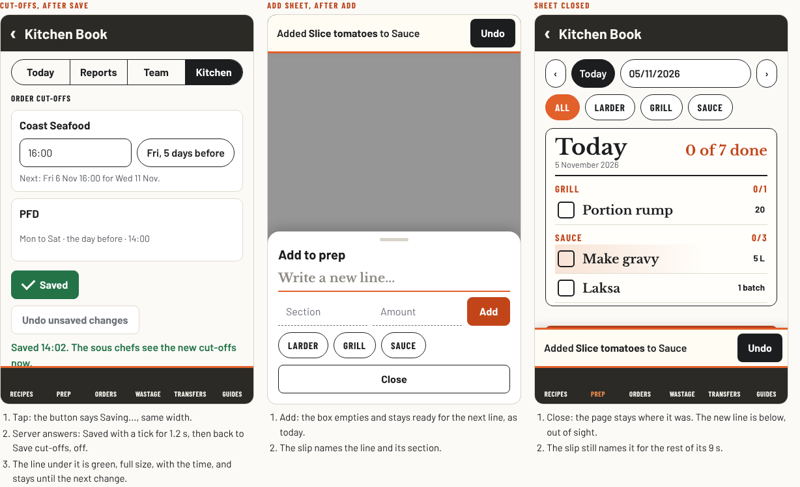
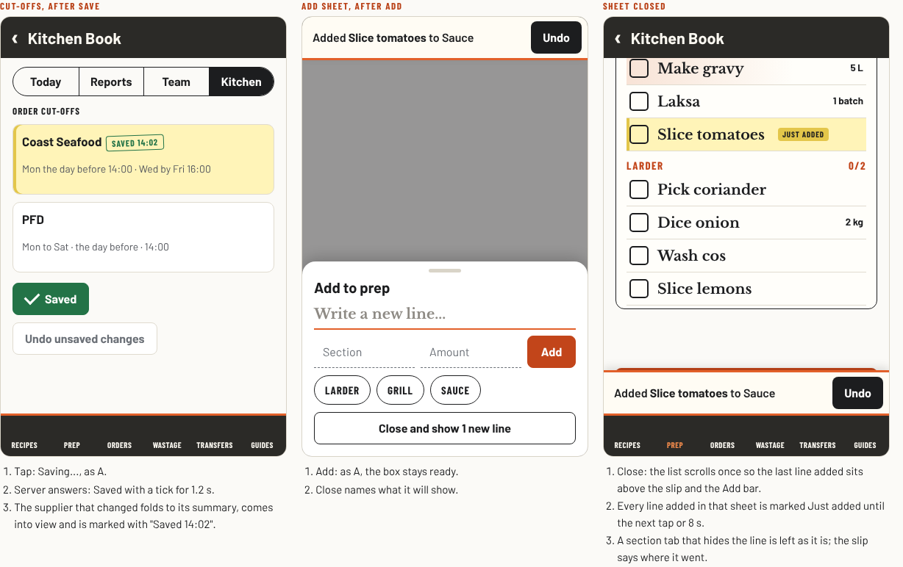
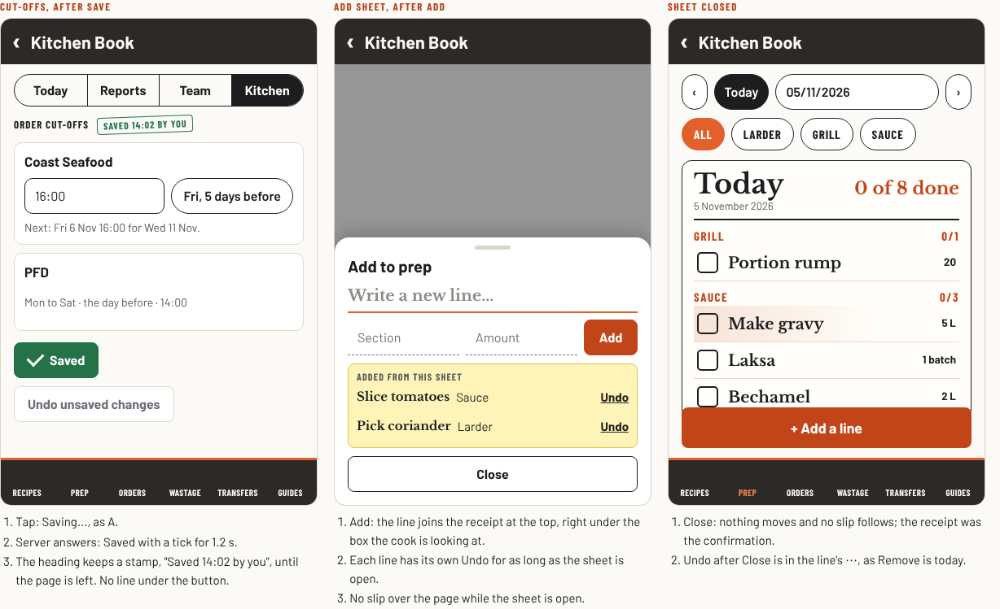
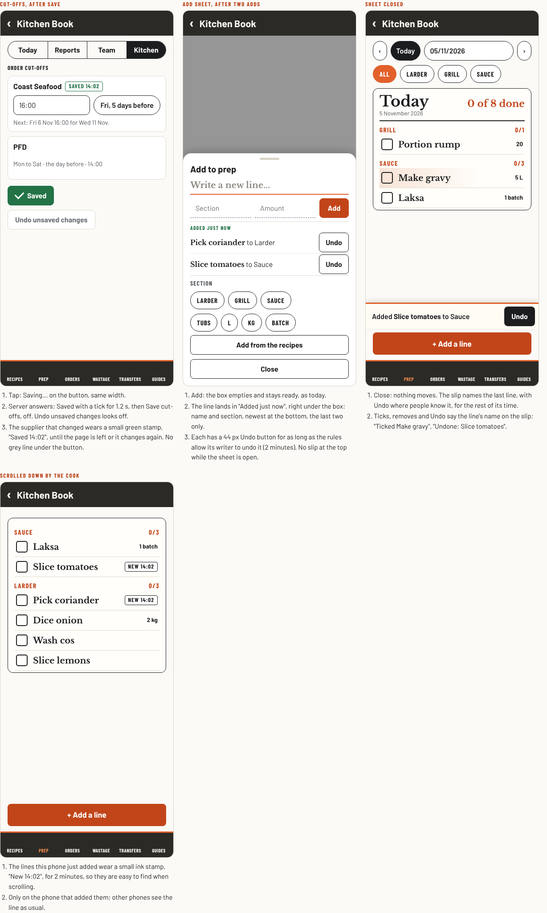

# After the tap: options

Requested 5 November 2026. The head chef's words: "I just saved something, the button got greyed out, nothing was scrolled or confirmed. There was no feedback that the action I was just doing came through. I was used to some scrolling, or back to top, or something that confirms my action. Can we audit the whole page for this kind of behaviour, see what we already got, make this a CLAUDE.md rule or skill, and then improve?"

**Status: round 2 scored, waiting for the head chef's choice.** Recommended: A with B's mark on admin cards. `index.html` in this folder is the working comparison (open it in a browser): today's book, the shared part and the three designs, drawn with the book's colours and fonts. Every line, name and time in it is made up. Nothing in it saves. The baseline is `main` at `6f21a3a`.

## Today

Source audit of every action in the book, 5 November 2026: 307 actions in `js/prep.js`, the lazy editors, the supplier and delivery pages and the admin modules, each traced from its button to its handler, what shows in the tap's frame, what confirms it after the server answers, what a failure shows and where the page goes next. Four auditors, source only; the head chef's case and the add sheet were then reproduced in the click-test stand-in at 390 px (`previews/today-*.png`).

| Area | Actions | Clear | Easy to miss | Nothing visible |
| --- | --- | --- | --- | --- |
| Prep, Orders, Wastage, Transfers | 77 | 58 | 17 | 2 |
| Pings, minutes, guides, drinks, mail, to-do, admin settings | 72 | 59 | 10 | 2 |
| Recipe, drawing and function editors, functions, Settings | 95 | 72 | 22 | 1 |
| Suppliers, Delivery received, Review desk, proofreader, admin reports | 63 | 41 | 22 | 0 |
| **All** | **307** | **230** | **71** | **5** |

What is clear already: adding, ticking and removing on the four work pages show at once (the line appears before the server answers, and says Not sent with no signal) with the docket slip and Undo. Shift pings, minutes, the guide editor and the staff list's Save bar use the 4 November Save button: Saving..., Saved with a tick for 1.2 s once the server answers, Try again in red. Delivery received says "Delivery saved." with a tick above its button. The drawing studio's Save reads Saved.

What is easy to miss, by pattern:

1. **A greyed button that never says Saved.** Save cut-offs (the head chef's case: grey, then a small grey "Saved." line, and Undo unsaved changes stays live), the recipe and function editors (the recipe Save stays grey reading Save, beside a stale "Save to make the change."), the supplier pages, drinks, to-do, mail and pushes. `svButton()` reaches only 4 forms in `js/prep.js`.
2. **The confirmation is where nobody is looking.** At the top of the page (supplier Record order placed, catalogue Save, Review desk, proofreader), in a small grey line under a button, or under an open sheet (cancelling a function from the band's popup draws its slip behind the sheet).
3. **The changed thing is not shown.** The add sheets stay open and the slip says only "Added"; after Close the new lines are not scrolled to or marked (18 actions). Until 4 November (#504) Add a line scrolled the inline form into view, and the Start here list scrolled a line to the middle and flashed it (`gotoRow()`, `.nb-row.is-flash`). The helper is still in `js/prep.js`, unused: most likely the scrolling the head chef was used to.
4. **Silent reversals.** Undo never says Undone; untick, un-order and Put back say nothing and the line jumps; a mail or to-do tick drops into a closed Done box with no words.
5. **Errors that look like news.** The recipe, drawing and function editors' own toasts look the same for success and failure and go by themselves; a failed round Sent tick in functions shows nothing on screen.
6. **Taps with no answer.** An empty Add on Orders; Refresh on the to-do list and the minutes register.

## Round 1: should we build it?

Five fresh reviewers, 5 November 2026, from the proposal and the screenshots. Role-based analysis, not research with real staff.

**Verdict: Build smaller (4 of 5).** The head chef, the skeptic, the cook mid-service and the keeper of the book said Build smaller; the new starter said Build.

What all five agreed:
- Every admin and editor Save says Saved with a tick on the button, with the book's existing Save button (`svButton()`). This is most of the head chef's complaint, and it is admin, not service.
- The slip names the line and where it went ("Added Slice tomatoes to Sauce"), and Undo says Undone. A bare "Added" tells nobody anything, least of all someone who reads English slowly.
- Out-of-date words go once something shows Saved (the live Undo unsaved changes after the cut-off save; "Save to make the change" beside "Saved. Version 1.").
- No orange for "just now": orange already means urgent, rolled and the counts.

What to cut: leave the other 60 or so easy-to-miss actions (closed Done boxes, Refresh with no sign, untick wording) until someone next works on that page. Ship the head chef's case first and measure.

Disagreements, one line each:
- **Scrolling after the add sheet closes.** The head chef and the keeper would land on the last line added on Close only; the cook and the skeptic want no automatic scroll on a service page ("it moves the line my wet thumb was reaching for"; `gotoRow()` also clears a section filter).
- **The rule note.** The skeptic called it a nice-to-have; the head chef wants it in the first pull request. It was asked for, so it stays.
- **Where the helper lives.** The keeper: in `js/motion.js` (`LK_MOTION`, already in the saved copy, look only), not reached through `window.LK_PREP`; any mark kept by line id with an end time so a redraw does not wipe it; tests check words and marks, not animation, with reduced motion on.

## Round 2: three designs

All three share the round 1 agreements above (Saved on every Save button, words that say what and where, Undone, stale words go, no orange). They differ in what happens to the thing that changed.

### A · Words only

Changes the least. Nothing moves and nothing is marked. The Save button and the slip carry the whole confirmation; the line under a Save button becomes green and full size with the time ("Saved 14:02. The sous chefs see the new cut-offs now.") and stays until the next change.

- Pros: smallest build, no motion, nothing moves under a finger; fixes the head chef's case fully; tests check words and states only.
- Cons: the new line is still never seen until someone scrolls; does not bring back the "it took me there" feel.

### B · Land on it

Rethinks the end of a task. When a sheet, form or editor closes after a save, the page shows the thing that changed: it scrolls it into view only if it is off screen, above the slip and the Add bar, and marks it "Just added" (or "Saved 14:02") in highlighter yellow until the next tap or 8 s. Never while a sheet is open or someone is adding; never for a change from another phone; a section tab that hides the line is left as it is and the slip says where it went. Close says what it will show ("Close and show 1 new line"). Editors and the supplier catalogue land on the saved row the same way.

- Pros: shows the result itself, where it lives; brings back the scroll the head chef was used to; reuses the unused helper.
- Cons: the page moves once after Close (the shared tablet); the mark must be kept by id so a redraw keeps it, and Recipes shelves need `backHome()`; most code per page.

### C · Receipt where you look

Removes the most. Nothing ever scrolls, and the slip leaves the add sheets: the sheet keeps a short receipt of what it added, under the box the cook is looking at, each line with its own Undo while the sheet is open (after Close, Undo is in the line's ⋯). A save leaves a stamp on the heading of what was saved ("Saved 14:02 by you") until the page is left; the grey "Saved." lines under buttons go.

- Pros: the confirmation sits under the cook's eyes, for every line added, not only the last; no slip over the list after adding; a stamp still shows on a second look later.
- Cons: the receipt takes room in the sheet (on a small phone the chips may need a scroll); Undo for adds moves from the slip people know; the slip stays for ticks and removes, so two places to undo.

### Side by side

Counted from the click tests' stand-in and the drawings at 390 px. Main task: add one prep line from the Prep tab (tap Add a line, type, tap Add) and tick one line.

| | Today | A · Words only | B · Land on it | C · Receipt |
| --- | --- | --- | --- | --- |
| Taps to add a line / tick a line | 2 + typing / 1 | 2 + typing / 1 | 2 + typing / 1 | 2 + typing / 1 |
| List lines visible at 390 px after Close | 4 (the slip covers 1 for 9 s) | 4 | 4 (moved to the new line) | 5 (no slip) |
| New line seen without scrolling | No | No (named on the slip) | Yes, marked | In the sheet, not the list |
| Save says Saved on the button | 4 forms of about 20 | All | All | All |
| Something moves by itself | No | No | Once, after Close or a save that closes a form | No |
| Navigation levels | Same | Same | Same | Same |
| Pull requests | | 2 | 3 to 4 | 3 |
| Relearning | | None | Little | Some: Undo for adds is in the sheet |
| New reads, listeners or rules | | None | None | None |
| Risk | | Still not seeing the line | Moving the page under someone's finger | A crowded sheet on a small phone |

## Mix: A and C, with a small stamp

Asked for by the head chef after round 2 ("what would a great mix look like between A and C with a small stamp?"). Drawn in `index.html`, section Mix, at 390 by 844 with every row of today's add sheet.

- **Saves (A).** Every Save button says Saving..., then Saved with a tick for 1.2 s once the server answers, then goes off; Try again in red on failure. Switched-off outlined buttons look off, so Undo unsaved changes no longer looks live. The grey "Saved." line under the button goes.
- **The small stamp on what was saved.** The supplier card that changed (or the editor's heading) wears "Saved 14:02" in green, 13 px condensed capitals in a box, until the page is left or it changes again. A word, not a fill, so glare does not wash it out.
- **The add sheet (C).** Under the Add row, "Added just now" lists the last two lines added from this sheet with their section ("Pick coriander to Larder"), newest at the bottom, each with a 44 px Undo button for as long as the rules let its writer undo it (2 minutes, `ownAddUndo()` in `firestore.rules`). No slip at the top of the screen while the sheet is open.
- **After Close (A).** Nothing moves. The slip names the last line ("Added Slice tomatoes to Sauce") with Undo, above the Add a line bar as today, for the rest of its time. Ticks, removes and Undo say the line's name on the slip ("Undone: Slice tomatoes").
- **The small stamp on new lines.** Lines this phone just added wear "New 14:02" in ink for 2 minutes, so the cook finds them when scrolling. Only on that phone, kept in memory by line id with an end time, so a redraw keeps it and nothing is saved.

Taps to add a line: 2 plus typing, as today. Lines visible at 390 px after Close: 4, as today while the slip shows. The add sheet is about 100 px taller with two receipt lines and still fits a 390 by 844 phone. No new reads, listeners, rules or saved fields.

Two places to undo an add (the receipt while the sheet is open, the slip once it closes) was the main worry about C; here both say Undo on a 44 px button, and the slip stays where people know it.

## Scores

The same five reviewers plus the kitchen screen designer, fresh agents, 5 November 2026. Each saw all three designs, the brief and today's screenshots. Role-based analysis, not research with real staff. Points: 3 for first, 2 for second, 1 for third.

| Reviewer | First | Second | Third | Main reason |
| --- | --- | --- | --- | --- |
| Head chef | A | B | C | Fixes what was reported in 2 pull requests, nothing to learn; B moves the shared tablet in service |
| Skeptic | A | C | B | The grey Save is the complaint; B puts yellow over a service list when no mistake happened (rule 3) |
| Keeper of the book | A | B | C | Cheapest, steady tests; B's scroll and 8 s mark are timing checks, and `content-visibility` rows can stop short; C touches Undo in 30 test files |
| Cook mid-service | C | A | B | Nothing moves and no slip over the list; B jumps as the thumb goes for a tick box |
| Screen designer | C | A | B | Confirmation under the eye; B's yellow is 1.10:1 on the paper and reads like the peach Rolled tint |
| New starter | B | C | A | Seeing my own line in its place works even when I read English slowly |
| **Points** | | | | **A 14, C 12, B 10** |

What they asked to carry into the winner:
- **Undo unsaved changes must look off once Saved shows** (all six). In the book today a switched-off outlined button looks exactly like a live one: `css/app.css` greys only the dark Save buttons. That is a fix for every page, not only cut-offs.
- **A short, full-size confirmation**, not a grey line: "Saved 14:02" with what it means, green, kept above the tab bar (skeptic, designer, keeper; the A mock's line ran under the tab bar).
- **B's "Saved 14:02" mark on the card that changed, with no scroll, on admin pages only** (head chef, keeper, designer): it shows which supplier changed without moving the page.
- **The slip keeps the section**: the line name first, "to Sauce" never cut off; two lines at most, above the Add a line bar as today (designer, skeptic).
- **C's receipt, if ever built, needs 44 px Undo buttons and at most the last two lines** (cook, designer), and proof that the full sheet still fits at 390 px with its unit chips and Add from the recipes.
- **B's landing could come later on Prep only**, if A still leaves the head chef wanting it (keeper).

## Recommendation

**A, Words only, with B's "Saved 14:02" mark on admin cards.** Three of six ranked it first and it scored highest. It fixes the head chef's case on every Save, names the line on the slip, makes switched-off buttons look off, and moves nothing on a service page.

Not recommended now: the scroll after Close (B). The head chef asked for "scrolling, or back to top, or something that confirms my action"; four of six reviewers judged that moving the list on the line during service costs more than it gives. If A is not enough after a fortnight of use, B's landing on Prep only is the next step. That is the head chef's call: see below.

## Build steps (if A is chosen)

1. **Saves say Saved, and off looks off.** Outlined buttons that are switched off look off everywhere (`css/app.css`). Order cut-offs, the recipe editor and the function editor Save say Saving..., Saved with a tick, Try again; the confirmation is a full-size green line with the time, above the tab bar; Undo unsaved changes and "Save to make the change" go once saved. The rule note (`docs/action-feedback.md`) and its pointer in `CLAUDE.md` come with it.
2. **The slip says what and where.** Add on Prep, Orders, Wastage and Transfers names the line and its section; Undo, untick, un-order and Put back say Undone with the name.
3. **Admin cards and pages that report at the top.** The supplier that changed on Order cut-offs, the supplier catalogue, Record order placed, the Review desk and the proofreader say Saved where the person is looking, with the "Saved 14:02" mark on the card, no scroll.

The other easy-to-miss actions in the audit are brought in line when someone next works on that page (`docs/open-work.md`).

## Files

- `index.html`: today, the shared part, the three designs at three moments each, and the comparison. Works at 390 px and 1280 px with no sideways scroll.
- `previews/today-*.png`: the book today at 390 px, click-test stand-in, synthetic data.
- `previews/option-*.png`: each design's three moments (the mix: four), from `index.html`.
