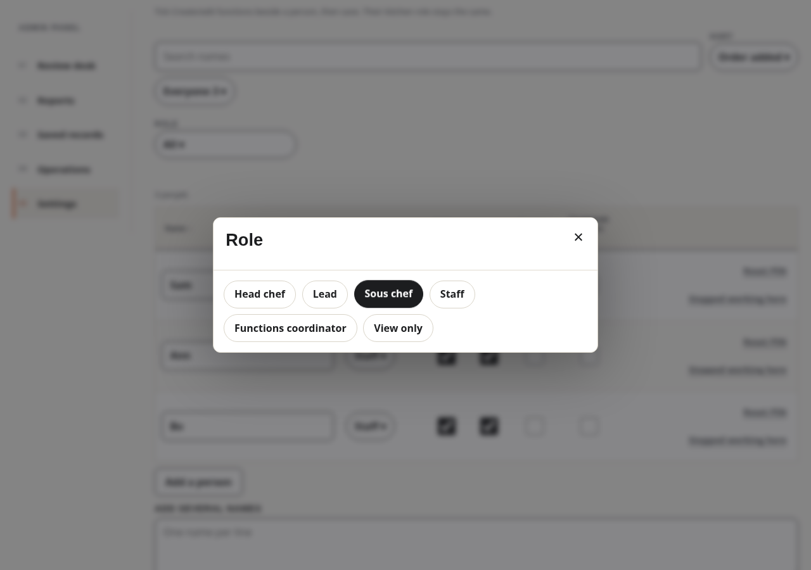

# Adaptive controls rollout

Status: implementation complete; full regression verification in progress. Baseline: `1427fcc`; integrated current main `069e548` on 1 November 2026.

The app stays dependency-free. Existing hidden form controls remain the value and validation source. Shared DOM components enhance new and redrawn controls. Existing save handlers, permissions and reads remain authoritative.

## Phase 1 inventory

A checked entry marks an audited rendering site. Route navigation, canvas object selection and command toggles (tick, urgent, expand and remove) retain their direct actions. Independent permission checkboxes retain their binary form semantics. Free-entry autocomplete fields keep an editable text field and open their suggestions in the shared picker. Each entry is a rendering site; helpers can render many controls. Static design comparisons under docs are examples, not application routes.

### Native selectors and autocomplete

- [x] `js/admin-intelligence.js:83` ai-, ai-field-
- [x] `js/admin-intelligence.js:154` ai-section-filter, ai-analysis-section
- [x] `js/admin-intelligence.js:265` ai-person-filter
- [x] `js/admin-intelligence.js:278` ai-person-filter
- [x] `js/draw.js:632` surf.
- [x] `js/draw.js:668` el.size
- [x] `js/draw.js:669` el.anchor
- [x] `js/draw.js:672` el.w
- [x] `js/draw.js:1195` dw-from, fromsel
- [x] `js/draw.js:1271` pc.cat
- [x] `js/draw.js:1334` reuse
- [x] `js/fnedit.js:379` '
' + guestsHTML(d) + inp('loc', 'Room, area or table (optional)', d.loc, ' maxl
- [x] `js/fnedit.js:380` fe-locs
- [x] `js/manage.js:338` mg-rx
- [x] `js/manage.js:340` return '<input' + (id ? ' id="' + id + '"' : '') + ' class="search mg-link" type="search" list="mg-r
- [x] `js/manage.js:371` mg-kind
- [x] `js/manage.js:445` return '
' + esc(a) + '<select class="search"
- [x] `js/manage.js:470` mg-msec
- [x] `js/manage.js:472` mg-mafter
- [x] `js/manage.js:492` mg-art
- [x] `js/manage.js:495` mg-side
- [x] `js/manage.js:496` mg-diag
- [x] `js/manage.js:514` mg-pside-
- [x] `js/prep.js:2589` function sel(k, label, val, opts) { return '<label class="a-f">' + label + '<select dat
- [x] `js/prep.js:2950` lv-s:
- [x] `js/prep.js:3524` p-sections
- [x] `js/prep.js:3526` p-section
- [x] `js/prep.js:3807` a-r
- [x] `js/prep.js:3917` ai-section
- [x] `js/prep.js:4821` w-sections
- [x] `js/prep.js:4822` w-sec
- [x] `js/prep.js:5730` n-to
- [x] `js/prep.js:6167` return '<select class="p-select" data-k="' + k + '"' + (i != null ? ' data-i="' + i + '"' : '') + ' 
- [x] `js/prep.js:6290` mn-older
- [x] `js/prep.js:6490` return '<label class="a-f">' + esc(label) + '<select data-k="' + esc(key) + '">' + opti
- [x] `js/prep.js:6511` wh-who, wh-people
- [x] `js/prep.js:6671` af-venue
- [x] `js/prep.js:8032` cut-p
- [x] `js/prep.js:8033` cut-r
- [x] `js/prep.js:8833` ml-pri:
- [x] `js/suppliers.js:177` supplier
- [x] `js/suppliers.js:289` function unitField(k, label, value) { return '<label class="field">' + label + '
- [x] `js/suppliers.js:292` rtitle, su-unit-list
- [x] `js/suppliers.js:310` rtitle, supplierCutoff
- [x] `js/suppliers.js:314` rtitle, import-cutoff

### Search rendering sites

- [x] `js/admin-intelligence.js:219` ai-reference-query
- [x] `js/app.js:561` find
- [x] `js/draw.js:612` dw-q, q
- [x] `js/manage.js:154` mg-q
- [x] `js/manage.js:340` return '<input' + (id ? ' id="' + id + '"' : '') + ' class="search mg-link" type="search" list="mg-r
- [x] `js/prep.js:2949` lv-q-, lv-q:
- [x] `js/prep.js:3330` p-rs
- [x] `js/prep.js:6506` wh-search
- [x] `js/prep.js:6511` wh-who, wh-people
- [x] `js/prep.js:7115` g-q
- [x] `js/suppliers.js:264` return '
' + supplierSelect() + field('q', 'Find an item', M.q, { type: 'sear
- [x] `js/suppliers.js:276` body += field('historyQ', 'Find an order', M.historyQ, { type: 'search', placeholder: 'Date or item 
- [x] `js/suppliers.js:310` rtitle, supplierCutoff
- [x] `js/suppliers.js:314` rtitle, import-cutoff

### Radio and custom selection groups

- [x] `js/admin-intelligence.js:92` function filters() { return '
' + [7, 30, 90].map(fu
- [x] `js/app.js:339` topview, topview:
- [x] `js/app.js:569` free, free:
- [x] `js/app.js:581` free, free:
- [x] `js/app.js:584` amode
- [x] `js/app.js:590` lens, lens:
- [x] `js/app.js:670` tick
- [x] `js/app.js:728` kind, kind:
- [x] `js/app.js:785` pick, pick:
- [x] `js/app.js:873` return '
' + VIEWS.map(fu
- [x] `js/app.js:875` return '<button type="button" class="view-opt" role="radio" data-act="' + act + '" data-val="' + v.i
- [x] `js/app.js:1093` settext, settext:
- [x] `js/app.js:1104` setshared, setshared:0, setshared:1
- [x] `js/app.js:1106` setpractice, setpractice:0, setpractice:1
- [x] `js/draw.js:560` function btn(a, label, o) { o = o || {}; return '<button type="button" class="' + (o.cls || 'p-x') +
- [x] `js/draw.js:628` ware
- [x] `js/draw.js:660` pick
- [x] `js/fnedit.js:186` chip
- [x] `js/fnedit.js:339` var d = e.d, out = '

- [x] `js/fnedit.js:340` mode
- [x] `js/manage.js:152` chip
- [x] `js/manage.js:354` tag
- [x] `js/manage.js:451` hand
- [x] `js/manage.js:533` return '<button type="button" class="mg-sw" role="switch" aria-checked="' + on + '" data-mg="' + act
- [x] `js/prep.js:2590` range
- [x] `js/prep.js:2838` heat
- [x] `js/prep.js:2951` lv-f
- [x] `js/prep.js:3001` calm
- [x] `js/prep.js:3018` hrm
- [x] `js/prep.js:3234` urgent
- [x] `js/prep.js:3239` tick
- [x] `js/prep.js:3514` tab
- [x] `js/prep.js:3515` tab
- [x] `js/prep.js:3516` tab
- [x] `js/prep.js:3546` today
- [x] `js/prep.js:3921` a-tab
- [x] `js/prep.js:4435` otick
- [x] `js/prep.js:4544` oview
- [x] `js/prep.js:4545` oday, otoday
- [x] `js/prep.js:4558` otick
- [x] `js/prep.js:4698` if (amt > (W_BIG[f.unit] || Infinity) && !arm('wbig:' + amt + f.unit)) { toast(amt + ' ' + f.unit + 
- [x] `js/prep.js:4807` sheet-close, sheet-h
- [x] `js/prep.js:4808` wreason
- [x] `js/prep.js:4826` w-unit-l, wunit
- [x] `js/prep.js:4827` w-reason-l, wreason
- [x] `js/prep.js:5070` if (amt > (X_BIG[f.unit] || Infinity) && !arm('xbig:' + amt + f.unit)) { toast(amt + ' ' + f.unit + 
- [x] `js/prep.js:5122` tr-vpick
- [x] `js/prep.js:5126` tr-ppick
- [x] `js/prep.js:5140` tr-dir-l
- [x] `js/prep.js:5141` tr-dir
- [x] `js/prep.js:5148` tr-unit-l, tr-unit
- [x] `js/prep.js:5721` n-day
- [x] `js/prep.js:5734` n-tag
- [x] `js/prep.js:5735` n-dow
- [x] `js/prep.js:5743` n-quick
- [x] `js/prep.js:5744` n-mode
- [x] `js/prep.js:6191` mn-ast
- [x] `js/prep.js:6289` mn-sel
- [x] `js/prep.js:6500` wh-view
- [x] `js/prep.js:6669` range
- [x] `js/prep.js:7110` g-cat
- [x] `js/prep.js:7371` g-fcat
- [x] `js/prep.js:7386` g-fwho
- [x] `js/prep.js:7624` dk-pick
- [x] `js/prep.js:7632` dk-pick
- [x] `js/prep.js:7911` cut-tick
- [x] `js/prep.js:8029` cut-day
- [x] `js/prep.js:8141` return '<button type="button" class="ks-b" data-ks="pick" data-v="' + esc(s.id) + '" aria-pressed="'
- [x] `js/prep.js:8148` var f = el.querySelector('.ks-b[aria-pressed="true"]') || el.querySelector('.ks-b'); if (f) f.focus(
- [x] `js/prep.js:8435` if (a === 'sheet') { S.sheet = el.getAttribute('data-v'); ovPush('reason', function () { wasteSheetC
- [x] `js/prep.js:8747` ml-cat
- [x] `js/prep.js:8750` ml-pri
- [x] `js/prep.js:8835` ml-tick
- [x] `js/prep.js:9091` todo-tick
- [x] `js/prep.js:9107` todo-for
- [x] `js/prep.js:9108` todo-for
- [x] `js/suppliers.js:185` (canEdit() ? '<nav class="chips su-tools" aria-label="Supplier tools"><button type="button" class="c
- [x] `js/suppliers.js:188` return '<aside class="su-side">Suppliers<nav aria-label="Suppliers">' + (
- [x] `js/suppliers.js:264` return '
' + supplierSelect() + field('q', 'Find an item', M.q, { type: 'sear
- [x] `js/suppliers.js:276` body += field('historyQ', 'Find an order', M.historyQ, { type: 'search', placeholder: 'Date or item 

### Admin tables and tabular lists

- [x] `js/prep.js:2740` ins-fixes
- [x] `js/prep.js:2793` '
<table class="a-table"><thead><tr>' + DOWS.map(function (d) { return '<th sco
- [x] `js/prep.js:2795` (nights ? '<h3 class="a-ch-h">The last nights</h3>
<table class="a-table"><thea
- [x] `js/prep.js:2816` '
<table class="a-table"><thead><tr><th scope="col">Item</th>' + DOWS.map(funct
- [x] `js/prep.js:2841` return chips + '
<
- [x] `js/prep.js:3032` return head + '
Time to tick by section</h3>From writing a line to tic
- [x] `js/prep.js:3144` var tbl = '

Show the daily numbers as a table

<t
- [x] `js/prep.js:3681` return key + '
<table class="mn-tbl"><thead><tr>
- [x] `js/prep.js:6296` minreg
- [x] `js/prep.js:6440` waste-days
- [x] `js/prep.js:6471` '
<
- [x] `js/prep.js:6483` return '<h3 class="a-ch-h">Reasons by weekday</h3>Average entries per day. Darker
- [x] `js/prep.js:6564` waste-reasons
- [x] `js/prep.js:6582` waste-items
- [x] `js/prep.js:6587` waste-who
- [x] `js/prep.js:6595` waste-log
- [x] `js/prep.js:6612` waste-rev
- [x] `js/prep.js:6700` xfer-venues
- [x] `js/prep.js:6712` xfer-items
- [x] `js/prep.js:6731` xfer-log
- [x] `js/prep.js:6806` ins-views
- [x] `js/prep.js:6833` ins-misses
- [x] `js/prep.js:7416` guides
- [x] `js/prep.js:8241` ks-days
- [x] `js/prep.js:8855` maildone
- [x] `js/prep.js:8857` mail
- [x] `js/prep.js:9125` todo
- [x] `js/prep.js:9130` tododone

## Behaviour contract

- Desktop modal from 768 px; bottom sheet below 768 px. Focus trap, Escape, backdrop, drag handle, safe area and reduced motion.
- Compact choices at 12 items or fewer; extended deferred search above 12; windowed list above 100.
- Multi-select drafts apply together. Free-entry autocomplete retains an explicit custom-value path.
- Search retains the committed result set while replacing a query, restores on accidental blur, and resets explicitly.
- Admin lists sort the complete filtered data before pagination, with three-state headers, filters and removable active badges. Calendar and heatmap coordinates retain their meaning; their row filters are separate from chronological cells.

## Verification

Dedicated browser checks cover deferred replacement, blur restoration, explicit reset, both responsive layouts, keyboard selection, virtualised options, multi-select drafts, focus trapping, phone Back, drag dismissal, native validation, column filters, complete-list sorting before pagination, numeric comparison and dates across a year boundary. The full browser suite is running on the integrated main branch. Phone and desktop previews were captured with synthetic staff data.

## Integration details

- All native selectors use hidden native fields for values and validation, with labelled adaptive triggers. New or redrawn controls are enhanced automatically.
- Recipe addition, function platter selection and daily kitchen-section selection open the shared picker directly. Allergen tags and minutes attendance expose explicit states instead of cycling invisibly.
- Standalone searches, picker searches, review queues and table searches share the committed-query lifecycle. The former supplier reminder searches now live inside their complete, untruncated pickers.
- `lvHTML` filters and sorts the entire dataset before pagination. It includes relevant categorical column filters, typed comparisons, header sort controls, active badges and reset. Card lists retain their predefined sort choices or use default/A to Z/Z to A.
- Static admin report tables use the same search and comparison functions. Calendar and hour-grid headers remain fixed coordinates; those matrices have row search while record tables have three-state column sorting.
- The supplier catalogue's tabular management view also sorts its complete filtered dataset before pagination, with reset badges.
- The newly integrated autocorrect admin lists use the same list helper. Their tab buttons remain page navigation.
- Native dialog top-layer placement handles nested screens. Escape, backdrop, swipe, phone Back and route changes dismiss a picker. Existing overlay history and automatic-sheet sequencing remain authoritative.
- The new startup script is in `index.html`, service-worker `SHELL` and both workerless freshness lists. There are no dependencies, backend changes, new reads or new persistent data.

## Added inventory from main integration

- [x] `js/proofreader-admin.js`: correction queue, shared-word table and correction-history table, all rendered through `lvHTML`.
- [x] `js/fnedit.js`: text-based platter autocomplete replaced by the full catalogue picker.
- [x] `js/prep.js`: recipe autocomplete and daily section sheet replaced by direct shared pickers; minutes attendance now exposes Present, Apology and Absent.
- [x] `js/manage.js`: ingredient and pin allergen tags now expose Not in it, Has it and May have it.
- [x] `js/smart.js`: drawing style choices use the shared picker adapter.
- [x] `js/suppliers.js`: catalogue management's Item/source, Current par and PDF par columns sort before its 20-row page limit.

## Review previews

These captures use synthetic staff and the real application styles.

| Phone bottom sheet | Desktop modal |
| --- | --- |
|  |  |
