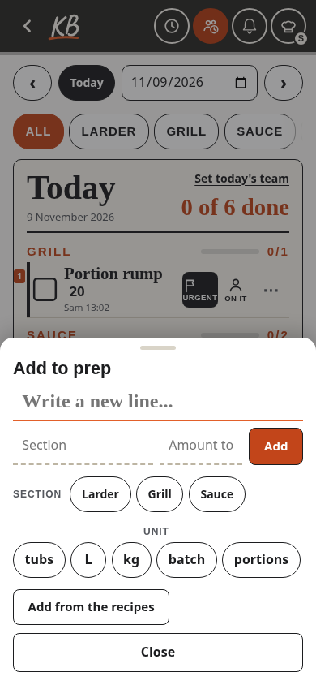
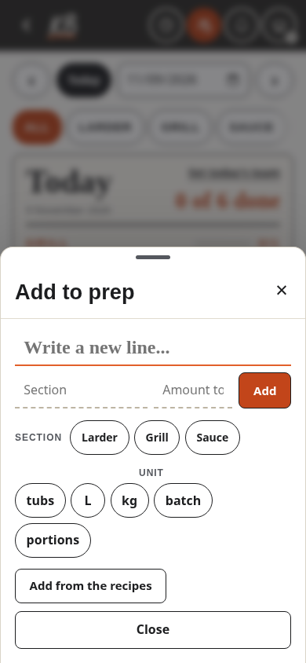
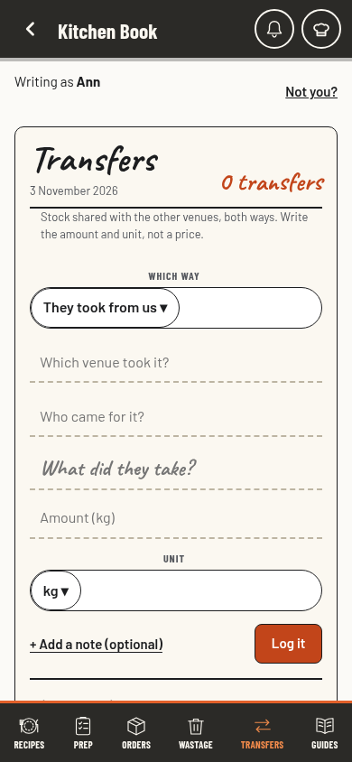
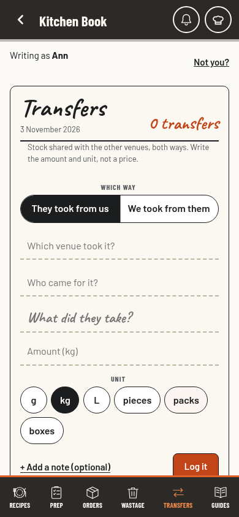
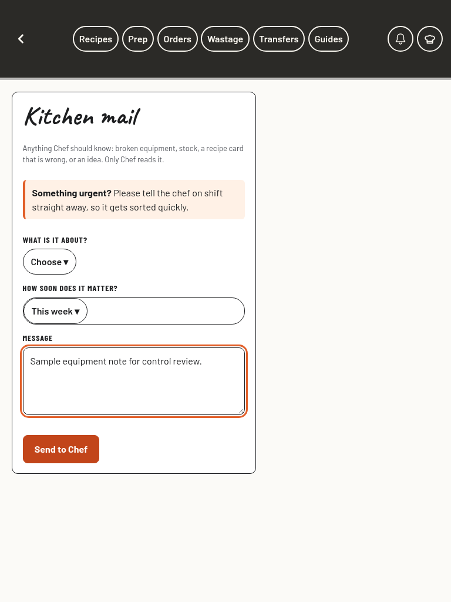
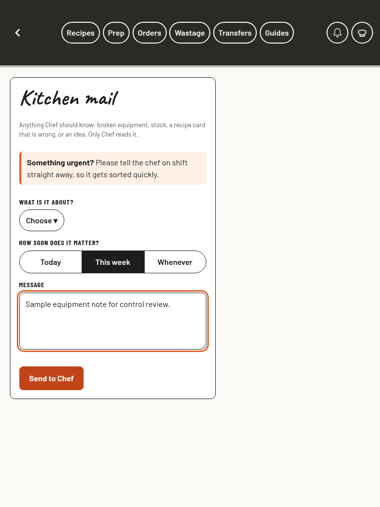
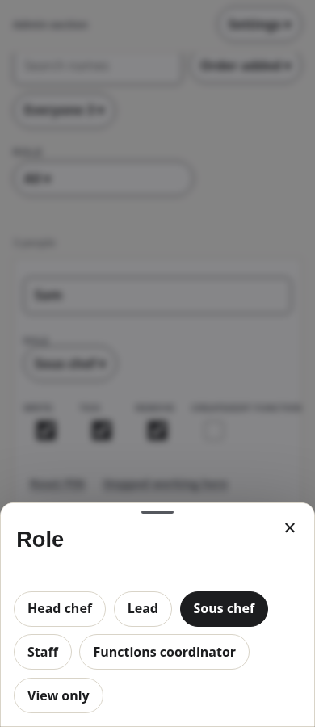
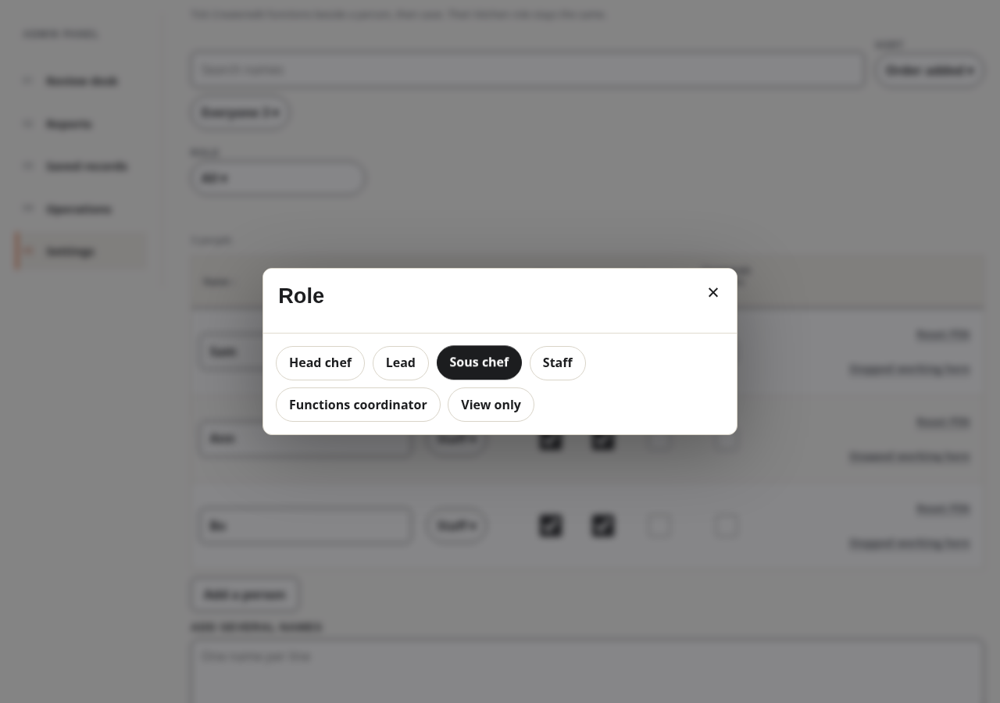

# Adaptive controls rollout

Status: implementation and local verification complete. Baseline: `1427fcc`; integrated current main `a2a24b2` on 1 November 2026.

The [2 November council audit](ux-council-audit.md) records the follow-up interaction fixes, measured header-sort work and honest route coverage.

A host that deliberately clears a search calls `LK_UX.resetSearch(input)` before clearing its model or redrawing. This also cancels a pending debounce. Ordinary redraws preserve raw text and the original pending deadline. The shared focus-restoration helper and the old field's scoped `_uxRedrawing` marker keep programmatic restoration separate from a real blur and refocus.

The search wrapper grows to fill a row (`flex: 1 1 10rem`). Inside a standard `.field`, which stacks its label and box in a column, that basis became a height and left about 110 px of empty space under Find a recipe and Find a drawing; `.field > .ux-search` now keeps its own height (3 November 2026, `tests/search-box-gap.test.js`).

The app stays dependency-free. Existing form controls remain the value and validation source. Shared DOM components enhance new and redrawn controls. Existing save handlers, permissions and reads remain authoritative.

## Shared modal frame (9 November 2026)

Chosen by the owner after the modal audit: reuse the existing shared picker's warm-paper frame, title styling, spacing, rounded corners and close × across existing dismissible overlays. No alternative visual direction is needed: the owner explicitly approved this existing pattern and said to implement it.

`ModalFrame()` and `SwipeDismiss()` in `js/controls.js` enhance existing markup, including redraws. A phone below 768 px gets a bottom sheet; at 768 px and above it becomes a centred modal. All have one named close × with a 44 px target, on touch as well as mouse. Larger document content retains a wider frame. Cooling details and the chef menu use the compact width. The occasion explanation gains the same frame and swipe support. Its language and Home controls remain available.

Existing fields stay in their feature's DOM. Simple headings gain a shared sticky header so the × stays in view while the form scrolls. The ×, downward grip/header gesture, backdrop, Escape and Back follow cancellation, not Save, Confirm or Got it. Prep, Orders, Wastage and Transfers keep their existing memory drafts. Pings remain unread. Pending attribution saves retain their busy guard. Uncommitted picker choices are cancelled without submitting. The native device-choice backdrop now uses its existing cancel handler. Mandatory kitchen/PIN/name screens remain non-dismissible. Existing footer text actions remain for clarity.

The chef menu and occasion explanation now use the existing overlay-history helper, returning focus after dismissal and retaining the destination when a link navigates. Occasion explanations wait behind other sheets, and automatic sheets wait behind native dialogs. Guide pages keep their existing zoom, page turning, pinch and history; their wider modal has a matching dim backdrop removed on close or route changes. Native confirmation Tab loops include the ×. Reduced motion disables the shared entrance/return motion.

### Coverage

| Existing family | Covered screens |
| --- | --- |
| `.sheet` | Prep/Orders add forms, Wastage log/review/older reason sheet, Transfers, Prep/Cleaning worker attribution, line menu/change amount/move section, Find and On this page |
| `.nt` | Shift pings, minutes, previews, Your day and cooling alerts |
| `.wm` | Signed-in and signed-out chef menu |
| `dialog.ux-picker` | Shared choices, section/recipe pickers, device choice, device-change confirmation and unsaved-update confirmation |
| `.cooling-menu`, `.fn-sheet`, `.mlp` | Timer details, function details and kitchen-mail reminder |
| `.gz-wrap` | Guide document pages, including page redraws and Full size |
| `dialog.kb-occasion-panel` | Seasonal occasion explanation |

PIN, kitchen access and name screens are deliberately outside this dismissible-overlay list. Native operating-system share/install prompts are controlled by the browser.

### Council quick check and service impact

Verdict: Build smaller. This is the owner's approved reuse of an existing frame on existing overlays, with no new page, popup, service step or capability removal. Product: an obvious exit on every device. Usability: a consistent title, grip and ×, with text footer actions retained. Engineering: one enhancement and frame rather than rewriting each form. This is a proportional role-based quick check, not independent reviewers or staff research. The owner's explicit choice settles the direction.

Add a prep line remains one tap from its tab; Tick remains one tap; opening Recipes remains one tap. Closing remains one tap or one gesture. Underlying list layout is unchanged: the synthetic 390 x 844 fixture has six fully visible Prep lines and a 90.27 px header before and after. The modal header reserves room for the × and can reduce content shown inside the open sheet, in exchange for a predictable visible exit. It takes no list lines away when closed. No reads, writes, rules, saved fields, dependencies or lazy-module API numbers change.

### Verification and comparison

The complete 279-file local run passed 274 files on the first run. The remaining files were resolved as follows: attribution and shift-start expectations now use the approved 768 px breakpoint; Screens expects the shared picker backdrop; Guides passed after the existing PDF test dependency was made available in the worktree; and the pre-existing cooling-motion midnight readiness race was reproduced on the unchanged app and fixed in its own test-only branch. The four layout/dependency reruns pass, as do the focused modal checks. The new modal-overlays file and the supplier-status file added during integration pass separately. Exact CI and release status are recorded in the PR.

`tests/modal-frame.test.js` checks the real Prep, Orders, Wastage and Transfers forms and chef menu at 390, 768 and 1280 px. Before implementation, 27 of its original 70 checks failed. With the shared frame, all 110 checks pass, including touch targets, responsive placement, cancellation without writes and draft retention. `tests/modal-close.test.js` retains keyboard, busy guard, unread-ping and nested-picker checks with the newly approved touch-visible ×. `tests/modal-overlays.test.js` covers native device backdrop cancellation, cooling, menu Back, occasion swipe/Back, guide redraws and backdrop cleanup. The existing swipe checks cover cancelled/short/multitouch gestures, native scrolling, nested cancellation and drafts. Full-suite results and release state are recorded in the pull request; local/mock evidence does not establish a production-device check.

| Before, 390 px | Shared frame, 390 px |
| --- | --- |
|  |  |

[Tablet comparison](images/shared-modal-after-768.png), [desktop comparison](images/shared-modal-after-1280.png), [chef menu](images/shared-modal-menu-390.png). Baseline commit: `72d36a0`, local tag `modal-frame-baseline-2026-11-09`. Rollback: revert the shared frame change; no data migration or rule publication is involved.

## Swipe to close (9 November 2026)

The first header × rollout was fine-pointer only. The owner's subsequent request to make every modal and bottom sheet look and behave the same supersedes that visibility rule. See the shared frame below. The earlier release's checks and measurements remain historical evidence, not the current touch contract.

The owner requested swipe dismissal for existing bottom sheets and modals. `SwipeDismiss()` in `js/controls.js` enhances the current sheet, pings/day, chef menu, cooling menu/alert, function, mail and native picker/dialog headings and grips. The guide document viewer supports dragging its toolbar; its page keeps pinch and horizontal page turning. These are existing overlays with existing close controls, not new screens.

Drag down 72 px, or flick at least 32 px at 0.5 px/ms, from a grip or heading. The panel follows the pointer. Short, sideways, upward, cancelled and multi-touch gestures return it to its resting position. Only the grip/title handles take the gesture; lists, options, form fields and other page content retain native interaction. Touch, pen and mouse use the same helper. Reduced motion removes the return transition. An accidental click after dragging is consumed; the next deliberate tap still works.

The helper clicks the original backdrop or sends the native dialog's existing Cancel event. It never saves, acknowledges or removes history directly. Pings stay unread, add-form drafts stay in memory under their existing Cancel rules, and nested picker cancellation only closes that picker. Worker-attribution sheets resist dismissal while waiting for a save. PIN and identity gates keep their existing behaviour because they are not dismissible overlay panels. Newly drawn headings are enhanced again, including reused native dialogs.

### Council quick check

Verdict: Build (small change, requested gesture on existing controls). It helps staff return to their list without finding a small Close button. There is no new tab, popup, step or service-page layout. Prep's Add a line remains one tap from its tab; closing an open sheet gains one optional gesture alongside its existing controls. The stand-in at 390 x 844 px shows six fully visible Prep rows before and after, with the same 90.27 px header and 68.75 px first row. This is a role-based quick check against synthetic fixtures, not staff research.

### Verification

The initial pinned-old-source gesture tests fail 9 of 31 assertions. The expanded final `swipe-dismiss.test.js` passes all 36 assertions with real Chromium CDP touch at 390 and 768 px and mouse dragging at 1280 px. Checks cover following the finger, snap-back on cancellation, short/horizontal/upward gestures, two-finger cancellation, busy-save guards, replaced picker titles, nested cancellation, unchanged selection and drafts, scrolling, unread safety pings, line and chef menus, the identity gate and Escape. The test waits for entrance animations before locating the touch target. Touch capture moving from the heading to the panel must not be mistaken for losing the gesture.

All 17 selected existing test files pass, including shared adaptive controls, overlay Back, Prep attribution, Prep/Orders/Wastage/Transfers sheets, cooling behaviour and update confirmation. Changed JavaScript parses and `git diff --check` passes. These are local stand-in browser checks; physical-device and live-release behaviour remain separate from that evidence.

No dependency, shell manifest, Firestore read, write, rule, stored field or persistent copy changes. Rollback is a normal revert of the client changes.

## Direct unit chips and two-way choices (3 November 2026)

The owner selected the existing transfer picker's left/right pattern for two-way choices where space permits, and asked to restore the unit chips to remove the tap needed to open their picker. This is a narrow reuse of the selected controls. It does not change the surrounding page layouts.

Transfers shows its existing six units: g, kg, L, pieces, packs and boxes. Wastage shows its existing five: g, kg, L, portions and pieces. Since 4 November 2026 (S3 of the work pages redesign, one amount control) the Prep and Orders add sheets show the units drawn in the agreed design under their amount box: Prep tubs, L, kg, batch and portions (`punit`), Orders L, kg, box, packs and bunches (`ounit`). Their box still takes a typed amount; a chip writes its unit after the number. Each unit is a visible chip with a target at least 44 px in both dimensions. Chips wrap onto another row instead of squeezing their labels or touch targets into one line. Their existing radio selection, validation and save handlers remain authoritative.

The fixed two-way groups are transfer direction, Insights Lines written/Rolled over, staff history Ticked/Written, note One day/Several days, recipe Show where/Free from, practice Off/On and function All at once/Staggered. Both choices appear in equal left and right parts when their full labels fit at the current text size. If they cannot fit, the group uses its existing labelled picker. Resizing, changing text size and loading fonts must recalculate the fit. Inline choices select directly, preserve keyboard focus through redraws and add no picker entry to Back history.

This is an explicit list of fixed choices. A changing list does not become a two-way control merely because it happens to contain two entries. Settings view previews, device privacy choices, guarded allergen edits, independent permission switches, multiselects and command buttons retain their existing interactions. The change adds no Firestore reads, writes, saved fields, permissions or dependencies. Reverting it restores the pickers without changing saved data.

### Quick space audit

The main avoidable step was hiding short, fixed choices behind a picker. The direct units and fitting two-way groups above address that without reducing type or touch targets. The implementation was measured at 320, 390, 568, 768 and 1280 px with Normal, Large and Extra large text, using both the book's fonts and fallback fonts. All six transfer units need two or three rows at 320 px, two rows at 390 px and one row from 568 px. Wastage needs two rows at 320 px, one or two at 390 px and one row from 568 px. All 60 form contexts retained 44 px targets without document overflow. These checks use synthetic kitchen fixtures, not production device observations.

Simply exposing the old six-part segment would undersize some targets on small screens. Long two-way labels also need the picker fallback at small widths or larger text. Useful explanations in Settings and the device setup are retained; removing them would require a separate design decision. Existing supplier workspace choices already use visible chips and do not need another picker.

The same synthetic Transfers form at 390 px, Normal text and the app's loaded fonts:

| Before | Direct choices |
| --- | --- |
|  |  |

`tests/inline-choices.test.js` checks both real forms at 320 and 390 px with Normal and Extra large text, direct selection, draft retention, writes and history, plus the wide direction control's keyboard behaviour and narrow picker fallback. It also checks disabled options, an unlisted two-item group's picker and autocomplete trigger focus after redraw. Related recipe, function, practice, Insights, transfer and wastage journeys remain in the required full Click tests gate. Layout measurements do not establish screen-reader conformance or production device testing.

## Picker follow-up council (3 November 2026)

The owner requested more uses of the selected direct-choice rules, with fewer clicks and less clutter. The quick audit reviewed the remaining fixed choices, report sorts, drawing options, folded drink lists and three-state controls. Priorities are based on the tasks and source, not usage telemetry.

| Council view | Recommendation |
| --- | --- |
| Product | Build Drinks Size and Kitchen mail priority first. Each removes the picker-opening tap within an existing staff form. Drinks Size is part of editing the saved usual, not a selection on every drinks run. |
| Usability | Show three equal choices only when their full labels fit one row with 44 px targets. Preserve the picker at narrow widths or larger text. Keep the existing text sizes and form layout. |
| Engineering | Reuse the measured button adapter and original handlers. Explicitly match the two fixed sets. Avoid a separate native-select adapter or changes to test helpers for this unit. |

Decision: build only Drinks **Small / Regular / Large** and the mail composer's **Today / This week / Whenever**. One direct selection replaces opening the picker and then choosing. Send and Save remain separate. These controls retain their existing pressed-button semantics, keyboard focus, drafts and validation. Fit is recalculated on font loading, text size and width changes, including the existing row's maximum width. Unit wrapping and the seven two-way groups keep their previous rules.

The opt-in matches the exact values and, for Drinks, the `size` field. Other drink fields can toggle back to an empty value or advance between folded sections, so they stay in their current controls. Saved-message priority selectors are also unchanged. The unit adds no reads, writes, stored fields, permissions, dependencies or module API changes.

Defer the native bowl Depth selector and report-sort pairs. A native adapter needs more validation and focus handling for a less frequent task. Wide report tables already offer one-tap sortable headers; narrow reports share a compact toolbar with Search. Showing every sort pair would add competition and could squeeze Search. Keep changing lists, cycle pickers, privacy choices and guarded edits in their existing interactions. Revert this follow-up to restore these two pickers without changing saved data.

The candidate was checked in 32 synthetic form contexts: both forms at 320, 390, 768 and 1280 px, Normal and Extra large text, with actual and fallback fonts. Twenty-one contexts fit the direct row and eleven retained the picker. All direct rows kept equal cells, full labels and targets at least 44 px in both dimensions, without overflow or overlap. The mail priority field below keeps the same position and height. `tests/compact-pickers.test.js` covers actual selection, keyboard focus, drafts, the original Save/Send payloads and excluded three-option groups. These checks do not establish physical-device or screen-reader conformance.

| Existing picker | Direct priority choices |
| --- | --- |
|  |  |

## Phase 1 inventory

A checked entry marks an audited rendering site. Route navigation, canvas object selection and command toggles (tick, urgent, expand and remove) retain their direct actions. Independent permission checkboxes retain their binary form semantics. Free-entry autocomplete fields keep an editable text field and open their suggestions in the shared picker. Each entry is a rendering site; helpers can render many controls. Static design comparisons under docs are examples, not application routes.

### Native selectors and autocomplete

- [x] `js/admin-intelligence.js:83` ai-, ai-field-
- [x] `js/admin-intelligence.js:154` ai-section-filter, ai-analysis-section
- [x] `js/admin-intelligence.js:265` ai-person-filter
- [x] `js/admin-intelligence.js:278` ai-person-filter
- [x] `js/draw.js:632` surf.
- [x] `js/draw.js:668` el.size
- [x] `js/draw.js:669` el.anchor
- [x] `js/draw.js:672` el.w
- [x] `js/draw.js:1195` dw-from, fromsel
- [x] `js/draw.js:1271` pc.cat
- [x] `js/draw.js:1334` reuse
- [x] `js/fnedit.js:379` '
' + guestsHTML(d) + inp('loc', 'Room, area or table (optional)', d.loc, ' maxl
- [x] `js/fnedit.js:380` fe-locs
- [x] `js/manage.js:338` mg-rx
- [x] `js/manage.js:340` return '<input' + (id ? ' id="' + id + '"' : '') + ' class="search mg-link" type="search" list="mg-r
- [x] `js/manage.js:371` mg-kind
- [x] `js/manage.js:445` return '
' + esc(a) + '<select class="search"
- [x] `js/manage.js:470` mg-msec
- [x] `js/manage.js:472` mg-mafter
- [x] `js/manage.js:492` mg-art
- [x] `js/manage.js:495` mg-side
- [x] `js/manage.js:496` mg-diag
- [x] `js/manage.js:514` mg-pside-
- [x] `js/prep.js:2589` function sel(k, label, val, opts) { return '<label class="a-f">' + label + '<select dat
- [x] `js/prep.js:2950` lv-s:
- [x] `js/prep.js:3524` p-sections
- [x] `js/prep.js:3526` p-section
- [x] `js/prep.js:3807` a-r
- [x] `js/prep.js:3917` ai-section
- [x] `js/prep.js:4821` w-sections
- [x] `js/prep.js:4822` w-sec
- [x] `js/prep.js:5730` n-to
- [x] `js/prep.js:6167` return '<select class="p-select" data-k="' + k + '"' + (i != null ? ' data-i="' + i + '"' : '') + ' 
- [x] `js/prep.js:6290` mn-older
- [x] `js/prep.js:6490` return '<label class="a-f">' + esc(label) + '<select data-k="' + esc(key) + '">' + opti
- [x] `js/prep.js:6511` wh-who, wh-people
- [x] `js/prep.js:6671` af-venue
- [x] `js/prep.js:8032` cut-p
- [x] `js/prep.js:8033` cut-r
- [x] `js/prep.js:8833` ml-pri:
- [x] `js/suppliers.js:177` supplier
- [x] `js/suppliers.js:289` function unitField(k, label, value) { return '<label class="field">' + label + '
- [x] `js/suppliers.js:292` rtitle, su-unit-list
- [x] `js/suppliers.js:310` rtitle, supplierCutoff
- [x] `js/suppliers.js:314` rtitle, import-cutoff

### Search rendering sites

- [x] `js/admin-intelligence.js:219` ai-reference-query
- [x] `js/app.js:561` find
- [x] `js/draw.js:612` dw-q, q
- [x] `js/manage.js:154` mg-q
- [x] `js/manage.js:340` return '<input' + (id ? ' id="' + id + '"' : '') + ' class="search mg-link" type="search" list="mg-r
- [x] `js/prep.js:2949` lv-q-, lv-q:
- [x] `js/prep.js:3330` p-rs
- [x] `js/prep.js:6506` wh-search
- [x] `js/prep.js:6511` wh-who, wh-people
- [x] `js/prep.js:7115` g-q
- [x] `js/suppliers.js:264` return '
' + supplierSelect() + field('q', 'Find an item', M.q, { type: 'sear
- [x] `js/suppliers.js:276` body += field('historyQ', 'Find an order', M.historyQ, { type: 'search', placeholder: 'Date or item 
- [x] `js/suppliers.js:310` rtitle, supplierCutoff
- [x] `js/suppliers.js:314` rtitle, import-cutoff

### Radio and custom selection groups

- [x] `js/admin-intelligence.js:92` function filters() { return '
' + [7, 30, 90].map(fu
- [x] `js/app.js:339` topview, topview:
- [x] `js/app.js:569` free, free:
- [x] `js/app.js:581` free, free:
- [x] `js/app.js:584` amode
- [x] `js/app.js:590` lens, lens:
- [x] `js/app.js:670` tick
- [x] `js/app.js:728` kind, kind:
- [x] `js/app.js:785` pick, pick:
- [x] `js/app.js:873` return '
' + VIEWS.map(fu
- [x] `js/app.js:875` return '<button type="button" class="view-opt" role="radio" data-act="' + act + '" data-val="' + v.i
- [x] `js/app.js:1093` settext, settext:
- [x] `js/app.js:1104` setshared, setshared:0, setshared:1
- [x] `js/app.js:1106` setpractice, setpractice:0, setpractice:1
- [x] `js/draw.js:560` function btn(a, label, o) { o = o || {}; return '<button type="button" class="' + (o.cls || 'p-x') +
- [x] `js/draw.js:628` ware
- [x] `js/draw.js:660` pick
- [x] `js/fnedit.js:186` chip
- [x] `js/fnedit.js:339` var d = e.d, out = '

- [x] `js/fnedit.js:340` mode
- [x] `js/manage.js:152` chip
- [x] `js/manage.js:354` tag
- [x] `js/manage.js:451` hand
- [x] `js/manage.js:533` return '<button type="button" class="mg-sw" role="switch" aria-checked="' + on + '" data-mg="' + act
- [x] `js/prep.js:2590` range
- [x] `js/prep.js:2838` heat
- [x] `js/prep.js:2951` lv-f
- [x] `js/prep.js:3001` calm
- [x] `js/prep.js:3018` hrm
- [x] `js/prep.js:3234` urgent
- [x] `js/prep.js:3239` tick
- [x] `js/prep.js:3514` tab
- [x] `js/prep.js:3515` tab
- [x] `js/prep.js:3516` tab
- [x] `js/prep.js:3546` today
- [x] `js/prep.js:3921` a-tab
- [x] `js/prep.js:4435` otick
- [x] `js/prep.js:4544` oview
- [x] `js/prep.js:4545` oday, otoday
- [x] `js/prep.js:4558` otick
- [x] `js/prep.js:4698` if (amt > (W_BIG[f.unit] || Infinity) && !arm('wbig:' + amt + f.unit)) { toast(amt + ' ' + f.unit + 
- [x] `js/prep.js:4807` sheet-close, sheet-h
- [x] `js/prep.js:4808` wreason
- [x] `js/prep.js:4826` w-unit-l, wunit
- [x] `js/prep.js:4827` w-reason-l, wreason
- [x] `js/prep.js:5070` if (amt > (X_BIG[f.unit] || Infinity) && !arm('xbig:' + amt + f.unit)) { toast(amt + ' ' + f.unit + 
- [x] `js/prep.js:5122` tr-vpick
- [x] `js/prep.js:5126` tr-ppick
- [x] `js/prep.js:5140` tr-dir-l
- [x] `js/prep.js:5141` tr-dir
- [x] `js/prep.js:5148` tr-unit-l, tr-unit
- [x] `js/prep.js:5721` n-day
- [x] `js/prep.js:5734` n-tag
- [x] `js/prep.js:5735` n-dow
- [x] `js/prep.js:5743` n-quick
- [x] `js/prep.js:5744` n-mode
- [x] `js/prep.js:6191` mn-ast
- [x] `js/prep.js:6289` mn-sel
- [x] `js/prep.js:6500` wh-view
- [x] `js/prep.js:6669` range
- [x] `js/prep.js:7110` g-cat
- [x] `js/prep.js:7371` g-fcat
- [x] `js/prep.js:7386` g-fwho
- [x] `js/prep.js:7624` dk-pick
- [x] `js/prep.js:7632` dk-pick
- [x] `js/prep.js:7911` cut-tick
- [x] `js/prep.js:8029` cut-day
- [x] `js/prep.js:8141` return '<button type="button" class="ks-b" data-ks="pick" data-v="' + esc(s.id) + '" aria-pressed="'
- [x] `js/prep.js:8148` var f = el.querySelector('.ks-b[aria-pressed="true"]') || el.querySelector('.ks-b'); if (f) f.focus(
- [x] `js/prep.js:8435` if (a === 'sheet') { S.sheet = el.getAttribute('data-v'); ovPush('reason', function () { wasteSheetC
- [x] `js/prep.js:8747` ml-cat
- [x] `js/prep.js:8750` ml-pri
- [x] `js/prep.js:8835` ml-tick
- [x] `js/prep.js:9091` todo-tick
- [x] `js/prep.js:9107` todo-for
- [x] `js/prep.js:9108` todo-for
- [x] `js/suppliers.js:185` (canEdit() ? '<nav class="chips su-tools" aria-label="Supplier tools"><button type="button" class="c
- [x] `js/suppliers.js:188` return '<aside class="su-side">Suppliers<nav aria-label="Suppliers">' + (
- [x] `js/suppliers.js:264` return '
' + supplierSelect() + field('q', 'Find an item', M.q, { type: 'sear
- [x] `js/suppliers.js:276` body += field('historyQ', 'Find an order', M.historyQ, { type: 'search', placeholder: 'Date or item 

### Admin tables and tabular lists

- [x] `js/prep.js:2740` ins-fixes
- [x] `js/prep.js:2793` '
<table class="a-table"><thead><tr>' + DOWS.map(function (d) { return '<th sco
- [x] `js/prep.js:2795` (nights ? '<h3 class="a-ch-h">The last nights</h3>
<table class="a-table"><thea
- [x] `js/prep.js:2816` '
<table class="a-table"><thead><tr><th scope="col">Item</th>' + DOWS.map(funct
- [x] `js/prep.js:2841` return chips + '
<
- [x] `js/prep.js:3032` return head + '
Time to tick by section</h3>From writing a line to tic
- [x] `js/prep.js:3144` var tbl = '

Show the daily numbers as a table

<t
- [x] `js/prep.js:3681` return key + '
<table class="mn-tbl"><thead><tr>
- [x] `js/prep.js:6296` minreg
- [x] `js/prep.js:6440` waste-days
- [x] `js/prep.js:6471` '
<
- [x] `js/prep.js:6483` return '<h3 class="a-ch-h">Reasons by weekday</h3>Average entries per day. Darker
- [x] `js/prep.js:6564` waste-reasons
- [x] `js/prep.js:6582` waste-items
- [x] `js/prep.js:6587` waste-who
- [x] `js/prep.js:6595` waste-log
- [x] `js/prep.js:6612` waste-rev
- [x] `js/prep.js:6700` xfer-venues
- [x] `js/prep.js:6712` xfer-items
- [x] `js/prep.js:6731` xfer-log
- [x] `js/prep.js:6806` ins-views
- [x] `js/prep.js:6833` ins-misses
- [x] `js/prep.js:7416` guides
- [x] `js/prep.js:8241` ks-days
- [x] `js/prep.js:8855` maildone
- [x] `js/prep.js:8857` mail
- [x] `js/prep.js:9125` todo
- [x] `js/prep.js:9130` tododone

## Behaviour contract

- Desktop modal from 768 px; bottom sheet below 768 px. Focus trap, Escape, backdrop, drag handle, safe area and reduced motion.
- Compact choices at 12 items or fewer; extended deferred search above 12; windowed list above 100.
- Multi-select drafts apply together. Free-entry autocomplete retains an explicit custom-value path.
- A page that draws again while a picker is open (another phone saved, a list came in) replaces the field the picker came from. The choice goes to the field that took its place, found by the same `id` or `data-` name `draw()` uses to put the cursor back (`liveSource()` in `js/controls.js`, 4 Nov 2026). Nothing is applied when there is not exactly one such field, it is switched off, or it no longer offers the choice. Before, the choice went to the old field and was lost; `tests/people-ids.test.js` checks it on the admin People tab's Role box.
- Search retains the committed result set while replacing a query, restores on accidental blur, and resets explicitly.
- Admin lists sort the complete filtered data before pagination, with three-state headers, filters and removable active badges. Calendar and heatmap coordinates retain their meaning; their row filters are separate from chronological cells.

## Verification

- All 160 test files have passing local evidence across the full browser run and targeted reruns of corrected journeys. Existing assertions were retained or updated for the requested picker and deferred-search behaviour.
- Final release check: adaptive controls 79 assertions, Chef's Desk 106, autocorrect administration 58 and screen integrations 17, all passing on current main.
- The unchanged offline-write regression passes all 270 assertions. A 9 px order-row shift was reproduced on unchanged main: completing an order removed its phone menu and widened its text. Keeping an invisible action-column slot holds the row at the same height before and after ticking. No assertion was relaxed.
- The dedicated checks exercise draft/committed queries, blur restoration, explicit reset, compact and extended layouts, real multi-select filter updates across redraws, cancellation, keyboard focus, native Back, swipe dismissal, native form validation, windowing above 100 options, categorical filters, empty-state reset, sorting before pagination, numeric ordering and dates across a year boundary.
- Picker test drivers wait for asynchronous overlay history and scroll restoration before measuring the underlying form. Largest-text phone fields remain clear of fixed save actions.

## Narrow Prep rows, selected option A

Selected by the owner on 2 November 2026 after comparing the current row with three isolated alternatives. Keep Tick beside the task words and put the existing priority, recipe and More actions below them when space is constrained. Do not rebuild the Prep page or change shared-screen attribution.

The exception applies below 360 CSS px at every app text size, and below 480 px with Extra large text. Amounts wrap inside the text column. The existing row markup, action handlers, roles, quantities, marks, recorder identity and Undo remain authoritative. Order rows do not use the exception. Normal 390 px, tablet and desktop rows retain their previous arrangement.

**5 November 2026, head chef:** I'm on it got its own button on each open line (On it, beside the !). At 390 px that left the words 58 px with a recipe link and broke "Laksa" mid-word, so the head chef picked option A for every phone: the exception now applies below 480 px at every text size, and Normal 390 px rows put their actions below the words too. An amount stays beside the words while it fits whole (`display: inline-block`, wrapping inside the row when long); below 360 px, or with Extra large text, the amount and the marks sit under the words as before. Tablets, laptops and 568 px landscape keep the actions on the right. `prep-reflow.test.js` expects the reflow below 480 px at every text size.

The comparison's 600 px Extra large breakpoint was provisional. Production measurements showed that applying it at 568 px landscape grew an already readable row from 51 to 164 px with the actual app fonts. The final 480 px boundary avoids that cost. The dedicated regression checks both 479/480 and 359/360 boundaries.

On the real production row at 320 px and Extra large text, the `Make gravy` text column grows from 13.94 to 187 px with fallback fonts, and from 32.20 to 187 px with the app fonts. The corresponding row heights change from 370 to 167.5 px and 271 to 164 px. These are synthetic layout measurements, not task-time or real-device research. Both font states retain the previous geometry at normal 390 px and at 768/1280 px; 568 px landscape also retains the previous row.

Local verification: `prep-reflow.test.js` fails 23 of its final 131 assertions against the old stylesheet and passes all 131 with the selected reflow. It checks the production rows across normal, large and Extra large text; long names and amounts; 44 px row targets; keyboard Tick, direct personal name taps, shared attribution, recipe return, More/focus/Remove/Undo, role-dependent controls, Not sent, retained typing and the existing pending/update guards. The ordinary personal tick remains optimistic and keeps its Not sent state; the layout does not change its acknowledgement contract. Reflow itself adds no reads.

Separate real-font captures load and check all five existing app font faces before measuring. The browser harness's normal font interception is still a fallback-font check. The full required gate and publication evidence belong in the release PR; local geometry checks do not establish a live release or screen-reader conformance.

The existing Prep-first, Prep-speed, attribution, Undo, keyboard/screen-reader basics, targets, wide-font and sticky-bar files pass all 201 assertions. A separate rendered Orders check at 320 px and Extra large text has identical row, text, tick and More geometry against the old and new styles, with no overflow or browser errors.

Rollback is a normal client revert PR. This unit changes no rules, schema, dependency, stored data, script ordering or module API. Keep the current private access and attribution contracts.
- CI follow-up (2 November 2026): late recipe/menu updates now refresh picker counts together with shelves. Contextual Back checks the committed query, and the drawing test centres and verifies its real rotation handle before dragging. The four affected test files pass together locally.
- All application JavaScript, library JavaScript and the service worker pass `node --check`. `git diff --check` passes. Read-budget checks pass.
- Phone and desktop previews use synthetic staff and the real application styles. GitHub CI and deployment status are recorded on PR #433.

## Integration details

- All native selectors use hidden native fields for values and validation, with labelled adaptive triggers. New or redrawn controls are enhanced automatically.
- Recipe addition, function platter selection and daily kitchen-section selection open the shared picker directly. Allergen tags and minutes attendance expose explicit states instead of cycling invisibly.
- Standalone searches, picker searches, review queues and table searches share the committed-query lifecycle. The former supplier reminder searches now live inside their complete, untruncated pickers.
- `lvHTML` filters and sorts the entire dataset before pagination. It includes relevant categorical column filters, typed comparisons, header sort controls, active badges and reset. Card lists retain their predefined sort choices or use default/A to Z/Z to A.
- Static admin report tables use the same search and comparison functions. Calendar and hour-grid headers remain fixed coordinates; those matrices have row search while record tables have three-state column sorting.
- The supplier catalogue's tabular management view also sorts its complete filtered dataset before pagination, with reset badges.
- The newly integrated autocorrect admin lists use the same list helper. Their tab buttons remain page navigation.
- Native dialog top-layer placement handles nested screens. Escape, backdrop, swipe, phone Back and route changes dismiss a picker. Existing overlay history and automatic-sheet sequencing remain authoritative.
- The new startup script is in `index.html`, service-worker `SHELL` and both workerless freshness lists. There are no dependencies, backend changes, new reads or new persistent data.

## Added inventory from main integration

- [x] `js/proofreader-admin.js`: correction queue, shared-word table and correction-history table, all rendered through `lvHTML`.
- [x] `js/fnedit.js`: text-based platter autocomplete replaced by the full catalogue picker.
- [x] `js/prep.js`: recipe autocomplete and daily section sheet replaced by direct shared pickers; minutes attendance now exposes Present, Apology and Absent.
- [x] `js/manage.js`: ingredient and pin allergen tags now expose Not in it, Has it and May have it.
- [x] `js/smart.js`: drawing style choices use the shared picker adapter.
- [x] `js/suppliers.js`: catalogue management's Item/source, Current par and PDF par columns sort before its 20-row page limit.

## Review previews

These captures use synthetic staff and the real application styles.

| Phone bottom sheet | Desktop modal |
| --- | --- |
|  |  |
