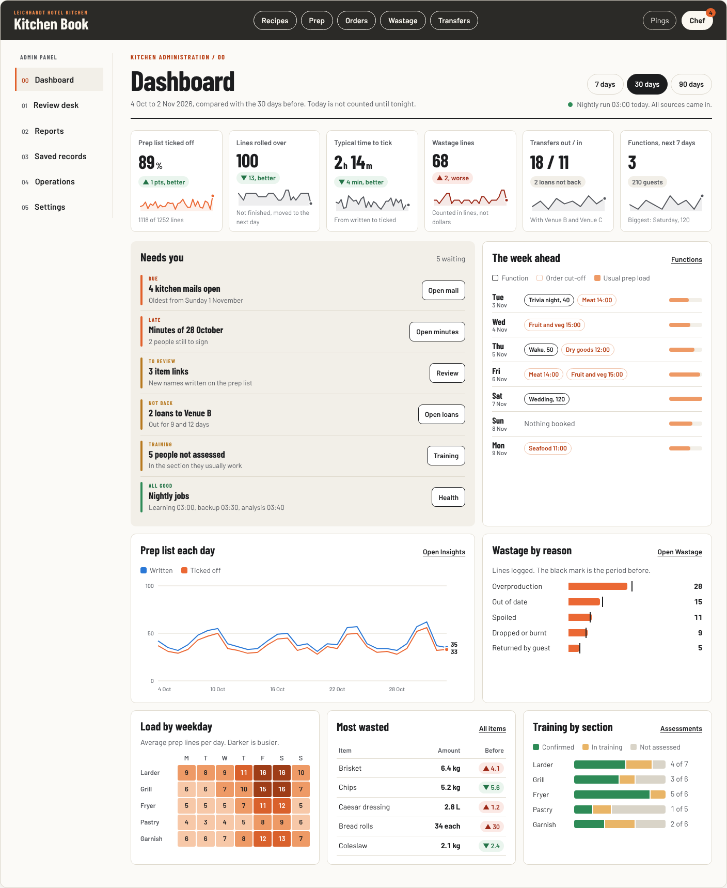
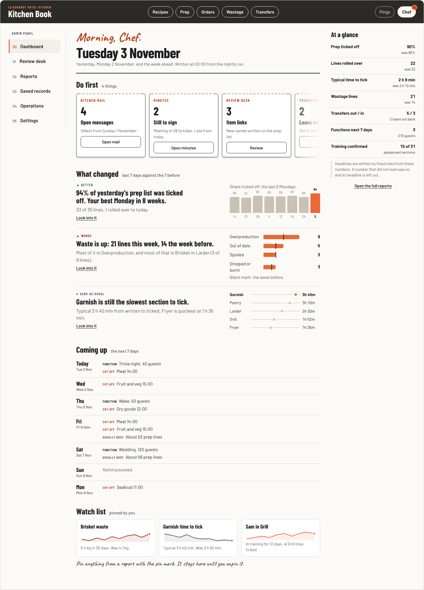
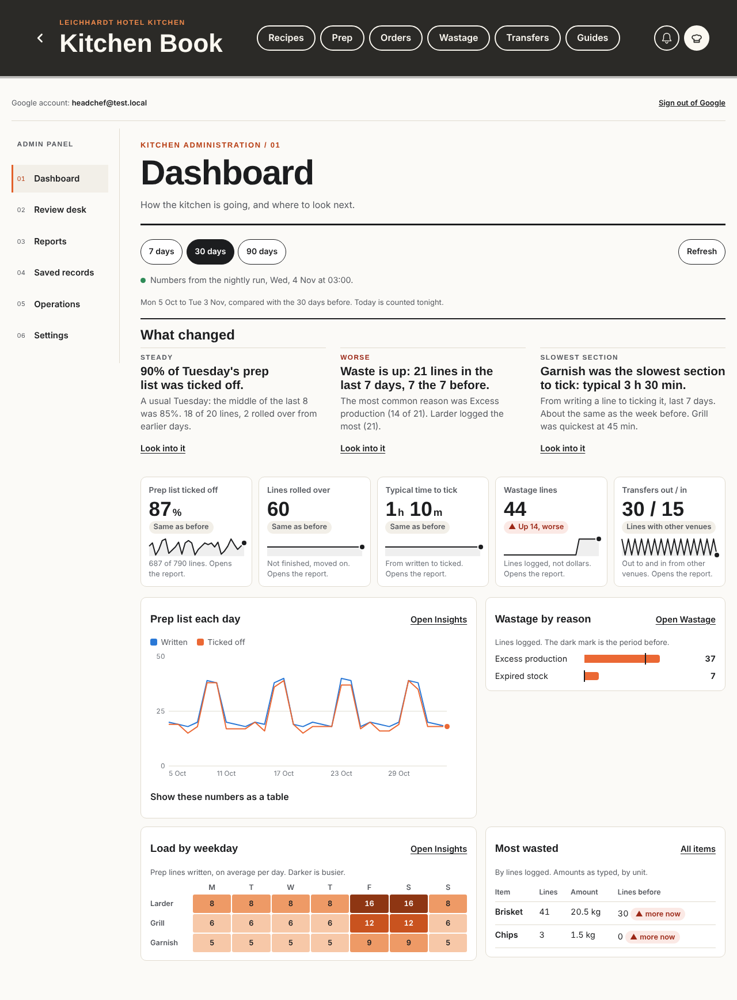
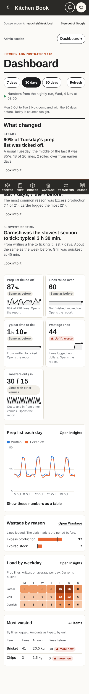

# Admin dashboard proposals

Requested 3 November 2026. **Selected 3 November 2026: A, The Pass board, with B's three written headlines as one strip above the tiles.** The build follows the steps under "If one is chosen", each in its own pull request.

The head chef asked for a proper dashboard in the admin panel, so the information already pulled is easier to see. Today the numbers sit across Reports, Review desk, Operations and Saved records, one page at a time. These proposals add one page that shows the important numbers, says whether they are getting better, and links into the existing reports for the detail.

Both designs keep the Chef's Desk look chosen on 1 November 2026 (`docs/admin-design-options/brief.md`): the chapter rail, Barlow and Barlow Condensed, warm paper, the charcoal bar and Leichhardt orange. All figures, items, venues and names in the mockups are examples.

## Ideas

1. **A dashboard opens first.** A new first chapter, Dashboard, before Review desk. The existing reports stay as the detail.
2. **Needs you.** One list of what is waiting: open mail, minutes not signed, item links, training gaps, loans not back, a nightly job that failed. Each row opens the exact page.
3. **Compared with what?** Every number shows the period before, in words as well as colour. More ticked is better, more waste is worse.
4. **Tap a number, see where it came from.** Tiles, bars and cells open the existing report with the same dates and section set.
5. **The week ahead.** Functions and guests, supplier cut-offs and the usually busy days on one screen.
6. **A watch list.** Pin an item, section or person from a report and follow its trend until unpinned.
7. **Written headlines.** Plain sentences from fixed rules on the numbers. No AI service; the same rules every night.
8. **Opens fast and cheap.** The nightly analysis job also writes one small private dashboard record (7, 30 and 90 days), so the page opens with about 5 reads instead of reading 60 days of lines on the device.

## The two designs

| Direction | Shape | Best fit | Tradeoff |
| --- | --- | --- | --- |
| A. The Pass board | Six tiles with trend lines, Needs you, the week ahead, then charts: prep each day, wastage by reason, load by weekday and section, most wasted items, training by section. One 7, 30 or 90 day switch for the page. | The tablet or office, a weekly look at patterns, rosters and waste. | Long on a phone; more to take in at once. |
| B. The Morning brief | "Morning, Chef." Do first dockets, three written headlines with one small chart each, the next 7 days, the watch list, and At a glance numbers at the side (at the end on a phone). | The phone before service, about two minutes. | Fewer numbers on screen; patterns outside the headlines need the reports. |

Recommendation: build A, with B's three written headlines as one strip above the tiles. If the head chef mostly checks on a phone before service, B on its own.

## Limits both keep

- Only the verified head chef admin sees it, like the reports now. A sous chef version is a separate decision.
- No prices, GP or supplier codes from AVC Live. Waste is in lines and amounts, never dollars.
- Delivery temperatures show what was recorded. No pass or fail limits are invented.
- A number that did not load says so. It never shows 0 or "nobody".
- Insights, Wastage, Transfers, Team and Item evidence keep their pages.

## Build steps (A with B's headlines)

Small pull requests in this order, each with click tests at 390, 768 and 1280 px and the read budget check:

1. Nightly dashboard numbers (done 3 Nov 2026). The nightly analysis job writes `analysis/dashboard` in the same atomic publish as the ranges, from the lines it already reads: no extra reads. The existing `analysis/{id}` rule already keeps it to the verified admin and to server writes, so no rules change. One row per finished day for 90 days: prep lines (all, written, ticked, rolled, written per section, minutes to tick per section), waste (lines, reasons, sections, items with unit and amount) and transfers out and in. Counted like Insights and Wastage; deleted and practice lines left out; never prices. `scripts/dashboard.mjs`, checked by `scripts/analysis-check.mjs`. The 90 day view has no earlier 90 days to compare with.
2. The Dashboard chapter (3 Nov 2026). `js/admin-dashboard.js` (`LK_DASH`, API 1), loaded only when the page opens, like the proofreader. Two reads on open (`analysis/dashboard`, `analysis/health`), kept in memory until Refresh or a change of person; a failed read waits for Refresh. Each device opens the Dashboard once after the update (`lk.dash.intro`), then the last page is kept. Charts use HTML and SVG with a pointer and arrow-key reading and a table view. `tests/admin-dashboard.test.js`.
3. Needs you (4 Nov 2026). Open kitchen mail, minutes still to sign and late, overdue meeting actions, transfers not returned and the nightly run, each opening its page. Reuses the mail and minutes loaded when the book opens; adds one query of the latest minutes' sign-offs (kept for the session, shared with the register) and one of the open transfers when the Dashboard opens. A failed check says so and is never counted as clear. Item links and training counts (4 Nov 2026): the Review desk's queue maths moved into `js/analysis-core.js` (`linkQueue`, `trainingQueue`), so the Review desk and the nightly job count the same way; the nightly job saves `needs { links, training, inTraining }` in `analysis/dashboard` (it reads `config/main` and `training` for it), and each row opens its Review desk queue. `tests/admin-dashboard.test.js`, `tests/rules/client-shapes.test.mjs`.
4. Week ahead (4 Nov 2026). Today and the next 6 days: confirmed functions from the live `kq` list `js/functions.js` already keeps (`LK_FN.list()`), cut-offs from `config/main.cutoffs` through `LK_CUT.on()`, and the usual prep load per weekday from the last 28 rows of `analysis/dashboard`. No reads. A change to the functions list redraws the Dashboard only when the week would look different. Functions that could not load say so; the cut-offs still show.
5. Watch list (head chef, 4 Nov 2026: build it, after the counts). Pinning an item, section or person needs a small saved admin record with its own rule, backup and PIN move, so it gets its own pull request and rules check.

## Files

- `index.html`: both designs in one page, with Design and Screen switches. Phone view reflows the same mockup at 390 px. Period pills in A change every number and chart.
- `previews/`: A and B at 1440 px, A at 768 px, A and B at 390 px.

Checked: no sideways scroll at 390, 768 and 1440 px, no script errors, real Barlow, Barlow Condensed and Caveat fonts.

| A. The Pass board | B. The Morning brief |
| --- | --- |
|  |  |

## The Dashboard as built

Synthetic test data only.

| Desktop | Phone |
| --- | --- |
|  |  |
