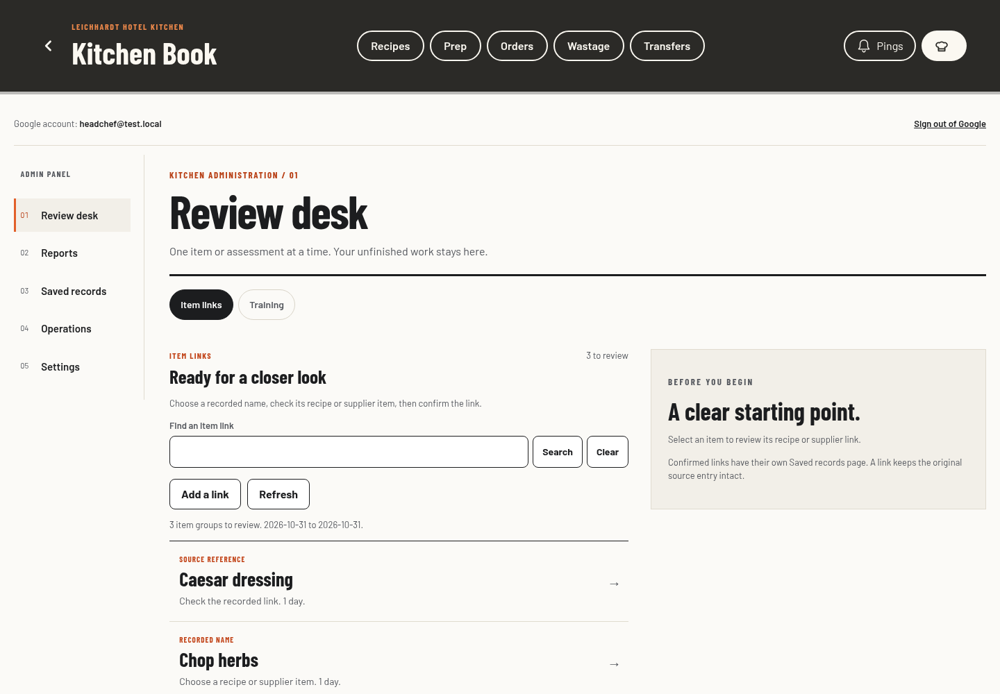
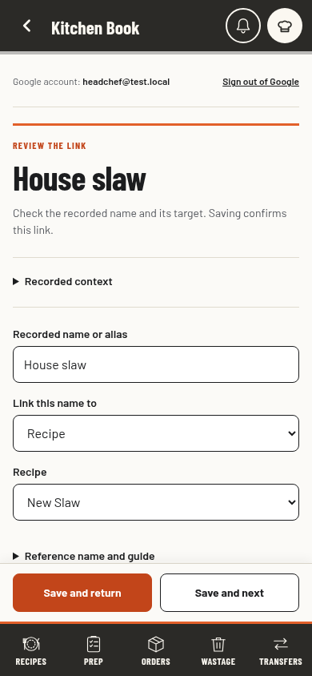

# Admin visual design options

Requested and selected 1 November 2026. The user chose A, The Chef's Desk. Production implementation is complete. PR #429 records current release checks and deployment evidence. The earlier Review desk behaviour remains the working baseline.

The user wants the whole admin panel to share the Kitchen Book's visual language and feel simpler and more fluent. The selected implementation applies A across the production admin panel. Roles, storage, rules and backend behaviour stay unchanged. The three original comparison pages remain example-only design context.

## What needs improving

The current admin competes with itself: section navigation, sub-tabs, toolbars, lists and forms have similar weight. Task headings lose the book's condensed typography. Context, optional fields and repeated labels push the primary action too far down a phone. The new draft should lead with the current job, keep a simple way back, preserve work and make the next useful action clear.

All options reuse the real Barlow, Barlow Condensed and Caveat typefaces, warm paper, charcoal shell, orange accents, thin rules, rectangular actions and pill choices. They retain the existing application header and phone navigation rather than adding a competing navigation system. All figures and people are synthetic examples.

## The three directions

| Direction | Layout and flow | Best fit | Tradeoff |
| --- | --- | --- | --- |
| A. The Chef's Desk, recommended | One-level chapter rail, ruled task list and adjacent context or editor. Focused task pages on phones. | Frequent admin work and repeated reviews. | More structured than the other options. |
| B. The Docket Rail | Kitchen dockets in task lanes, followed by focused review. Phone shows one lane at a time. | Quick check-ins between service. | Long queues take more space. |
| C. The Kitchen Book | Printed chapter contents and an open-book spread, then a short focused review sequence. | Deliberate, calm work with fewer controls at once. | More navigation between chapters. |

Recommendation: A keeps the proven review behaviour while giving it a clearer, calmer hierarchy. B is the closest to the kitchen wall and landing-page dockets. C has the strongest printed-book character. The user selected A.

## Shared scope

Every concept includes item links, explicit training assessments, reports, saved records, Operations and Settings. Saved assessments distinguish a section from a single recipe. Prep activity never confirms skill. Source identities remain explicit. Back retains a draft; Cancel is explicit. Saves in these previews update only local example state and report the result.

Apply the selected direction consistently across the admin panel, including its older operational and settings screens. Preserve current permissions, private drafts, saved-record access during summary failures, version checks, read budgets, source identity and the existing shared navigation. The design must not invent new analysis, automatic assessments or new data requirements.

## Review files

- `index.html` is the interactive comparison with desktop/phone controls.
- `a.html`, `b.html`, `c.html` are the individual working mockups.
- `admin-design-review.html` is the portable single-file comparison.
- `previews/` contains desktop, phone and focused-task screenshots using the actual typefaces.

## Verification and next step

Verify all initial layouts at 390, 768 and 1440 px, keyboard navigation, example-only labelling, task Back/Resume, explicit link/assessment saves, stored assessment scope, settings, modal focus and the comparison controls. This verifies the design drafts, not a production implementation. The user has selected A. Production verification and release evidence are tracked in PR #429.

Completed checks: all three layouts fit 390, 768 and 1440 px without horizontal overflow, with the actual Barlow, Barlow Condensed and Caveat fonts loaded. Phone review actions stay above the existing navigation, and fields scroll clear of them. A preserves draft and queue context; B passes 36 focused checks including full assessment records, modal keyboard behaviour, text size and saved shift notes; C preserves recipe-only assessment scope in summaries, reports and saved records. The normal and portable comparisons pass 58 browser checks across phone and desktop, including all three previews, keyboard selection, preserved example state, downloads and full-size views. Final comparison captures have no recorded browser errors.

## Selected implementation

The production frame uses one chapter rail on desktop and a section picker on smaller screens. Page choices sit with the chapter title rather than inside a second sidebar level. Ruled queues use Barlow Condensed task headings and an adjacent warm-paper context or editor. The initial phone queue trims decorative introductions so its first review target stays on screen at 390 by 844 px. Focused phone tasks hide the chapter picker, chapter heading and page choices. Save actions stay above the existing kitchen navigation; required inputs can scroll clear. Reports, saved records, Operations and Settings use the same typography, spacing and rules.

Existing page ids, heading jumps, permissions, private drafts, Back/Resume, acknowledged saves, explicit assessment scope and record histories remain in use. No prototype examples or simulated writes enter the application. Styles stay in the existing atomic application shell; this adds no lazy asset or data reads. The pre-change revision is tagged locally as `admin-visual-baseline-2026-11-01`.

## Production verification

The dedicated Chef's Desk test passes 98 checks at 390, 768 and 1280 px, including largest-text phone inputs, header Back, action clearance, private draft resumption and acknowledged reference/training saves. Existing admin, roles, read-budget and local-navigation checks were run; the affected navigation expectations were updated and rechecked successfully. The final focused run passes all 15 test files. PR #429 records the full browser suite, required CI and live release checks.

Production-layout captures use only synthetic test data and the application's actual fonts. They fit 390, 768 and 1440 px without horizontal overflow or browser errors.

| Desktop queue and context | Focused phone review |
| --- | --- |
|  |  |

The [phone queue](../images/admin-chefs-desk-phone.png), [tablet](../images/admin-chefs-desk-tablet.png) and [phone Settings](../images/admin-chefs-desk-settings-phone.png) show the same selected language on the other layouts.
