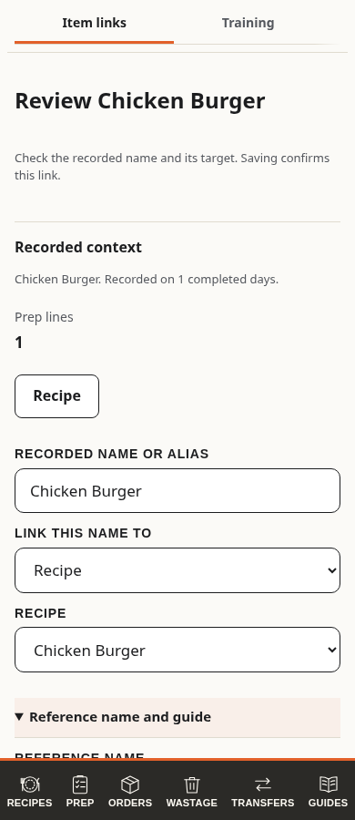
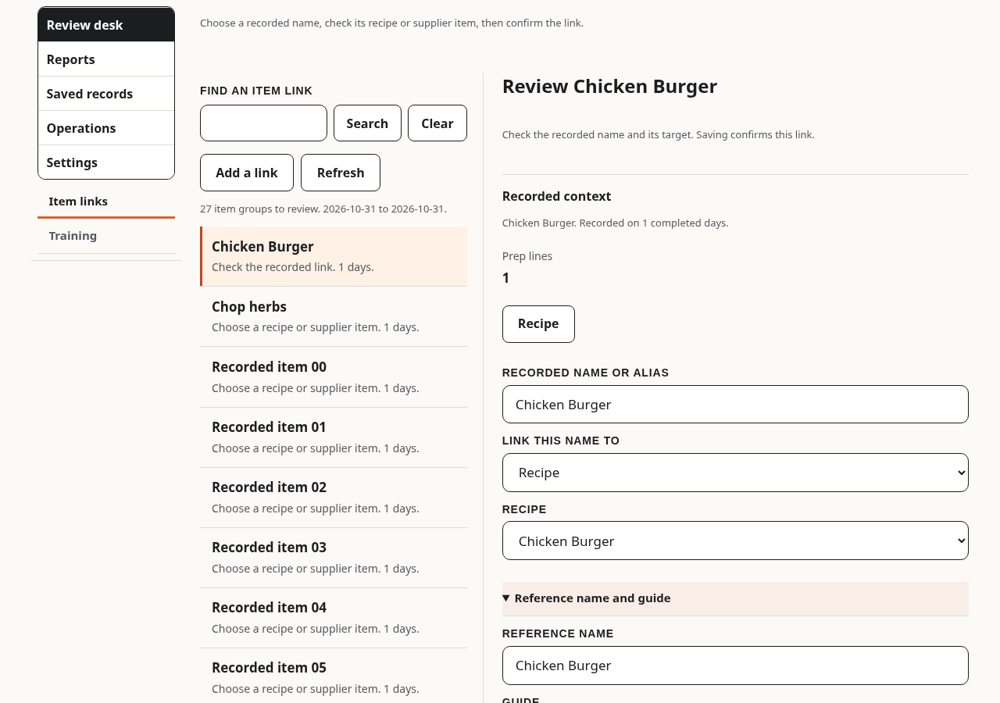

# Admin analysis, references and training

Approved direction: grouped workspace, existing infrastructure, both data relationships and staff training. No external imports or new service. The app remains plain JavaScript on GitHub Pages, Firebase 10.14.1 in the browser and firebase-admin 12.7.0 in Actions.

## What the admin can do

The admin panel has four rooms (4 Nov 2026, design B, `admin-pages-options/brief.md`): Today (Dashboard, Item links, Training, Proofreader, Kitchen mail), Reports (Insights, Wastage, Transfers, Team, Item evidence, Learning), Team (People, Assessments) and Kitchen (Order cut-offs, Suppliers & pars, Shift pings, Minutes, Guides, Confirmed links, Backup and PIN). A laptop shows the rooms as a rail; a phone or tablet shows them as one row of four buttons. Existing page ids and entry links remain valid, including saved last-page choices; the old `overview` id opens Today on Item links. A first visit opens Today on the Dashboard. Item links and Training are the two review queues in Today; Confirmed links are under Kitchen and Assessments under Team. The existing Insights, Wastage and Transfers reports retain their own live date and filter controls.

The Review desk keeps the selected review beside its queue from 1100 px. Smaller screens open one focused task; the header Back returns to the original list. Reports retains available infrastructure, source counts, data quality and latest run health under Analysis health and source coverage. Item evidence shows 7, 30 or 90 completed Queensland days, excluding today. Search items, filter explicitly tagged sections, open weekday evidence and compare routine prep with matching waste. A section filter reads that range's daily contributions only on demand. Records without a section are excluded from that filter. Coverage and quality remain for the whole selected period.

Amounts are separate by source, unit and transfer direction. An empty unit means unit not set. Staff order requests are not supplier orders, prep is not consumption and waste is not a measured waste rate. Function-generated prep remains visible but is excluded from routine-prep comparisons. The latest 14 days are compared with up to 14 preceding days, with both sample lengths shown. No prediction or percentage confidence is invented.

The item list contains up to 200 groups, with 40 search matches shown at once. Truncation is labelled. Every source day remains available through Browse daily records, paged 40 at a time. Reference links open the original recipe, guide or private supplier catalogue. The daily evidence includes source document ids, quantities, section and waste reason. Original sources are not rewritten.

Saved records holds admin-confirmed aliases under Confirmed links. A recipe or supplier/item pair supplies stable identity. Existing recipe ids and supplier/item ids are explicit source references. A supplier item keeps its own identity when linked to a related recipe. Several aliases may point to the same identity; conflicting identities stay unjoined. A spelling coincidence alone never joins different sources. The editor refuses duplicate aliases and requires a recipe or complete supplier/item pair. Supplier units and conversions are never inferred.

Training contains explicit assessments and links to recipes and guides. Since Today's team (step 4, 7 Nov 2026) each person and section also shows the shifts worked on it in the last 30 days ("2 shifts on it in the last 30 days"), from `teamsum/main`, beside the ticks: a chance to learn, never competence. Status is Not assessed, In training or Confirmed. Person, section or recipe, assessor and assessment day are required. Missing assessments mean Not assessed; zero ticks means no recorded activity in this period. Activity never sets competence. Person selection filters assessments and opens that person's station counts. The existing Team report is retained under Reports with corrected activity labels.

## Storage and access

All paths are under `kitchens/<pin>`:

| Path | Contract |
| --- | --- |
| `references/<id>` | alias, label, recipeId, supplierId, itemId, guideId, v, at, by |
| `training/<id>` | personId, section, recipeId, guideId, status, assessorId, day, v, at, by |
| `references/<id>/hist/<v>`, `training/<id>/hist/<v>` | Exact previous records; immutable. A version update must preserve its previous value atomically. |
| `analysisDaily/<generation>_<day>` | v, day, source counts, exclusions, quality and eligible evidence entries. Derived from current sources. |
| `dashwatch/main` | list (up to 12 keys: `sec:<section>`, `item:<name>|<unit>`, `person:<id>`), v, at, by. The admin Dashboard's watch list; verified admin only. |
| `analysis/dashboard` | v, generation, at, from, to, `needs` (`links`, `training`, `inTraining`: the Review desk queues counted with `linkQueue` and `trainingQueue` in `js/analysis-core.js`) and one row per finished day (`days`): prep counts and minutes to tick per section, waste lines, reasons, sections and items, transfers out and in. Published with the ranges for the admin Dashboard. See `admin-dashboard-options/brief.md`. |
| `teamsum/main` | v, at, day, from, to, `days` (the last 30 days' shifts worked: `{ day, s: [{ p: person, sec: section name, sh: shift }] }`), `usual` (`'<weekday>|<shift>'`: person to [section id, times, of], from the last 8 weeks' plans), `learn` (person to the sections they are In training on). Today's team, step 4 (7 Nov 2026). Read by the head chef, the sous chefs (own PIN session) and the verified admin, never staff; written only by the nightly job; not backed up or copied in a PIN move (rebuilt each night). |
| `analysis/current`, `range-7`, `range-30`, `range-90`, `health` | Published generation, range, freshness, inventory, source counts, coverage, quality, item patterns and staff activity. |

Only the verified Google admin reads these collections. Staff, sous chefs, function-only sessions, signed-out clients, other Google accounts and unverified email accounts cannot read or write them. No private report goes into the staff-readable `summary` collection. Browser writes to derived data are restricted to creation or identical copies for kitchen PIN migration. Normal publications are server-written. All editable browser records use the existing `W()` writer and pending-write tracking. Conflicting revisions fail and preserve the form. A failed save never displays success.

Private data and drafts stay in module memory, are guarded by the current access context and are discarded on hand-over. Existing unload, update, sign-out and unsaved-change controls include the new forms. The admin module loads only when a new workspace page opens. Staff page entry adds no analysis reads.

Manual backup, nightly encrypted backup and kitchen PIN migration include all new collections and reference/training histories. Existing backup retention remains unchanged. Do not commit backup files, private catalogues, identifying data or production evidence. Public workflow logs print counts only.

## Nightly processing

The existing Nightly learning workflow runs `nightly-analysis.mjs` after learning, even if the preceding learning step fails. Existing `learned` and `ordlearned` totals and staff suggestions remain compatible. New analysis runs in comparison mode (`comparisonOnly: true`) until production evidence supports changing staff ranking. Evidence-based prep review is available to the admin now, without automatic quantity changes or orders.

The analysis job rereads up to 90 completed days of prep, staff orders, waste and transfers, plus dated supplier order snapshots, delivery receipts and functions. It inventories supplier items, current recipe assets and guides. Practice, removed and rolled copies are excluded. Confirmed functions are counted separately. Sources and aliases are re-read on each run, so late corrections and mapping changes are incorporated without duplicate increments.

The source-query budget is 15,000 per run, including empty-query charges. An exhausted query may read one extra record to detect truncation. Reading the previous publication pointer costs one additional read. The job fails instead of publishing truncated source coverage. Individual daily documents and range summaries are limited to 700 KB. Daily writes use batches of eight to stay below Firestore's request limit. Random generation ids separate retries. All daily reads and calculations must succeed before contribution writes begin. The three range summaries and current pointer publish atomically. Partial generation writes never become current. The last good generation remains readable when any stage fails; health is recorded separately.

**Day digests** (Plan B 2.1, 5 Nov 2026, `docs/firestore-usage.md`). After publishing, the job writes `digest/<day>` for each of the last 60 days it read: `{ v: 1, day, at, prep: [lines], orders: [lines] }`, every line as stored with its id, removed ones included. `digest/_index` keeps a fingerprint per day (one extra read), so only days whose lines changed are written: about 60 on the first night, then 1 to 3. A day over 700 KB gets no digest, and a day that leaves the window is deleted. The rules let anyone who may read the lines read a digest, and nobody but the job write one (`tests/rules/rules.test.mjs`, `tests/rules/client-shapes.test.mjs`). Since 2.2 and 2.3 the phones read them for the prep and order hints, and the admin reports (Insights, Team, the Proofreader: `loadStats()`, `loadOrdStats()`) for their past days, with today and any day a stamp names from the lines (`digestRead()` in `js/prep.js`, `docs/prep-book.md`). Refresh reads the index and the digests again. A Proofreader repair names its day in the stamp like any past-day fix (`pastNames()`). A move to a new kitchen PIN does not copy them: the next night builds them under the new PIN. `scripts/analysis-check.mjs` checks the digest of a day, the index, a night with nothing changed, a fixed past day and days leaving the window.

Maintenance removes generations older than the published generation and its predecessor. Since 7 Nov 2026 (Plan B 4.1) a normal night deletes the generation before last by name, from the window `analysis/current` keeps for it (`previousFrom`, `previousTo`): about 90 deletes and no reads. A full run, a cleanup left pending, or a record without that window still examines at most 400 daily document ids, so a run that failed after writing its days leaves nothing behind for long. Maintenance failure marks cleanup pending while retaining the successful publication.

**Days before the book started** (Plan B 4.1, 7 Nov 2026). `analysis/current.first` keeps the first day with any prep, order, waste or transfer line. A normal night does not read the days before it (they are empty: about 280 reads a night saved until the 90-day window moves past the start, mid-January 2027). A full run reads every day of the window again: on Sundays (kitchen time), with `full`, or when the first day is not known. It catches a line written into a day before the first, and moves `first` back. Manual backup and PIN migration can cost more because they intentionally copy all stored evidence.

**Today's team** (step 4, 7 Nov 2026, `docs/prep-book.md`). After the queues, the job reads 8 weeks of `team/<day>` plans and 30 days of `shifts/<day>_<id>` section picks and publishes `teamsum/main` in the same batch as the summaries, with the shared code in `js/analysis-core.js` (`teamStints()`, `teamUsual()`, `teamLearning()`). A stint is one person on one section on one shift of one day: from the plan, from a cook's own move (the record's log), or from the day's pick when the plan did not have them on; the chefs' role records are left out. `scripts/analysis-check.mjs` and `tests/analysis-core.test.js` check them.

Anonymous suggestion feedback keeps shown phone-days, taken and dismissed counters and adds edited (`e`) for an applied order quantity changed before Add. The usage summary rebuilds the last seven days from retained phone records, so delayed submissions are incorporated without duplicate counts. Edited appears in the existing Smart features table when present. Counts contain no typed text, staff names or screen recordings. This does not measure causal recommendation quality.

## Verification and release

Run the normal browser suite with `CHROME=/usr/bin/chromium npm --prefix tests test`; rules with `npm --prefix tests/rules test`; and `scripts/analysis-check.mjs` on the Firestore emulator alongside the existing nightly-learning checks. CI includes the new checks. The browser tests cover 390, 768 and 1280 px, references, revision history, explicit training, failed saves, sign-out and staff read isolation. Core checks cover aliases, ambiguous joins, prototype-shaped names, excluded records and incompatible units.

Release additive rules from the feature branch with Publish rules before merging client code. Then require green PR checks, run the pre-merge check, squash merge and verify Pages and live click tests. Run Nightly learning once and confirm the first published analysis in the verified admin session. Existing staff suggestions need no migration. Roll back client defects through a revert PR; preserve records and private access rules. Data already written is not rolled back by reverting code.

## Review desk and saved records

Item links lists recorded names awaiting review; Confirmed links lists saved references separately. The queue always uses the published 90-day summary, independently of Training and Reports dates. Search and Show more stay with their lists. The source period, grouping and top-200 summary limit are explained in optional help. A failed or delayed activity summary never hides saved references on their own page. A new manual link uses its typed name as the default reference name; an explicitly edited reference name and existing saved names stay unchanged. A spelling match alone never creates a target: only existing valid recipe or supplier/item ids prefill a source-linked review. Saving one link leaves other recorded groups available.

Training shows compact person/section opportunities before choosing a person. These reflect missing or in-progress section assessments, with activity as context. The focused assessment shows the person, activity and saved learning references. The admin explicitly chooses whole section or one recipe, the assessor, date and outcome. A recipe never confirms an entire section. Saved assessments do not depend on activity periods. No competence or mentor qualification is inferred from tick counts.

The task heading receives focus synchronously and retains it across background redraws. Fields retain text, focus and cursor selection through the existing parent mechanism. Optional-field disclosures are captured before a redraw so an active field cannot be hidden by a delayed native toggle event.

The header Back or Back to list retains the draft, search, period and originating list position. An unfinished-review banner offers Resume on other admin pages too. Cancel changes is an explicit discard. Navigation never saves. Only the visible task intercepts contextual Back; an unrelated legacy editor retains its existing Back behaviour. Local tabs and filters still add no browser-history entries.

Save and return waits for acknowledgement, updates the loaded record list and returns to the origin with an outcome. Save and next advances after acknowledgement. Training keeps a visited set for that review pass, so In training assessments cannot repeatedly cycle between earlier subjects. Failed saves retain the same form and values. During an unresolved save, the editor, header Back and admin navigation are disabled. A new form cannot save before its saved-record list has loaded, so duplicate checks are complete and a delayed initial read cannot overwrite an acknowledged record. The existing version/history writer remains authoritative.

Analysis item selection reveals its detail next to the list on desktop or as a focused view on phone/tablet. Reference review from that item preserves explicit recipe or supplier identity, and returns to the same source evidence. Refresh invalidates older requests as well as cached records. Module API 3 uses a versioned URL and verifies the loaded API; an older offline script shows a recoverable error.

The active item queue reuses the existing references, suppliers and 90-day summary reads and adds one health-document read on first open, cached in memory until Refresh. Only the selected queue loads its data. Saved libraries read their records independently of activity summaries. Applying an acknowledged save to the loaded list avoids an immediate full-list reread. There are no new staff reads, schema, rules, roles, backup fields, backend services or nightly-learning behaviour changes.

## Screen examples

These are synthetic fixtures, not production staff or kitchen data.

| Focused phone task | Desktop queue and detail |
| --- | --- |
|  |  |

## Progress

PR #424 was approved, merged and deployed. Its first production analysis completed successfully for the 90-day window. Publication approval from that release is already resolved and must not be requested again for this display-only follow-up.

The clarity follow-up, PR #425, was merged as `cb9da05` and deployed. All 153 pre-merge test files, the rules and learning checks, 125 focused live checks and the full automatic live suite passed. The journeys cover recorded and confirmed references, source-target prefill, saves and failures, tab returns, late-response guards, training assessment boundaries, module versions, field focus and staff isolation. This client-only release needed no rules publication or production-data migration.

The user subsequently reported that the screens do not flow well. The [flow specification](admin-flow-spec.md) records observed navigation and editor problems, common acceptance criteria and three alternatives. The [interactive concepts](admin-flow-concepts.html) use example data only. The user selected A, Review desk, on 1 November 2026. The selected implementation and its current release evidence are tracked in [PR #427](https://github.com/KuschiKuschbert/leichhardt-kitchen/pull/427). The chosen contract is a task queue with adjacent desktop details, a focused phone view, contextual Back, visible draft resumption, acknowledged Save and next, and separate saved records. Existing data, permissions, operational pages and local-filter history boundaries remain in use.

## The Chef's Desk visual design

The user selected A on 1 November 2026. [The design brief](admin-design-options/brief.md) records the selected layout and PR #429 tracks release evidence. The frame has one-level chapters, page choices beside a large condensed chapter title, ruled review lists and a narrower context/editor surface. Focused phone tasks hide chapter navigation and keep Save above the existing bottom navigation. The same spacing, typography and rules apply to legacy reports, Operations and Settings. Existing API 3, data paths, adapters, roles, read budgets, version guards and private draft lifecycle are unchanged.

## Dashboard proposals

On 3 November 2026 the head chef asked for a dashboard that makes the admin information easier to see. [The proposals](admin-dashboard-options/brief.md) describe eight ideas and two designs, A The Pass board and B The Morning brief, with example data only. The head chef selected A with B's three headlines on 3 November 2026.
