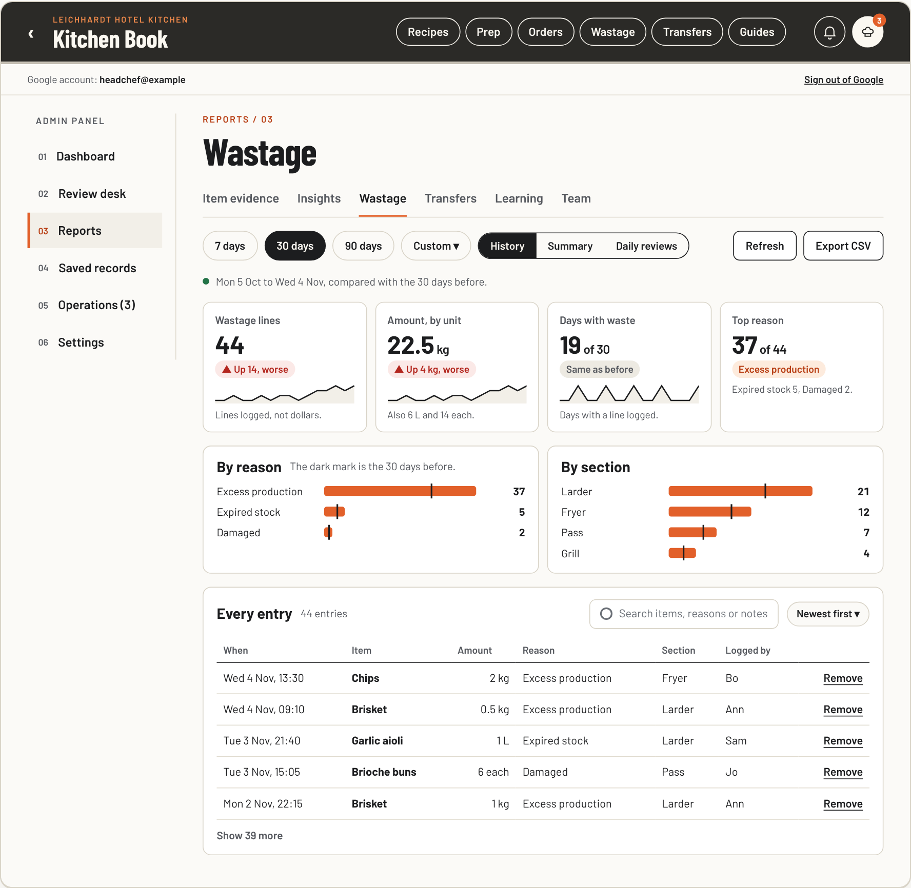
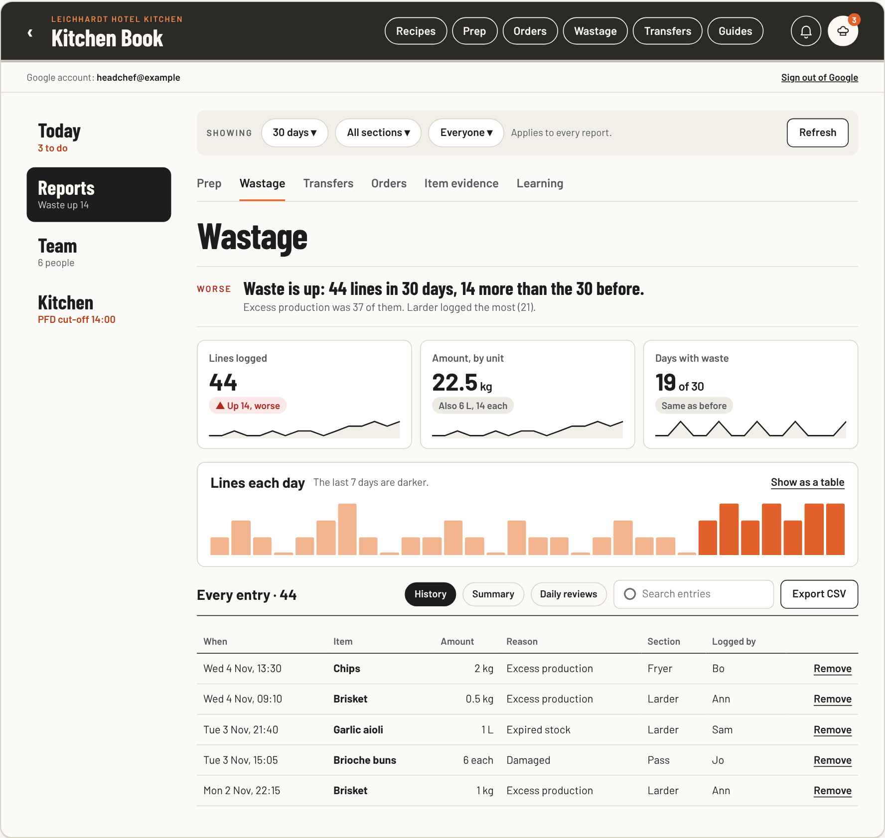
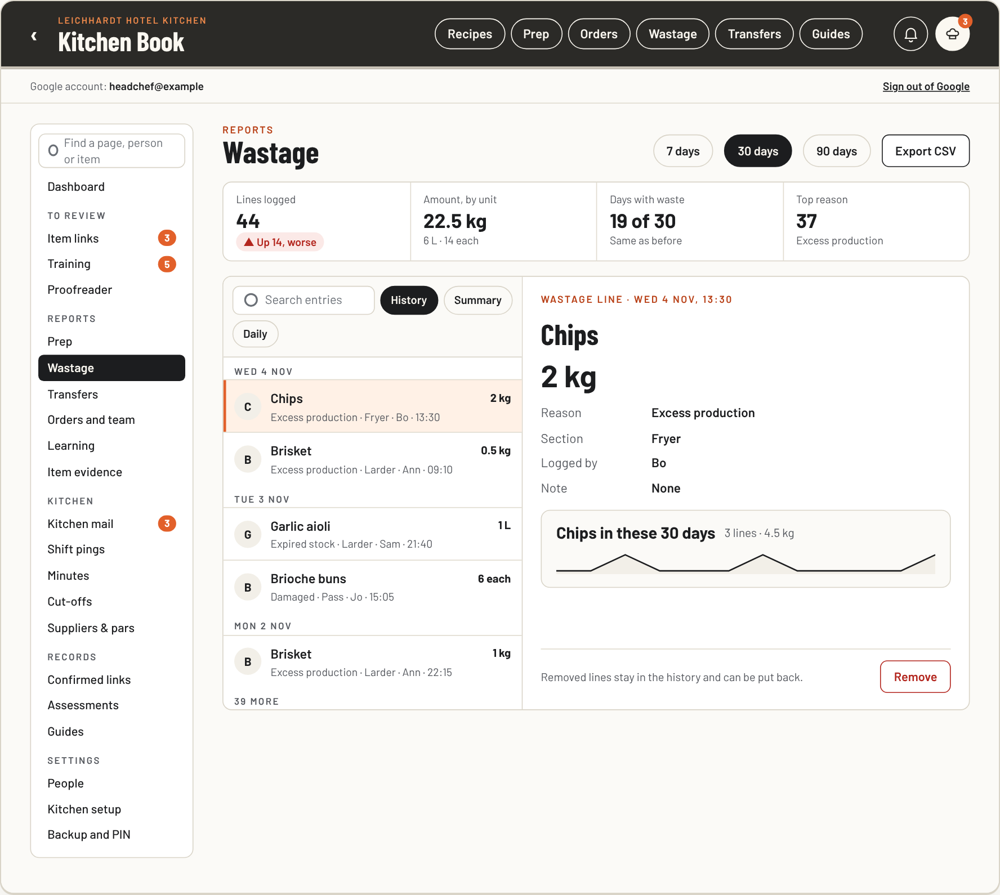
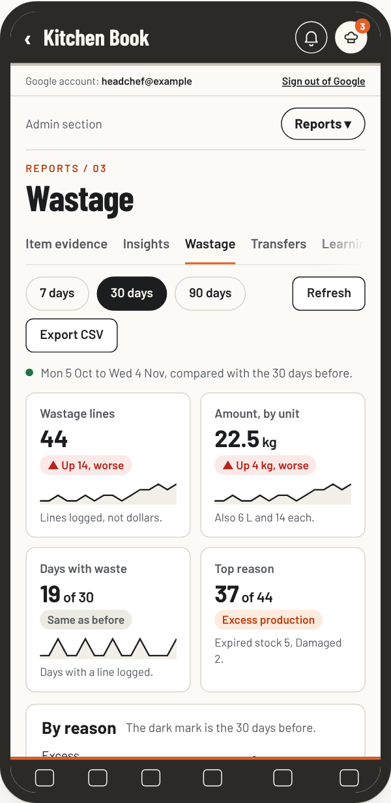
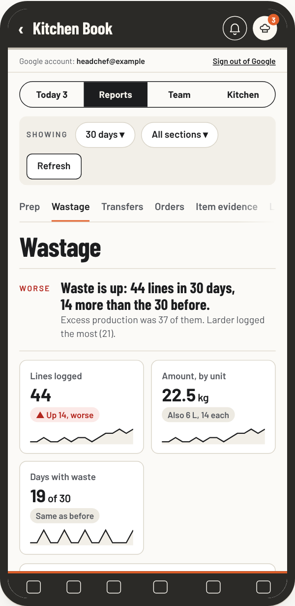
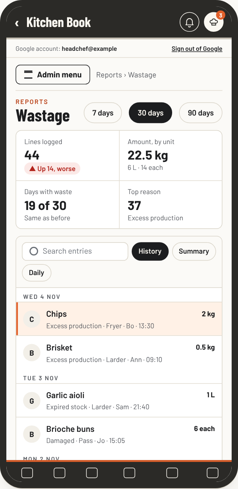
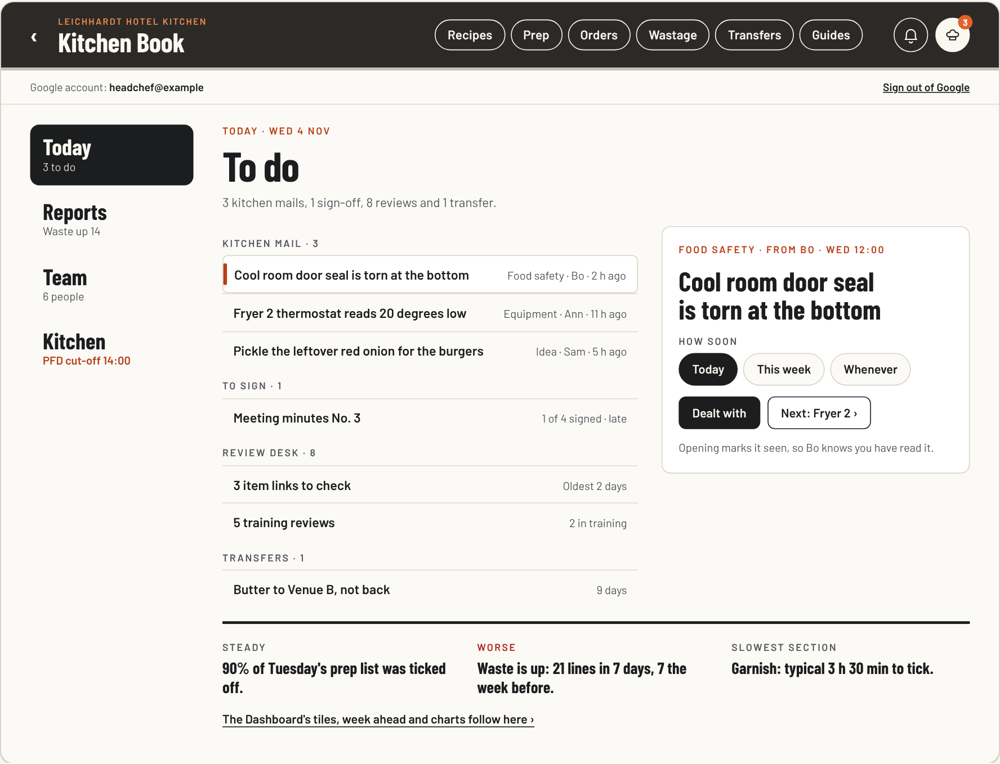

# Admin pages redesign options

Requested 4 November 2026. **Waiting for the head chef's choice.** No application code changes until then.

The head chef loves the Dashboard, but the other admin pages do not flow with its design. The request: a full update of the admin panel's pages, with three designs for a better and more modern organisation, each with pros and cons.

## The brief, for an engineer

The admin panel's information architecture and visual language are inconsistent. The Dashboard (`js/admin-dashboard.js`, the Pass board with written headlines, `docs/admin-dashboard-options/brief.md`) sets the bar: one toolbar, numbers first, trend chips, cards and charts with drill-through. The other 20 pages across the six chapters predate it and do not share its page anatomy, typography, control sizes, block styles or navigation depth. Audit every admin page against the Dashboard and propose three distinct directions for organising and styling the whole panel, with mockups at phone and laptop widths, the navigation model, where every existing page lands, the effect on reads, rules, roles and tests, the build in pull requests, and pros and cons.

## What drifts from the Dashboard today

Measured on 4 November 2026 by opening all 21 admin pages with the test stand-in (`tests/fake/`) at 1280 and 390 px.

1. **Up to four levels of navigation.** Chapter rail, page pills, On this page chips, then a view switch. Reports › Insights has 7 jump chips, Team has 9 over two lines, Wastage adds History, Summary and Daily reviews. The Dashboard has one level.
2. **Controls before content.** Wastage has four rows of controls before the first number: a 352 px period box, the view switch, a 156 px tall search box and More filters. On a phone the first entry starts about 1,130 px down.
3. **Numbers last, in small type.** Wastage, Transfers and Team show totals as small inline text. No page but the Dashboard uses its tiles, trend lines or "Up 14, worse" chips.
4. **Two surface styles, four heading styles.** White cards on the Dashboard; flat ruled blocks, beige table heads and black segmented switches elsewhere. Headings are numbered and orange (Insights), condensed with a kicker (Review desk), plain bold (the rest) or card titles (Dashboard).
5. **Very long pages.** Team is 3,800 px on a laptop and 5,690 px on a phone, with 6 search boxes and 6 tables. Insights is 4,000 px. People is 2,480 px because every person is an open form.
6. **Help text before the work.** Backup has eight lines before Download a backup; Order cut-offs four before Add a supplier; Kitchen mail three before the first message.
7. **Things said twice, or split up.** Dashboard tiles repeat Insights' Overview; Insights' By person repeats Team; the Training queue and saved Assessments are in different chapters; Suppliers & pars is a page with two links.
8. **Controls in many sizes.** The period choice is a wide dropdown, a small pill or pill buttons depending on the page. Search boxes run from 36 to 156 px tall.

## Shared fixes in every option (the page kit)

Step 1 whichever design is chosen: one page header with one toolbar row (period pills like the Dashboard's, filters as pills, Refresh and Export at the right); the Dashboard's tiles where a page has numbers, using only numbers it already counts; cards for numbers and charts, ruled lists with their own search, settings as rows that say what they are set to; one size for controls; at most two levels of navigation; one line of help with the rest under How this works; the Dashboard's honest failed and waiting states.

## The three designs

| Design | Organisation | Best fit | Tradeoff |
| --- | --- | --- | --- |
| A. The Pass board everywhere | Same 6 chapters and 21 pages. Every page gets the Dashboard's anatomy: toolbar, tiles, cards. | You like where things are; only the look bothers you. | Organisation and overlaps stay. Cards everywhere reverse the 22 Oct 2026 "fewer boxes" decision. Longest on a phone. |
| B. Four rooms (recommended) | Today (To do with in-place tasks, then the Dashboard), Reports (one shared filter bar), Team (a page per person), Kitchen (settings rows like the 3 Nov Settings page). | Simpler panel; working by task. | Most relearning; changes the 1 Nov chapter list. Person page must keep "Ticks record activity. They do not confirm skill." |
| C. The workbench | Every page in one rail with counts and Find. Each page is a list with the chosen item beside it; full-screen detail on a phone. | Laptop work, jumping between many pages. | Biggest rebuild and test churn. Reverses the 1 Nov "no second sidebar level". Long reports fit a list less well. |

| | A | B | C |
| --- | --- | --- | --- |
| Navigation levels | 2 | 2 | 1, then list and detail |
| Build | About 6 pull requests | About 9 | About 11 |
| Relearning | Low | High at first | Medium |
| New reads or rules | None | None | None (rail counts reuse Needs you; none shown until loaded, never 0) |
| Test changes | Small | Medium, with a roles walk for the person page | Large |
| Risk | Low | Medium | Medium to high |

Recommendation: B on the shared page kit. It fixes both the look and the organisation, reuses three patterns already chosen (the Dashboard, the Review desk's focused task and the Settings rows), and adds no reads or rules. A is the low-risk fallback. Parts mix well: A's tiles and cards fit B's reports, C's list and detail fits B's Team and Kitchen mail.

## What every option keeps

Who can see each page, private drafts, Back and Resume, acknowledged saves, record histories, the read budget (`tests/read-budget.test.js`) and the existing page ids inside the code, so old links and the Dashboard's tiles keep opening the right report. Nothing is removed. The comparison page has a table of where each of the 21 pages goes in each design.

## If B is chosen

Each its own pull request, with click tests at 390, 768 and 1280 px and the read budget check: 1. page kit; 2. four rooms in the rail and the phone room switch, page ids unchanged; 3. Today: To do with in-place tasks, the Dashboard under it; 4. Reports: one filter bar and the same report layout; 5. Team: person pages, with the role walk-through on the emulator; 6. Kitchen: settings rows, records and access; 7. remove the old chapter styles and update the notes. Keep a baseline tag on `main` first (CLAUDE.md, Big look changes).

## Files

- `index.html`: the comparison. Each design shows the same four pages (Wastage report, People, Kitchen mail, Order cut-offs) at laptop and phone width, with pros, cons, costs and the page map. Example data only.
- `previews/`: Wastage in each design at laptop and phone width, and B's Today.

Checked: no sideways scroll at 1280 and 390 px, no script errors, real Barlow and Barlow Condensed fonts, every mockup screen fits its 1100 or 390 px frame.

| A. The Pass board everywhere | B. Four rooms | C. The workbench |
| --- | --- | --- |
|  |  |  |
|  |  |  |

B's Today, the To do list with the open mail beside it: 
