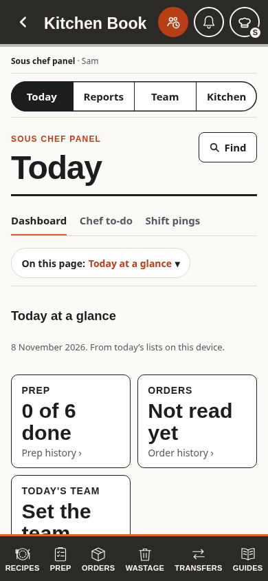
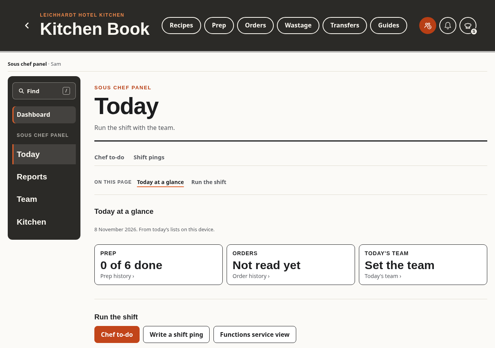
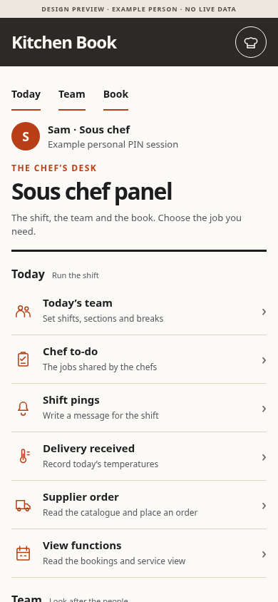
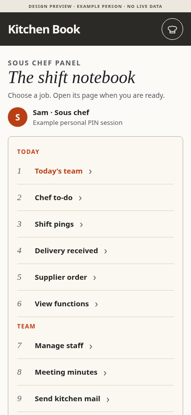
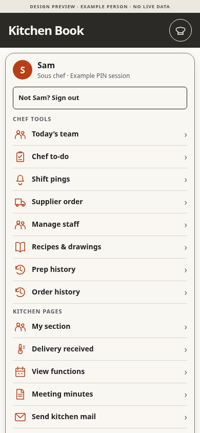

# Head chef and sous chef panel

Requested 8 November 2026. **Chosen 8 November 2026: a dedicated Head chef / Sous chef panel like the real admin account.** The owner clarified: "please check how the admin panel is implemented in the admin account, we need a similar thing for head/chef and sous chef". This selects A's dedicated-panel direction with the actual admin shell and working subpages, rather than the earlier link-only example. Implementation and verification are recorded below; release remains subject to the existing queue.

## Chosen implementation

The subsequently approved [prep standards feature](../prep-standards.md) adds a fifth shared room, **Prep**, for head-chef editing and sous-chef reference. The original panel verification below records its four-room baseline.

The real admin is rendered by adminHTML() in js/prep.js. Its four rooms, laptop rail, phone tabs, Find, On this page and content pane use the existing ad-* and a-* patterns. Both panels now call panelShellHTML() for that same markup.

The chef hat adds Head chef panel or Sous chef panel at #/chef. A current personal chef PIN session opens it. Canonical headId/sousIds determine access; an editable role label, remembered Google or a typed email does not. The existing direct service links remain.

| Room | Working pages |
| --- | --- |
| Today | Dashboard from today's already loaded lists, Chef to-do, Shift pings, conditional shared Kitchen mail |
| Reports | Prep history and Order history, one selected day, with search and recorded status |
| Team | Today's team planner, Manage staff and Meeting minutes sign-off register |
| Kitchen | Overview and the existing recipe, supplier, function, delivery and guide workspaces |

Chef to-do, Today's team, staff, pings, the register and shared mail use their existing renderers, state and writes inside the panel. There are no copied editors or second drafts. Team and to-do refresh, clock and view-restoration hooks recognise their chef subpages. Lazy recipe, supplier, function, delivery and guide tools keep their current routes and return through the normal page trail.

Chef Find includes only permitted chef pages and current headings. It does not include owner reports, assessments, permission settings or people assessment pages. Chef tab/room state stays in memory and is separate from the saved admin tab. Handover clears it; scheduled locks hide retained drafts behind the original person's PIN and close private navigation sheets.

### Reads, permissions and failure behaviour

- Dashboard counts reuse the loaded current-day lists and existing team plan. No admin analytics, historical summary, assessment or watch-list query is added.
- Opening a history report or changing its date reads only that selected prep/order day, one document read per line, at least one for an empty query. Refresh explicitly rereads it. The shared pastRead() cache and correction stamps are reused. The new strict option requires a server answer for an uncached or refreshed report, so an offline response cannot become an empty-day result. Previously confirmed complete ranges can use the existing memory cache.
- The existing mail sharing switch still controls PIN chef reading and triage. The chef reader does not expose the sharing switch or owner Seen control. Functions booking still requires its separate tick; only Head chef/admin edit the supplier catalogue.
- Manage staff remains the existing roster editor. Canonical permission approval and PIN resets remain owner-admin actions.
- Owner analytics, assessments, reference records, waste/transfer/delivery history, kitchen settings, security and backups keep their current checks. No rule or schema change is required.
- Loading, refused and failed history reads have explicit states. Canonical role removal closes the panel and its Find results. Existing write, unsaved-work and daily-device locks apply.

### Acceptance and verification

The dedicated panel is implemented. The new chef-panel browser file passes **143 checks** covering both chef PIN roles, all three widths, room navigation, real todo/ping/staff saves, selected-day histories, filtered Find, shared-mail triage, canonical revocation, daily lock, retained drafts and handover. It also covers missing canonical membership, returning from an old Prep/Orders date, today's metric destinations, an uncached report refusal and contextual minutes Preview Back. The existing chef-menu, head-chef and admin-hidden files pass another 174 checks.

All 13 focused regression files passed: admin-nav, admin-kit, admin-inbox, admin-review-desk, read-budget, roles, page-roles, safe-text, todays-team, todo-notebook, local-back-navigation, device-prep-lock and device-lock-handover. App and test syntax, design-pattern registry and diff whitespace checks passed. The full 253-file app suite and required repository CI are release gates; their actual results and release status are recorded in [PR #607](https://github.com/KuschiKuschbert/leichhardt-kitchen/pull/607) before marking ready.

The screenshots below show the implemented application with the repository's synthetic people and mocked Firebase. There were no page errors or sideways overflow at 390, 768 or 1280 px for either PIN chef role. These are source/mock checks, not live permission or production-data checks. No rule changed or publication is required. PR #607 tracks CI and release.

| Phone | Laptop |
| --- | --- |
|  |  |

Working subpages: [staff roster](implemented/sam-1280-people.png), [pings editor](implemented/sam-1280-notes.png), [team planner](implemented/sam-1280-plan.png) and [prep history](implemented/sam-1280-prep-history.png). Head chef: [phone](implemented/ann-390-dashboard.png), [laptop](implemented/ann-1280-dashboard.png).

The owner asked for a head chef / sous chef panel alongside the admin-email panel. One shared implementation can use each person's current kitchen and personal PIN session, show the appropriate role heading and keep the owner admin destination separate.

## Baseline before this change

The app already recognises canonical headId and sousIds. Chef tools live in the chef hat. The full admin panel requires verified owner Google, this device's current head-chef PIN session and a matching grant. Remembered Google or a typed email alone is insufficient.

The [proposal](proposal.md) records the source audit and the [current screenshots](previews/). Current main at discovery: eedbdd7. The screenshots use repository test people, the synthetic six-digit test kitchen PIN and a mocked Firebase service. Nothing was written to the live kitchen.

| Existing capability | Head chef PIN | Sous chef PIN |
| --- | --- | --- |
| Today's team, Chef to-do, Shift pings | Manage | Manage |
| Recipes and drawings | Manage | Manage |
| Supplier orders and supplier history | Read and place | Read and place |
| Supplier catalogue | Edit | Read |
| Prep and order history | Browse and permitted corrections | Browse and permitted corrections |
| Manage staff | Roster changes and permission requests | Roster changes and permission requests |
| Meeting minutes | Published minutes and sign-off register | Published minutes and sign-off register |
| Delivery received | Today's temperatures | Today's temperatures |
| Functions | View and cancel; booking changes need Functions tick | Same |
| Kitchen mail | Shared reading/triage only when sousMail is on | Same |

Manage staff does not grant canonical permissions or reset PINs. Add, Tick and Delete still follow the individual's configured capabilities. The current head chef hat omits Kitchen mail; a chosen implementation should expose the existing permitted destination with the same mail switch, rather than grant more access.

Keep admin analytics, assessments, reference records, waste/transfer/delivery history, guide and minutes editing, kitchen settings, backups and security controls under verified admin access. Any later request to expand these needs its own explicit contract and rule checks.

## Round 1: should we build it?

Five independent role-based agent reviews, not research with actual staff. Each read the proposal, the service rules, its reviewer brief and current screenshots. **Build smaller, 5 of 5.**

| Reviewer | Main reason and requested improvement |
| --- | --- |
| Cook mid-service | Existing tools already take two taps. Try clearer chef grouping first and keep service tasks direct. Flagged the initial count of covered rows; the baseline was corrected. |
| Head chef | Role naming helps, but there is no observed frequency or speed evidence to justify a separate page. Try menu-only first. |
| Skeptic | A second navigation path duplicates the existing menu. Compare wrong turns and task-finding time before committing. |
| New starter | PIN Head chef followed by Admin panel / Google is confusing. Keep plain task groups; another page of the same labels may not help. |
| Keeper of the book | Keep zero extra opening reads, no badge queries and one copy of each editor. Verify offline, update and handover behaviour if built. |

All five prefer exploring the smaller menu approach. This advice does not replace the owner's requested panel or choose a layout for them.

## Three designs

The [interactive comparison](index.html) is a static prototype using example people. Its role, mail and Functions switches demonstrate the intended conditions; they grant no authority. Every Open action explains the intended destination and makes no write.

| A. Chef desk | B. Shift notebook | C. Chef tools in the hat |
| --- | --- | --- |
|  |  |  |

Laptop: [A](previews/a-sous-1280.png), [B](previews/b-sous-1280.png), [C](previews/c-sous-1280.png). Head chef: [A](previews/a-head-390.png), [B](previews/b-head-390.png), [C](previews/c-head-390.png). B's phone [task detail](previews/b-sous-390-detail.png).

### A. Chef desk

A named full-page panel in the current admin visual language. On a laptop the grouped navigation sits in a dark rail; on a phone it is a single page of Today, Team and Book links. The existing role line in the hat becomes the entry so it adds no new service bar button or row. Direct service links remain.

For: meets the request for a panel, puts all existing chef tools under a clear role heading, least new interaction to learn. Against: duplicates the menu; going through the panel adds a tap compared with a direct hat link.

### B. Shift notebook

A daily task list and one task's explanation beside it on a laptop, with a focused detail on a phone. Choose a task, then open the existing page. No editor is copied into the panel and the task list is not a saved checklist or a live status report.

For: gives occasional users context before entering a tool and fits the kitchen's notebook look. Against: more taps, more layout/state to maintain, and explanatory text may slow experienced chefs.

### C. Chef tools in the hat

Keep one menu and no new page. Make the existing role and chef grouping clear, separate owner administration, and show shared mail only under its current conditions. All tools still open directly.

For: least to build and learn, current two-tap actions remain two taps, no duplicate hub. Against: does not provide a dedicated full-screen panel or laptop overview, and the longer tool list may need scrolling on a phone.

## Comparison and measurements

Taps start from the closed chef hat on a work page. Text entry and sign-in are excluded. Counts describe the proposed entry contract; the static prototype starts at the concept itself. Counts of visible links in the previews include complete, unobscured rows only.

| Measure | Current | A | B | C |
| --- | --- | --- | --- | --- |
| Open Today's team from closed hat | 2 | 3 via panel, existing direct 2 retained | 4 via notebook, existing direct 2 retained | 2 |
| Navigation levels for the chef destination | 1 menu | 2, menu then panel | 3, menu then panel then task | 1 menu |
| Tick or start adding prep from Prep tab | 1 | 1 | 1 | 1 |
| Prep rows wholly visible, 390 x 844 fixture | 3 | 3, source list untouched | 3, source list untouched | 3, source list untouched |
| Complete tool links in phone concept, 390 x 844 | Not a panel | 6 | 9 | 13, including My section |
| New Firestore reads/listeners on hub/menu open | 0 | Target 0 | Target 0 | Target 0 |
| New schema or rules | None | None expected | None expected | None expected |
| Estimated application pull requests after choice | | 1 | 1 to 2 | 1 |
| Relearning | | Low | Medium | Low |
| Main risk | | Duplicate navigation | Extra taps and private selection state | Long menu and no panel |

The list-space comparison is a preservation requirement, not a measurement of an implemented app change. Current counts were checked in the test stand-in with clipping and fixed controls considered. Concept screenshots hide only the comparison controls, retaining the preview label. Tool-row counts use bounds and hit testing to exclude covered rows. C retains My section, Drinks run, Settings and Sign out; its long menu needs scrolling. The real implementation must keep all current work tabs, feature switches and unrelated links.

## Round 2: ranking and recommendation

Six fresh independent role-based agent reviewers inspected the same three designs and their phone/laptop screenshots. Each scored 1 to 5. This is design analysis, not research with actual kitchen staff.

| Reviewer | A | B | C | First choice |
| --- | --- | --- | --- | --- |
| Cook mid-service | 3 | 2 | 4 | C |
| Head chef | 3 | 2 | 4 | C |
| Skeptic | 3 | 2 | 4 | C |
| New starter | 4 | 2 | 3 | A |
| Keeper of the book | 3 | 2 | 4 | C |
| Kitchen screen designer | 3 | 2 | 4 | C |
| Total | 19 | 12 | 23 | C, first for 5 of 6 |

**Council recommendation: C with A's Today, Team and Book grouping.** It keeps the two-tap routes and one navigation structure. Use short explanations selectively; B's extra step is not justified by current evidence.

**If a separate panel is the owner's priority, choose A.** It is the strongest dedicated panel and the new starter's first choice. Keep direct hat links and use the existing role line as entry. B is the least supported: its numbered tasks can look like a checklist, while selection merely opens an explanation before another Open button.

The designer also flagged C's 14 px labels and exactly 44 px targets as cramped compared with A's 68 px rows. Screenshots do not establish WCAG conformance or wet-hand usability. A chosen build still needs accessibility, offline, session and service checks.

## Verification

- JavaScript parse: node --check docs/chef-panel-options/preview.js passed.
- One-off Chromium/Playwright validation: **204 checks passed**. The 18 role/design/width captures covered 390, 768 and 1280 px, no sideways overflow, no page errors, no external requests, the conditional Owner admin link, opening a tool and Escape dismissal. The 24 role/design/mail/Functions combinations showed the intended Read/Send and Manage/View labels. The visible comparison controls also changed design, role, mail and Functions correctly.
- Prototype assets and local links exist, new text has no em dashes, and git diff --check passed. The browser check found and corrected a prototype event selector that intercepted permission-toggle clicks before the successful run.
- To inspect locally: node tests/serve.js, then /docs/chef-panel-options/ on its localhost address. Query states: design=a|b|c, role=head|sous, mail=0|1, fn=0|1, capture=1. B task detail: task=team.
- Current source baseline: both PIN roles captured at 390 and 1280 px, zero page errors and no sideways overflow. The existing admin was captured at 1280 px. These fixtures use mocked Firebase; there was no live security, persistence, emulator or production validation, because application code and rules are unchanged.

## Implementation and release checklist

1. Owner choice is recorded above and in docs/head-chef-decisions.md. No wider permissions were requested.
2. Implement the chosen navigation using the current menu, route, page and editor helpers. Canonical headId/sousIds and current session determine access. Never grant a chef role based on an editable label or an entered email.
3. Reuse current data and destination loaders, without hub badge queries or copied editors. Respect feature switches. Show loading/refusal/offline states accurately, preserve drafts and clear private selection on lock, revocation and handover.
4. Verify Head PIN, Sous PIN, owner with matching head session/grant, staff, lead, view-only, functions-only, locked remembered Google and shared-device handover. Cover individually disabled capabilities, Functions tick removal and shared-mail on/off. Check 390/768/1280, keyboard, back navigation, read budgets and saved-shell updates as applicable.
5. Keep application records in step, run focused browser checks and required CI, then release through the existing queue. No rule publication is expected unless the owner explicitly chooses wider capabilities.

## Resume

Continue verification of the chosen working panel. Keep PR #607 draft until the application checks pass, then update its description around the final implementation and use the existing release queue. The earlier proposal, screenshots and council scores below retain the design history; they do not override the owner's chosen admin-style panel.
