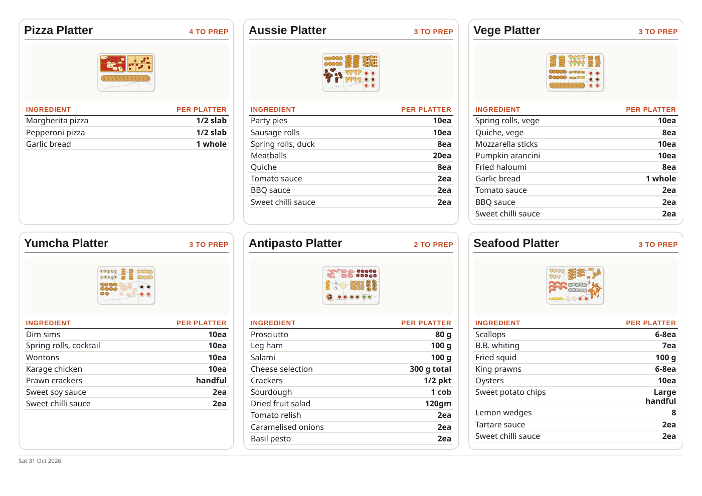

# Function printing

Approved by the head chef on 25 Oct 2026: Layout 2, the timed run sheet. This supersedes the older no-print decision for functions.

## User contract

- Everyone with the kitchen PIN can use **Print function** on the kitchen function sheet, including its popup, and **Print run sheet** in Service View.
- Function managers also have **Print function** in Create Functions, the edit form and the confirmation review. Existing permissions to create and edit are unchanged.
- The form prints its current input, including a time still being typed. It does not save or confirm. New and changed forms say **Draft / not saved**. An incomplete draft shows TBC and the outstanding fields.
- A saved function prints every round, including rounds already sent. The day run sheet includes confirmed functions dated today and overnight functions with a round today, ordered by first food time. Each function starts a new sheet. Every round for each selected function is included. Drafts and cancelled functions are excluded from this day copy.
- An individual cancelled copy is labelled **Cancelled / do not send**. Overnight rounds show their date and next-day label.
- The print layout is A4 portrait with the book's Barlow and Barlow Condensed fonts and system fallbacks. It includes event name, date, event start, guests, area, food service times, booked quantities, each round's quantities and note, sent marks, totals, service and dietary notes, kitchen comment and its saved author, version, last change and Queensland print time.
- A long booking or note continues onto more pages. Never truncate it or reduce all the words to fit one page.
- Booking contacts, app navigation and interactive controls are excluded. Paper ticks do not change the book.
- A cached kitchen copy carries its last-read time and a warning to check the latest changes. Printing does not turn a failed read into an empty schedule.
- The native dialog supports a printer or the browser's Save as PDF option. A missing or failed print API gives a visible message and permits retry. Closing the dialog restores the current screen and unfinished form.

## Implementation boundaries

`js/functions.js` builds a print-only snapshot under `#fn-print`, calls the native print API and cleans it up on `afterprint` or a return to the window. The snapshot stays separate from live screen updates. The function editor flushes pending local input and hands only the kitchen document shape to that printer. It does not pass `fncontact`.

The shared print code is already in the shell through `js/functions.js`. No new runtime dependency, service, Firestore read, listener, write, collection, field or persistent cache is added. `FE_API` and the editor's `API` are both 6 after the cancellation-access change. Print CSS uses a named A4 page so it does not change other browser print views.

## Verification

`tests/function-print.test.js` exercises staff printing, the full service day, overnight dates, offline warnings, current unsaved input, contact exclusion, escaped text, incomplete drafts, retry, empty schedules and large bookings. It renders real Chromium PDFs to check A4 dimensions, page count and complete long notes. The existing Functions journeys, screen widths, permissions and read-budget checks must also pass.

## Rollback

Revert the feature pull request on a fresh branch and redeploy Pages. No saved data or database rules need rolling back. The old editor and app API versions must be restored together.

## Platter prep tiles (31 Oct 2026)

**Print prep sheet** sits under Today and each upcoming date on Functions (`#/fn`), and beside Print run sheet in Service View (`#/fn/now`). Each button prints its labelled day. Empty days have a disabled button.

The print tiles follow the page design: Barlow and Barlow Condensed type, orange quantity accents, rounded white cards, warm neutral borders and a pale drawing panel. Ingredient quantities are bold and aligned for quick scanning.

The A4 landscape copy shows the book's platter references as tiles in three columns. Each tile contains only the platter name, drawing, ingredients, quantities per platter and total platters to prep for the selected day. All Functions platters stay visible, including zero-booked references, plus any booked recipe no longer in the catalogue. There is no page title, introduction, function overview, ingredient explanation or recipe description. The selected date is in a small footer. The normal six-platter menu fits one page with readable ingredient text. Long ingredient lists continue without clipping.

Totals include every confirmed function with food on the selected day, including completed functions and already-sent rounds. Overnight functions contribute only rounds on that day. Undated rounds belong to the booking date. Drafts and cancellations are excluded. Ingredients use current recipe quantities without multiplying or guessing amounts. Square-bracket amounts stay unconfirmed. Missing recipes or drawings say so. Existing portrait run sheets remain available for function names, round times and service and dietary notes.

The tiles share the native print lifecycle, offline/source warning, retry and access gate. Printing uses only already-loaded function, recipe and drawing data. SVG is cleaned again at print time. No reads, writes, rules, caches, contacts or new dependencies are added. `tests/function-prep-print.test.js` verifies real A4 PDFs, daily and overnight totals, upcoming-day buttons, current and missing recipes, drawings, safe text, long ingredient lists, screen widths, empty days and the read/write budget.

Example with synthetic bookings:

