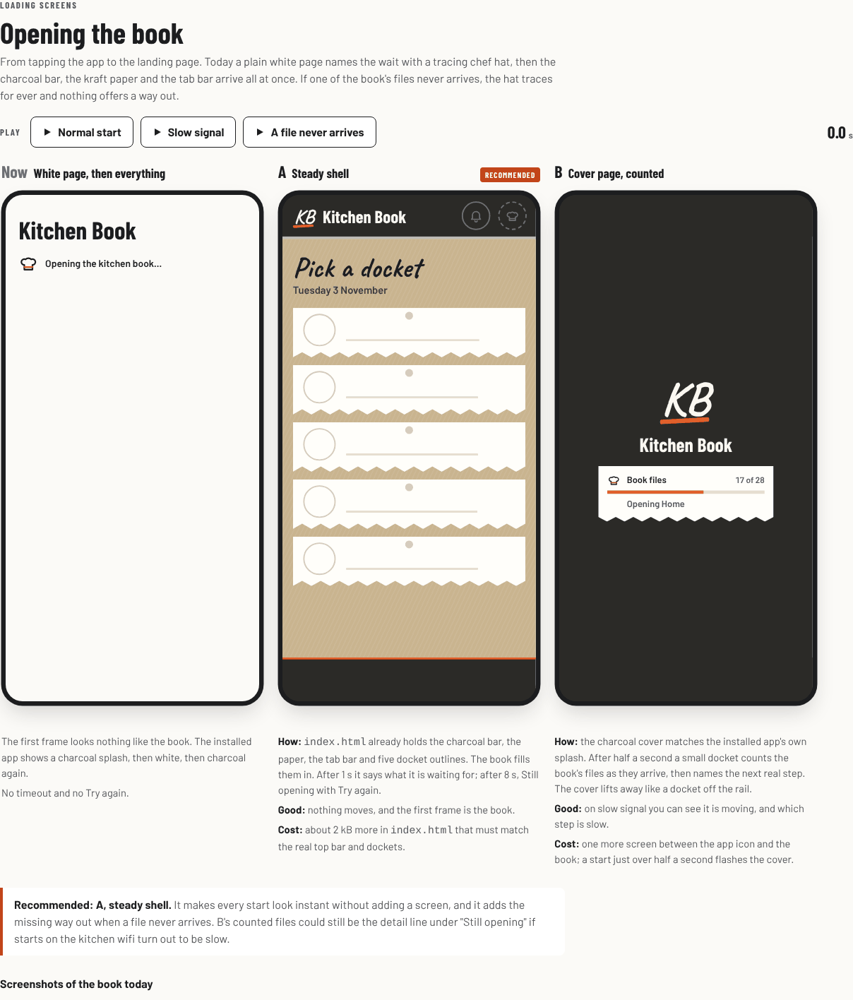
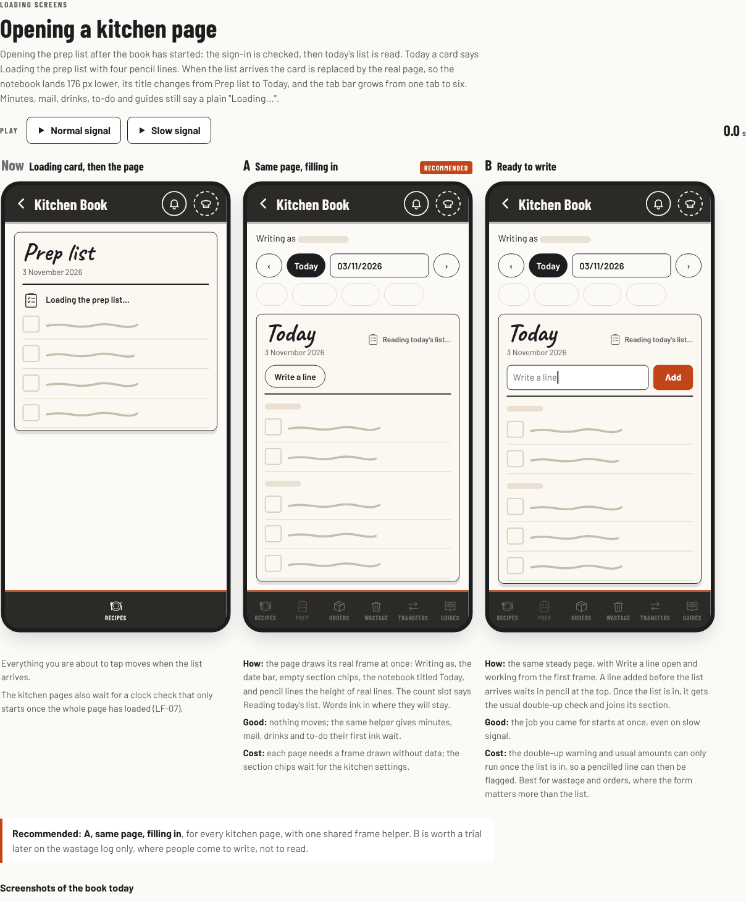
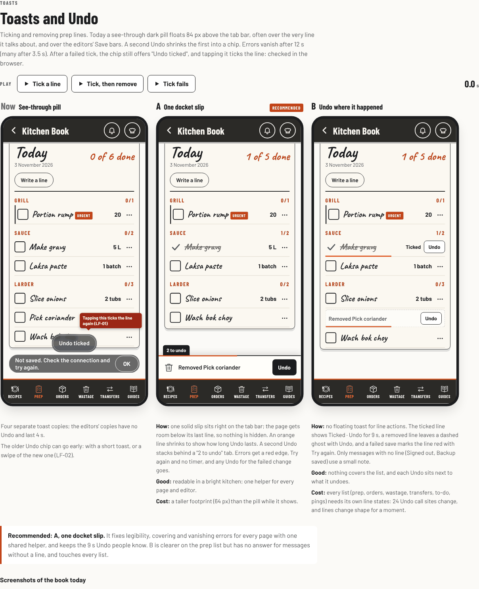
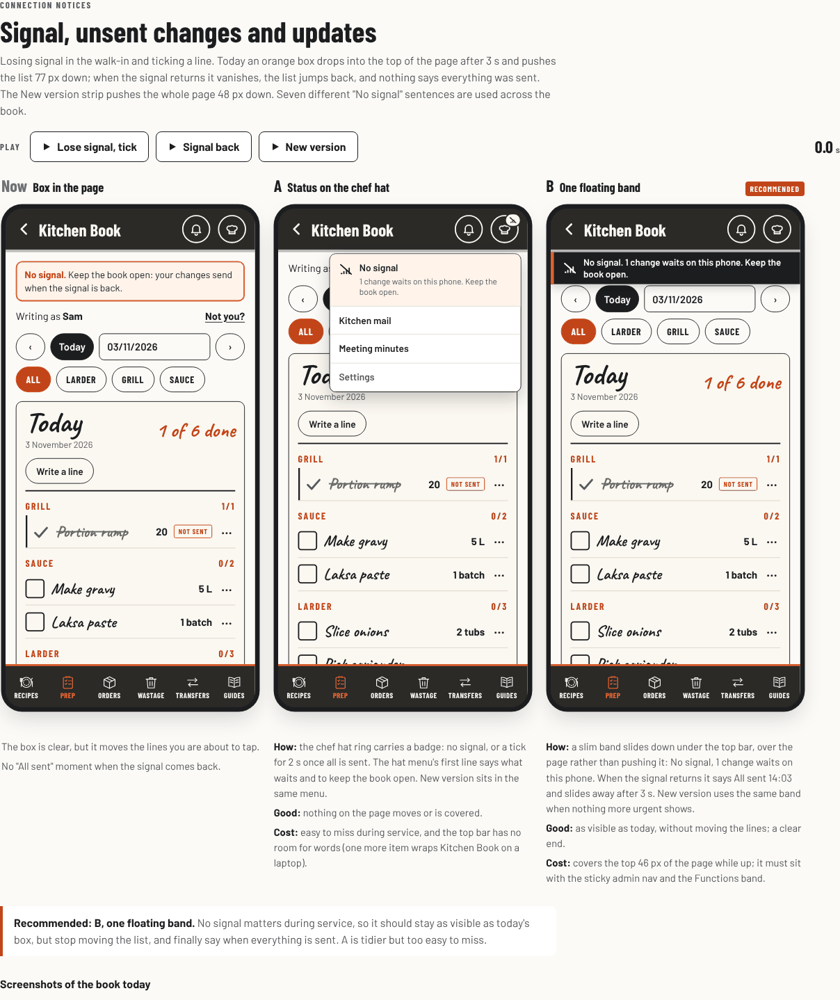
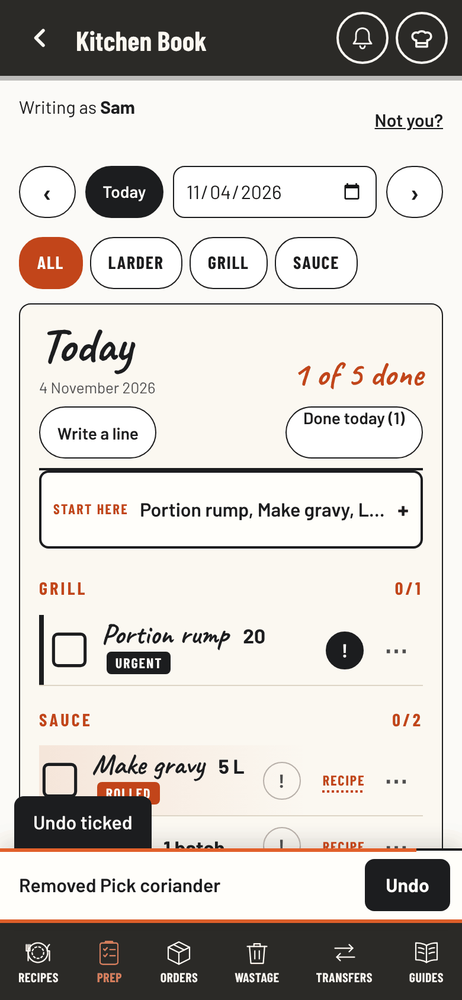
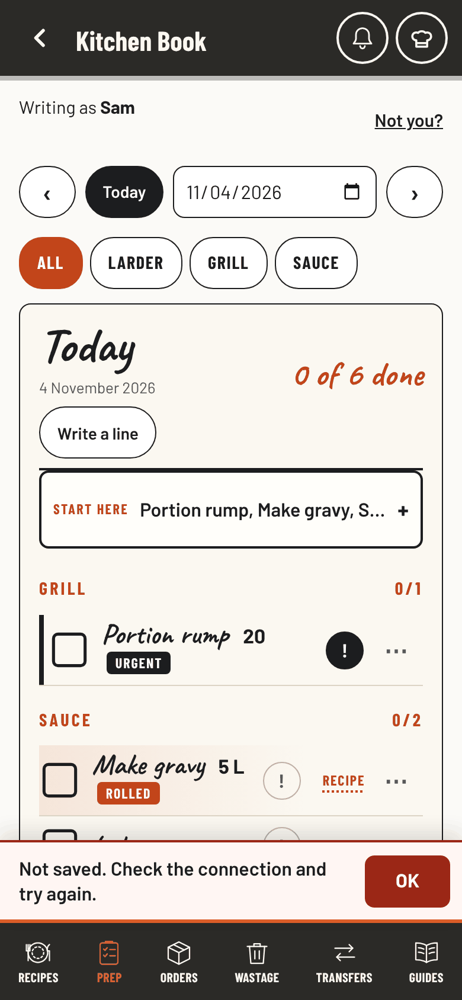

# Loading and feedback proposals

Requested 4 November 2026: upgrade the loading screens, the speed the book feels, and the toasts and messages around them, with two redesigns for each where it makes sense. **Selected 4 November 2026: the recommended set.** A for opening the book, opening a kitchen page, taps, saving and toasts; B, the floating band, for signal and updates. The build follows the steps under "Build steps", each in its own pull request.

Every option builds on **Ink in motion** (`docs/loading-motion.md`, approved 3 November 2026). The traced icons, the pencil placeholder lines, reduced motion, and the rule that a tick or Saved only shows after the server confirms all stay. Two designs per moment, as asked; the whole-app audit brief's default of three was not used.

Open `index.html` to play each moment on three phones side by side (today, A, B) under one clock. All lines, names and times in it are examples.

## The six moments

| Moment | What goes wrong now | A | B | Recommended |
| --- | --- | --- | --- | --- |
| Opening the book | A white page, then the whole book drops in at once. If a file never arrives the chef hat traces for ever. | **Steady shell.** `index.html` draws the charcoal bar, the kraft paper, the tab bar and the docket outlines; the words ink in. After 1 s it names the wait; after 8 s, Still opening with Try again. | **Cover page, counted.** The charcoal cover of the installed app, with a small docket counting the book's files, then the next real step. Shows only after 0.5 s. | A |
| Opening a kitchen page | A loading card is swapped for the real page: the notebook lands 176 px lower, its title changes, the tab bar grows from 1 to 6 tabs. Minutes, mail, drinks, to-do and guides say a plain "Loading...". | **Same page, filling in.** The real frame from the first frame: Writing as, the date bar, empty chips, the notebook titled Today, pencil lines the height of real lines. Words ink in place. | **Ready to write.** The same steady page with the add box working at once. A line written before the list arrives waits in pencil, then gets the double-up check and joins its section. | A (B worth a trial on Wastage only) |
| Taps and page changes | The first Recipes of a visit: 0.5 to 1.2 s with nothing new on screen after the press. | **Answer the tap first.** The tab, heading, search and chips show in the tap's frame; the shelves draw first-screen first. A 120 ms fade, none with Reduce motion. | **Start before the tap.** Recipes is drawn off screen while the landing sits idle, so the tap shows the whole page at once; Back keeps both pages. | A |
| Saving a form | "Saving..." shows twice (pings, deliveries). Success and failure are the same grey text. Slow-save notes start after 3, 4, 5 or 10 s. | **The button tells the story.** Saving at the same width, Saved with a tick for 1.2 s after the server confirms, Try again with a red line that stays. One line after 4 s: Waiting for the signal. | **Saved stamp.** A handwritten stamp on the record: Saved 14:02, On this phone only, or Not saved, words kept. It stays on the record for the shift. | A |
| Toasts and Undo | A see-through pill 84 px up, over the line it is about and over the editors' Save bars. Errors vanish. A stale Undo ticks the line (LF-01). | **One docket slip.** A solid slip on the tab bar, the page makes room for it, an orange line shows the Undo time, "2 to undo" keeps both. Errors have a red edge, Try again and no timer. | **Undo where it happened.** The ticked line shows Ticked · Undo, a removed line leaves a dashed ghost with Undo, a failed line turns red with Try again. A small note only for messages with no line. | A |
| Signal and updates | The No signal box pushes the list 77 px down, then vanishes with no "all sent". The update strip pushes the page 48 px. | **Status on the chef hat.** A badge on the hat ring; the hat menu explains it. New version in the same menu. | **One floating band.** A slim band slides over the top of the page instead of pushing it, says All sent 14:03 when the signal returns, and carries the update offer when nothing more urgent shows. | B |

Why these picks:

- **Opening, A.** Every start looks instant and nothing moves, without adding a screen. B's counted files can become the detail line under "Still opening" if starts on the kitchen wifi prove slow.
- **Pages, A.** One frame helper also gives minutes, mail, drinks and to-do their first proper wait. B needs the double-up warning and usual amounts to wait for the list, which suits the wastage form more than the prep list.
- **Speed, A.** It helps every tap, costs nothing on phones that never open Recipes, and is easy to measure. B spends work and memory on every phone, the shared tablet included, for a page that may not open.
- **Saving, A.** One helper fixes the double Saving, the grey errors and the four slow-save times. B's stamp could be added later to records people come back to (minutes, deliveries).
- **Toasts, A.** One helper fixes legibility, covering and vanishing errors on every page, editors included, and keeps the 9 s Undo people know. B has no answer for messages without a line and touches 24 Undo call sites across six lists.
- **Signal, B.** No signal matters during service, so it stays as visible as today, but stops moving the list and finally says when everything is sent. A is tidier but easy to miss, and the top bar has no room for words.

## Findings

Source read across `js/`, `index.html`, `css/app.css` and `sw.js`, and browser checks with the click tests' stand-in for Firebase. Fix needs no design choice; Design is what the options answer; Speed and Tidy are for later small pull requests.

| ID | Kind | Finding | Evidence |
| --- | --- | --- | --- |
| LF-01 | Fix | **A stale Undo reverses itself.** After a tick fails to save, the older toast's chip still says "Undo ticked". The line is not ticked, and tapping the chip ticks it. | Browser, stand-in with writes refused: stored `done` false after the failure, true after tapping the chip. `toast()` keeps the older action in `S.toastOld`; `failed()` does not remove it. |
| LF-02 | Fix | **The older Undo can go early.** README says it stays 6 more seconds. It goes with a following 3.5 s toast (`toastHTML()` draws nothing without a new toast) and with any swipe or scroll of the new one (`toastAway()` always clears it). | Source, `js/prep.js` toast block. |
| LF-03 | Design | **Pages jump**: opening page to the book; the prep loading card to the page (176 px, title change, tabs 1 to 6); the No signal box (77 px); the update strip (48 px); the recipe status line; drawings arriving on a recipe card; the module loading note to the module page. | Screenshots at 390 px; source. |
| LF-04 | Design | **Toasts cover what they are about**: 84 px up on a phone over list lines and over the sticky Save bars at 68 px (`.mg-bar`, `.fe-bar`, admin save); hidden behind any open sheet; seasonal particles draw over them. | Screenshots; `css/app.css` z-index and bottom offsets. |
| LF-05 | Design | **Errors vanish.** About 30 refusals and failures are short toasts: "Sign-out could not finish. Close this tab before handing over the device." 3.5 s; editors' "Not changed" 4 s; function cancel failures 5 s. A failed "Sent" tick in functions shows nothing. | Source, call sites listed in the audit notes. |
| LF-06 | Tidy | **Errors look like success, status like an error.** Seven message slots show "Could not save" in the grey `.saved` style; "Checking your PIN..." uses the red alert style. | Source. |
| LF-07 | Speed | **Kitchen pages wait for a late clock check.** The server time check (`lkHead()`) starts only after the window `load` event, and kitchen pages show "Loading..." until it answers (`bodyHTML()`, `S.pin && !T.ready()`): up to 8 s on a hanging connection, 10 s fallback, even when everything else is ready. | Source. Measure on a real phone before changing it. |
| LF-08 | Design | **The opening page has no way out.** If a deferred file fails, the chef hat traces for ever. | Source, `index.html`. |
| LF-09 | Tidy | **Four toast copies**: the prep toast, the landing toast (`plainToast()`), and identical copies in `js/manage.js`, `js/draw.js` and `js/fnedit.js` (4 s, no Undo). Two can show at once. Already WA-10 in `docs/ux-council-audit.md`. | Source. |
| LF-10 | Tidy | **One wait, many names.** The sign-in check reads "Loading...", "One moment...", "Checking who is signed in on this device...", "Checking your kitchen sign-in..." or "Checking your access...". Seven "No signal" sentences; six endings after "Not sent yet."; Team says 30 days and Insights 60 for the same read. | Source. |
| LF-11 | Tidy | **Plain "Loading..." where Ink in motion did not reach**: minutes, guides list, mail, drinks, to-do, past pings, the waste review, `#/fn`, the proofreader, admin subsections. Pencil line counts vary from 0 to 5. `ink-reveal` and `.is-loading` are unused. | Source. |
| LF-12 | Tidy | **Saving says too much and too little.** "Saving..." twice on pings and deliveries; no button ever says Saved; the cut-off Save has no busy state; the backup button changes width as its words change. | Screenshot; source. |
| LF-13 | Tidy | **Dead ends.** The admin workspace and proofreader load errors need a full reload (no Try again); the missing-days and export failures have no Retry; "Reload the book..." in the function editor has no button. | Source. |
| LF-14 | Speed | **A heavy first visit.** 4.0 MB of script and style (807 kB compressed) before the first page: `js/art.js` 1.6 MB, `js/prep.js` 0.9 MB, the seasonal scripts about 0.9 MB. Later visits come from the saved book. | Measured file sizes. Any move needs measuring first (CLAUDE.md, Loading). |
| LF-15 | Tidy | **Undo shorter than the rules allow.** Ticked has Undo for 9 s, the rules let the same person untick for 110 s; a cancelled function has Undo for 9 s against 2 minutes. | Source. |
| LF-16 | Tidy | **One success before it is true.** "Signed out. Hand the phone over." shows before the Google sign-out finishes; its failure toast can follow. | Source, `js/prep.js` sign-out. |

## Measured baseline

`main` at `01227ea`, served locally, headless Chromium with the CPU slowed 4 times, the click tests' Firebase stand-in (answers in about 5 ms), synthetic data. Real Firestore, App Check and sign-in add network time these numbers leave out. Medians of 3 to 5 runs.

| Measure | Result |
| --- | --- |
| Reload to the landing dockets | 0.34 s |
| Reload straight to the prep list, until its lines show | 0.65 to 1.2 s, the loading card visible every time |
| Landing to Recipes, first of the visit | 0.47 to 1.2 s |
| Landing to Recipes, later | 0.35 to 0.49 s |
| Landing to a recipe card | 0.08 to 0.26 s (the first of the visit is the slowest) |
| Landing to Prep, first / later | 0.48 to 1.35 s / 0.05 to 0.1 s |
| Landing to Orders or Wastage, first / later | 0.16 to 0.23 s / 0.03 to 0.04 s |
| Startup script and style | 4.0 MB, 807 kB compressed |

Not yet checked: a real phone, an iPhone, real Firebase latency, a screen reader.

## Shared groundwork, whichever is picked

- **One toast helper and one save-state helper**, used by every page and editor, keeping the cached-module compatibility rules (`MG_API`, `FE_API` and the optional-helper fallback in `docs/loading-motion.md`). If it is a new startup file it joins `SHELL`, both `js/upkeep.js` lists and the saved-shell manifest (`docs/saved-shell-generations.md`).
- **Same words for the same wait.** Opening (files and editors), Reading (kitchen data, replacing most "Loading..."), Checking (sign-in and access), Saving or Sending (writes; Sending for mail only). Three "No signal" sentences: the page waits, a change waits, a read failed.
- **How long things stay.** A confirmation 4 s. Undo 9 s, as now. An error until OK, Try again, or the problem is gone, never a timer. A slow-save note after 4 s everywhere.

## Limits every option keeps

- No new Firestore reads, listeners or polling; the reads budget test stays as it is.
- Nothing private kept on the phone. The steady frames use only what the device already knows (its profile and the date), never cached lines.
- Saved or Sent only after the server confirms; an answer from the cache is never "nothing there" (CLAUDE.md, Changes that went wrong before).
- Reduce motion removes traces, slides and fades; a known offline stops decorative traces.
- Every message stays in Australian English, short, with no em dashes.

## Build steps (the recommended set)

Small pull requests in this order, each with click tests at 390, 768 and 1280 px, the reads budget check and reduced motion. The shared helpers and words from the proposal ride with the step that first needs them, so no pull request changes code without changing what the team sees.

1. **Fix the stale Undo** (LF-01, LF-02), built 4 Nov 2026 with this record: a failed save takes its own Undo with it, a Ticked Undo only ever unticks, and the older Undo keeps its full time. `tests/stale-undo.test.js`: 6 failed of 19 on the old code, 0 of 19 with the fix.
2. **Toasts: the docket slip** (LF-04, LF-05), built 4 Nov 2026 with this record, on every page, the editors and the landing included, since all four toast copies share the same classes. Errors get a red edge and stay until OK. The editor copies stay separate for now (WA-10); their error toasts get the staying error look with step 3's editor follow-up.
3. **Saving: the button tells the story** (LF-06, LF-12), form by form, starting with pings, minutes and deliveries, with the save words from the wording table.
4. **Signal: the floating band**, with All sent and the update offer (LF-03 for the box and the strip).
5. **Opening and pages: steady shell and same page, filling in** (LF-03, LF-08, LF-10, LF-11). Touches `index.html` and the saved-shell lists, so it goes alone.
6. **Speed: answer the tap first**, Recipes drawn in pieces, measured before and after on the same slowed phone. LF-07 (the late clock check) measured alongside it.

Rollback for each is a revert of its own pull request; none of them writes new fields or needs a rules change.

## Files

- `index.html`: the six moments, each with today, A and B playing side by side under one clock, the findings, the groundwork and the build order. Works at 390 px (one phone at a time, swipe for the next) and on a laptop (three across).
- `previews/now-*.png`: the book today at 390 px with real fonts and synthetic data.
- `previews/options-*.png`: each moment's strip at 1280 px.

Checked: no sideways scroll at 390 and 1280 px, no script errors after playing every moment, real Barlow, Barlow Condensed and Caveat fonts.

| Opening | Pages | Toasts | Signal |
| --- | --- | --- | --- |
|  |  |  |  |

Built (steps 1 and 2), 390 px with synthetic data:

| Two Undos | A save that failed |
| --- | --- |
|  |  |
