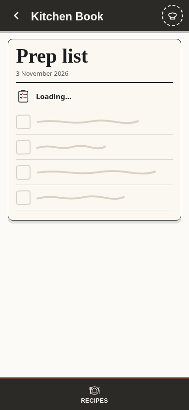
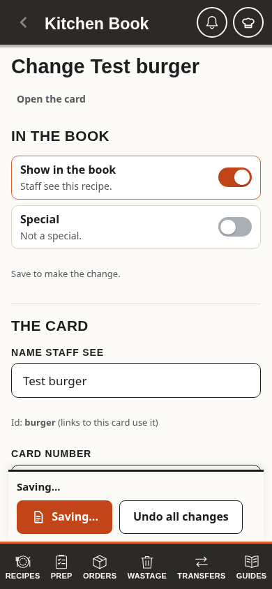

# Ink in motion

The owner selected **Ink in motion** and approved release on 3 November 2026. It keeps the book's cream paper, charcoal drawings, orange ink, existing type and page layouts.

The actual phone notebook during startup and recipe editor during a held save, using synthetic data:

## Behaviour

- The initial HTML names the book and the wait before the deferred app scripts run.
- Active waits trace only a detail of the matching native icon, on a 1.8 second cycle with a rest. The base drawing stays visible. A prep checkmark never suggests an unconfirmed completion.
- First list loads use decorative handwritten placeholder rows in the existing notebook. They are hidden from assistive technology. Loaded recipes remain usable during their existing background check; its status changes without replacing the search field or results. Very short recipe checks do not flash a message.
- Lazy editors, reports, access checks and update checks name the actual work. Offline and failure messages remain actionable and static.
- Busy save buttons keep a stable minimum width and touch height. Existing pending flags prevent repeat submission. A confirmed check is shown only in existing success branches after the write resolves. Drafts and queued-write warnings keep their existing meaning.
- Guide preparation counts completed pages. Guide saving counts acknowledged page writes, any old-page cleanup and the final guide record. It cannot reach completion while the final record is still pending. Unknown totals show a named wait without a percentage.
- Landing dockets have one small entrance per page session. Reduced motion removes tracing, entrances and progress transitions. A known browser offline event immediately stops active decorative traces, without triggering reads or retries. Pending operations keep their busy markup even when rendered offline, so the same icon resumes on reconnection. Settled errors and offline results remain still.

## Implementation boundaries

`js/motion.js` exposes escaped `icon`, `label`, `status`, `skeleton` and `progress` markup. It owns no requests, timers, observers, storage or save state. `js/boot.js` maintains a presentation-only offline class. Existing code decides when each wait starts and ends.

The helper is in the HTML, service worker shell and both update file lists. Lazy modules use an optional helper with a plain-text fallback for an older saved shell. Their URL revisions advance, while compatible module API numbers stay unchanged.

Saved generations carry their own immutable file manifest. This lets the last complete pre-motion generation remain a valid fallback even though it has no motion helper. New generations still require every file, including the helper. Activation retains the last validated complete generation. See [saved shell generations](saved-shell-generations.md).

There are no new Firestore reads, listeners, rules, fields or private caches. Recipe status uses the existing bounded sync and emits a presentation event on completion even when no recipes changed. Guide progress wraps the existing sequential writes; their order and contents are unchanged.

## Verification and rollback

Focused browser tests exercise delayed first reads, offline recovery, pending saves, failed writes, old-shell helper fallback and staged guide acknowledgements with synthetic data. The full click suite and required GitHub checks gate release. Browser checks use Firebase stand-ins and do not write kitchen data.

Revert the presentation changes to remove the motion, retaining the manifest-aware service worker validation and its complete-generation fallback. No rules publication or kitchen data migration is required. Follow the compatible rollback contract in [saved shell generations](saved-shell-generations.md).
