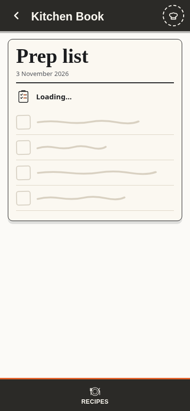
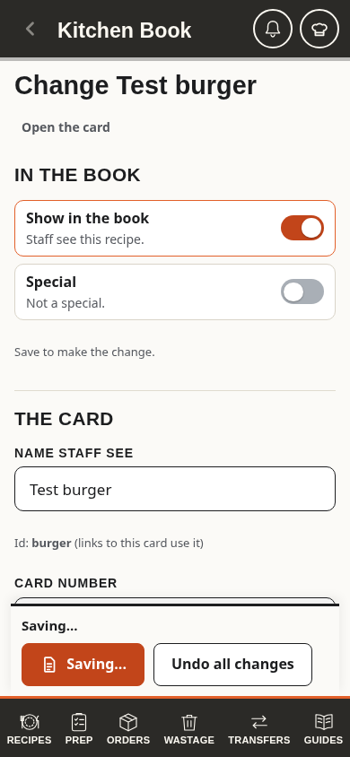

# Ink in motion

The owner selected **Ink in motion** and approved release on 3 November 2026. It keeps the book's cream paper, charcoal drawings, orange ink, existing type and page layouts.

The actual phone notebook during startup and recipe editor during a held save, using synthetic data:

## Behaviour

- The initial HTML names the book and the wait before the deferred app scripts run.
- Active waits trace only a detail of the matching native icon, on a 1.8 second cycle with a rest. The base drawing stays visible. A prep checkmark never suggests an unconfirmed completion.
- First list loads use decorative handwritten placeholder rows in the existing notebook. They are hidden from assistive technology. Loaded recipes remain usable during their existing background check; its status changes without replacing the search field or results. Very short recipe checks do not flash a message.
- Lazy editors, reports, access checks and update checks name the actual work. Offline and failure messages remain actionable and static.
- Busy save buttons keep a stable minimum width and touch height. Existing pending flags prevent repeat submission. A confirmed check is shown only in existing success branches after the write resolves. Drafts and queued-write warnings keep their existing meaning.
- Guide preparation counts completed pages. Guide saving counts acknowledged page writes, any old-page cleanup and the final guide record. It cannot reach completion while the final record is still pending. Unknown totals show a named wait without a percentage.
- Landing dockets have one small entrance per page session. Reduced motion removes tracing, entrances and progress transitions. A known browser offline event immediately stops active decorative traces, without triggering reads or retries. Pending operations keep their busy markup even when drawn offline, so the same icon resumes on reconnection (4 Nov 2026, replaces #462). Settled errors and offline results remain still.

## Top bar feedback, 9 November 2026

Today's team and the active Operandio clock use the existing icon tilt on mouse hover and held presses. Their targets stay in place at their existing size. Both the chef link and staff button clear touch feedback on release, cancellation or a drag away. Only the timer's clock drawing moves; its progress ring, countdown, disabled button and read-only finished status stay still. Reduced motion removes the tilt and compression. This repairs missing coverage in the shared control styles and pointer handler, without changing timer actions or team navigation.

Synthetic browser captures: [team hover](images/topbar-feedback/team-hover.png), [timer hover](images/topbar-feedback/timer-hover.png). The regression checks mouse and touch input, fixed targets, reduced motion, pending writes and the read-only countdown. It fails 14 of 36 checks on the original source and passes all 36 with the fix.

## The first list after a cold start, 24 November 2026

The head chef found the Prep list stuck on Loading for a long time when the app first opens. On a phone that opens with a saved daily session the book waited for three server answers one after another: the sign-in roster, then the kitchen's settings, then the page's own list. The list was only asked for once the settings had come in.

Now the page's own list (prep, orders, wastage or transfers) is asked for at the same moment as the kitchen's settings (`listsMay()` in `js/prep.js`). The roster has already said this person may open the kitchen pages, and the rules check the same session for both reads. The page still shows Loading until the settings are in, so nothing shows sooner than before. Each list keeps one listener: the settings' answer finds it running and leaves it. What a list's watcher starts after it starts with it too, under the same gate: the wastage summary, and on Transfers the loans still out and the transfer summary.

Measured on the test stand-in with a slowed phone (4x CPU), from the Loading card to today's lines, median of 5: 0.93 s to 0.64 s with 300 ms server answers, 1.81 s to 1.18 s with 600 ms (a weak kitchen signal). Synthetic timings, not live usage. The Firebase sign-in, App Check and the connection set-up before the first answer are unchanged and come on top on a real phone. No new reads, rules, fields or saved copies. `tests/cold-start.test.js` holds the settings' answer back on Prep, Orders, Wastage and Transfers and checks the list came in meanwhile, nothing showed, one listener ran, and the summaries and loans still out were read: 4 failed of 22 on the old order, 0 of 22 now.

## The words and a long wait, 24 November 2026

Chosen by the head chef after the council ([brief](loading-wait-options/brief.md)). The loading card names the step instead of "Loading...": "Connecting to the kitchen book" (the clock, the Firebase files, the sign-in and the roster), then "Getting today's prep list" (order list, wastage, transfers; other pages "Opening" and their name) while the kitchen settings and the list are read together. Past 1.5 s the four placeholder rows breathe together, from their resting shade down and back, never darker (boxes 0.55, lines 0.65), on the icon's 1.8 s rhythm. This extends "Ink in motion" (only an icon detail traced) by the head chef's choice, against the council's advice. Past 8 s the card says "Still waiting for an answer from the kitchen book. You can use the recipes while you wait." and the rows and the icon rest. Reduce motion and a known offline stop the breathing; the words still change.

`waitHTML()` in `js/prep.js` owns the two timers (1.5 s and 8 s, each only redrawing the card while it is there) and the phase: `--ink-phase` comes from when the card first showed, so a redraw (the clock, the sign-in, each answer) carries the breath on. The wait ends once nothing on the page has waited for its first load for 0.4 s, so a draw or two of something else in between keeps it. Since 24 Nov 2026 the card also stays up from the roster's answer until the kitchen's settings are in (`bodyHTML()`): a page drawn from the roster alone, which carries no capability lists, showed Prep's read-only notice for a frame; `tests/loading-wait.test.js` checks it never shows (1 failed of 11 on the old code). Holding the page moved when Today's team asks for the week: today's own read (for the top bar's chip) now always answers first, and a week read that then failed marked today Could not load. A failed week read now leaves today's plan that came in (`tmPlanLoad()`); `tests/todays-team.test.js` checks it (1 failed of 134 without it). The test holds the page clock still from before the card shows and moves it only by `runFor` (24 Nov 2026): running in real time, Playwright 1.48's clock put itself back by a second after `runFor(1600)`, so the card was drawn again at 0.54 s and stopped breathing (2 of 56 runs at 6 to 8 at a time, 0 of 56 now; `docs/flaky-tests.md`, A jump the clock undid). `js/motion.js` is unchanged. `tests/loading-wait.test.js` holds the roster and the settings back and checks the words, the breathing from 1.5 s, the breath carried through a redraw, the 8 s line, the rows at rest, the list replacing the card and reduce motion: 7 failed of 10 on the old card, 0 of 10 now.

## Implementation boundaries

`js/motion.js` exposes escaped `icon`, `label`, `status`, `skeleton` and `progress` markup. It owns no requests, timers, observers, storage or save state. `js/boot.js` maintains a presentation-only offline class. Existing code decides when each wait starts and ends.

The helper is in the HTML, service worker shell and both update file lists. Lazy modules use an optional helper with a plain-text fallback for an older saved shell. Their URL revisions advance, while compatible module API numbers stay unchanged.

Saved generations carry their own immutable file manifest. This lets the last complete pre-motion generation remain a valid fallback even though it has no motion helper. New generations still require every file, including the helper. Activation retains the last validated complete generation. See [saved shell generations](saved-shell-generations.md).

There are no new Firestore reads, listeners, rules, fields or private caches. Recipe status uses the existing bounded sync and emits a presentation event on completion even when no recipes changed. Guide progress wraps the existing sequential writes; their order and contents are unchanged.

## Verification and rollback

Focused browser tests exercise delayed first reads, offline recovery, pending saves, failed writes, old-shell helper fallback and staged guide acknowledgements with synthetic data. The full click suite and required GitHub checks gate release. Browser checks use Firebase stand-ins and do not write kitchen data.

Revert the presentation changes to remove the motion, retaining the manifest-aware service worker validation and its complete-generation fallback. No rules publication or kitchen data migration is required. Follow the compatible rollback contract in [saved shell generations](saved-shell-generations.md).
