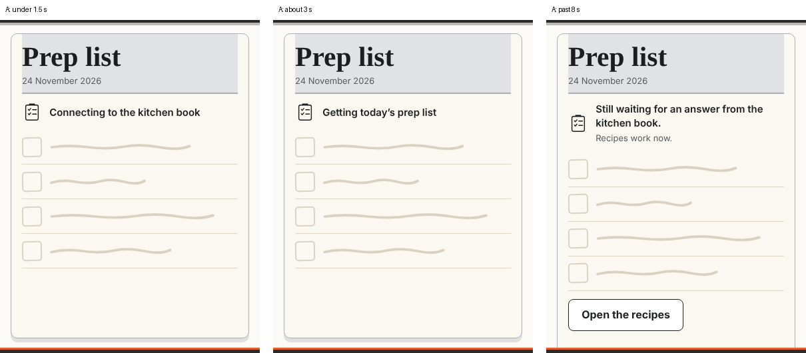
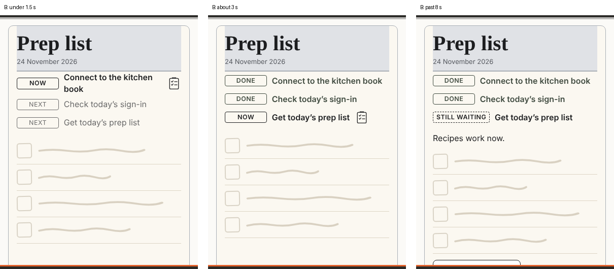
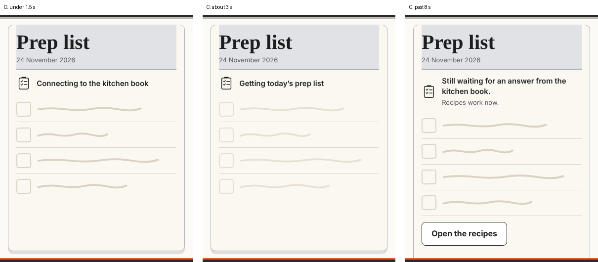
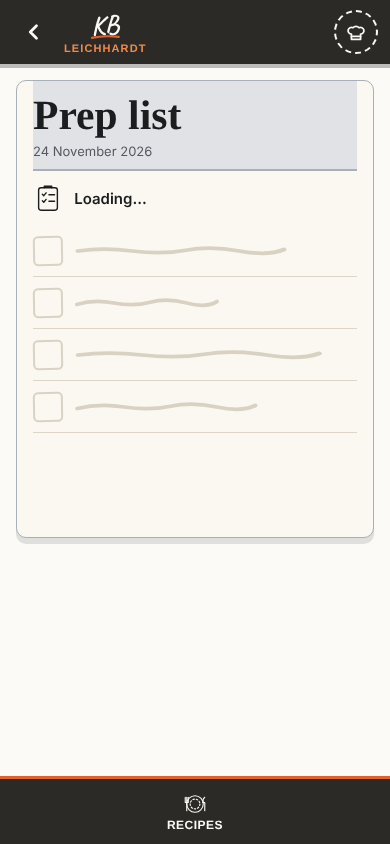
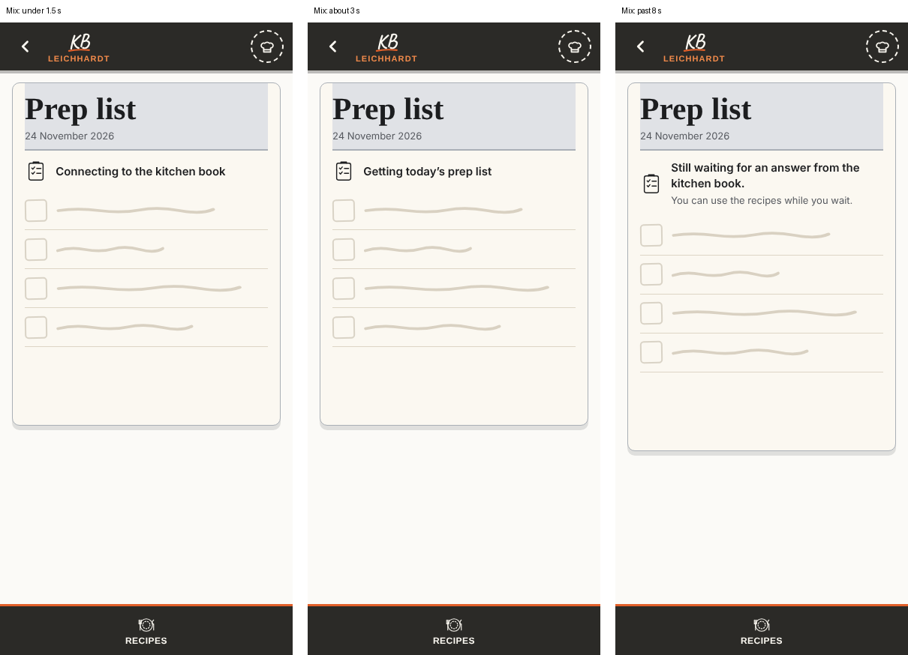

# Fewer reloads and a clearer long wait: the council's brief

Asked by the head chef on 24 November 2026: "now the app feels slow loading a lot of pages, whats the cause, can we find a great middle ground and maybe have the loading screen also show some kind of animation from the elements it already has while its loading longer?" Earlier the same day: "When I first start the app this loading screen loads for quite some time before I can see anything."

Status: chosen by the head chef on 24 November 2026 (see Chosen at the end). Built in small pull requests. This is role-based analysis, not research with real staff.

## What was measured

Source commit `086d78e` (main), 24 November 2026. Synthetic or source-derived unless it says otherwise.

| What | Result | How |
| --- | --- | --- |
| New versions a day | Wed 18 Nov 6, Thu 19 Nov 9, Fri 20 Nov 6, Sat 21 Nov 0, Sun 22 Nov 8, **Mon 23 Nov 36**, Tue 24 Nov 16 by 14:15 | Merges that change a file the phones load (`scripts/site-changed.sh` on each commit). An upper bound: queued publishes can fold into one deployment |
| When a phone moves to a new version | 2 minutes untouched (at most once an hour), brought back after 5 minutes away (at most once every 10 minutes), 04:00, and within 8 s of a fresh open if nobody touched the screen | `js/upkeep.js`; `docs/site-publishing.md` (Silent updates); `tests/saved-copy.test.js` "just opened: the book takes up the new version by itself" |
| The book's own start | 4.4 MB in 34 scripts (about 1 MB compressed). 4x slowed CPU: 0.7 to 0.8 s to DOMContentLoaded on the first load after an update, 0.5 s after | Local server, Chromium headless shell, Firebase blocked |
| Loading card to today's lines | 0.64 s with 300 ms server answers, 1.18 s with 600 ms | Stand-in, 4x CPU, median of 5 (`docs/loading-motion.md`, 24 Nov 2026) |
| Sign-in, App Check and connection on a real phone | Not evidenced | Needs the real kitchen; the head chef's screenshot shows a VPN key, so real answers may be slower than the stand-in |
| A reload's reads | 70 to 95 per phone | `docs/firestore-usage.md` |
| Moving between pages | Most open with no Loading; Orders, Wastage, Transfers one server answer the first time; Supplier order about 1 s; second visits instant | Stand-in, 4x CPU, 300 ms answers |

## Round 1: should we build it?

Proposal and evidence packet: the problem above, then two parts. Part 1, a middle ground: merges keep landing at any time, but a phone moves to a new version only at a quiet moment. Part 2: on a long wait, the card names the real step, and the placeholder rows are written in by the ink one after another.

**Verdict: Build smaller, 5 of 5.** Build Part 1 and the step words. Cut the rows written in one after another.

| Reviewer | Verdict | In one line |
| --- | --- | --- |
| Cook mid-service | Build smaller | Fewer reloads is the real win on the line; moving rows pull the eye mid-service. Give "a real rest" a hard number, about 30 minutes |
| Head chef | Build smaller | The problem is real and Part 1 saves reads; moving ink polishes a wait nobody has timed. Weigh batching publishes to set times |
| Skeptic | Build smaller | Take away the second start of a fresh open; Part 2 makes nothing faster and "the signal is slow" would guess at a cause |
| New starter | Build smaller | Fewer surprise reloads keep me where I was; step words must say what the book is doing, never sound like an instruction |
| Keeper | Build smaller | A fresh open after a publish starts twice; phones cannot tell an urgent publish; count real starts before changing `js/upkeep.js` |

Disagreement: none on the verdict. The head chef's and keeper's cheapest route is batching publishes (a workflow change); the skeptic and cook prefer changing when a phone takes the new version.

Contract fit (all five): Part 1 deliberately changes the 13 November silent-update rule, so it is the head chef's choice. The rows written in one after another depart from "Ink in motion" (only an icon detail traces) and suggest progress that is not real. Timers belong in `js/prep.js`, not `js/motion.js`.

### Break-it findings from round 1

| Scenario | Expected | Observed or hypothesis | Evidence | Smallest check |
| --- | --- | --- | --- | --- |
| Any cook opens the book after a publish (closed overnight, or the phone dropped it in the background) and waits without touching | One start | The saved copy starts, the new copy downloads behind it, and the page reloads within 8 s: two Loading cards, two sign-ins, the first start's reads partly wasted | Source-reviewed; the behaviour is the designed one checked in `tests/saved-copy.test.js`. Phone timing Risk / Not evidenced | Stand-in test at 600 ms answers counting starts and reads per fresh open with a new version |
| An urgent fix, then a plain change, then a phone comes back | It takes the fix | Phones see only Last-Modified and ETag, so they cannot tell an urgent publish | Risk / Not evidenced | A two-version test: urgent then plain |
| A phone used all service with no rest meets a stricter rules publish | Its writes are still accepted | Old code keeps sending the old shape; Not sent lines pile up | Risk / Not evidenced | The previous release's client shapes (`tests/rules/client-shapes.test.mjs`) against the new rules, or stricter rules always urgent |
| A slow wait while the clock, the sign-in and each answer redraw the card (`render()` replaces it) | Words change in place, any motion counts from the first show | CSS delays restart at each redraw; the 8 s line resets | Risk / Not evidenced | `tests/ink-prep.test.js`: redraws at 1.0, 2.0 and 2.5 s on the test clock; progress only forward, the 8 s line once |
| A new starter reads "Signing in" or "Opening the kitchen" | They wait | They look for a sign-in button, or think of opening hours | Risk / Not evidenced (role-based) | Plain words that say what the book is doing |

## Round 2: three designs

Previews (synthetic data, the real loading card's markup with stand-in fonts): `preview-a.html`, `preview-b.html`, `preview-c.html`, each with `?s=1` (first 1.5 s), `?s=2` (about 3 s) and `?s=3` (past 8 s). Screenshots at 390 px:

- A: 
- B: 
- C:  (the middle frame holds the rows at their faintest; the preview page plays the movement)
- Today: 

Common to all three: nothing from the list shows before the kitchen settings are in (as today); no new reads, listeners or rules; offline and failure cards unchanged; the words count from when the card first showed, not from each redraw; reduce motion keeps the words and removes any movement; the step names follow the page (Prep list, Order list, Wastage, Transfers).

### A: hold the publish (changes the least)

**Central idea:** fewer new versions, nothing new on the phones' update rules. **Updates:** merges still land at any time, but Publish site sends a new version to the phones only at two set quiet times, 15:05 and 22:35, plus at once for a pull request labelled `urgent`. The phones' rules stay as they are. **Card:** one line names the real step: "Connecting to the kitchen book" until the roster answers, then "Getting today's prep list". Past 8 s: a still line, "Still waiting for an answer from the kitchen book. Recipes work now.", and an Open the recipes button. Rows stay still.

- Pros: a workflow change only for Part 1 (`.github/workflows/publish-site.yml`, its test); at most two new versions a day (plus urgent), so at most two update reloads and two double starts per phone; Publish rules already follows Publish site, so rules and code stay together; urgent works because the publish itself knows the label.
- Cons: a fresh open right after a set time still starts twice; a finished fix waits up to 16.5 hours (22:35 to 15:05) unless labelled urgent (corrected in round 2); the deferred publish must compare with the last published version, not one merge.

### B: never start twice (rethinks when a phone moves)

**Central idea:** a phone never interrupts a start or a short break to update. **Updates:** publishes at any time, as now. A fresh open never reloads part way: the new copy waits on the phone and is used at the next fresh open. Brought back after 5 minutes away no longer reloads; after 30 minutes away it does. 2 minutes untouched (at most once an hour) and 04:00 stay. An urgent publish writes a small version note that the update check reads, so an urgent fix still applies on the next return. **Card:** a short list of the real steps, each with a word tag: Done, Now, Next: "Connect to the kitchen book", "Check today's sign-in", "Get today's prep list". Past 8 s the current step says Still waiting, with "Recipes work now." and Open the recipes. Rows stay still.

- Pros: removes the double start of a fresh open, which most likely explains "when I first start the app"; a cook coming back from a 5 to 30 minute break never lands on a reload; publishes stay immediate for the next fresh open; the step list shows real completed work.
- Cons: changes the updater itself (`js/upkeep.js`, a saved-shell file, with `sw.js` untouched), so the update tests change; a phone can run an older version longer, which widens the stricter-rules risk unless urgent is used; the step list takes about 70 px more and three lines to read; "Check today's sign-in" may read like an instruction.

### C: both, with a living wait (removes the most friction)

**Central idea:** the fewest reloads and a wait that clearly still works. **Updates:** A's two set publish times and urgent at once, plus B's "never start twice" and 30 minutes away. **Card:** A's one line. Past 1.5 s the four placeholder rows breathe together (all at once, never one by one, never darker than today, on a slow 2.4 s cycle), so the page looks alive without suggesting lines arriving. Past 8 s the movement stops and A's still line and Open the recipes show. Reduce motion: no breathing.

- Pros: the fewest reloads of the three; no double start; a gentle sign of life the head chef asked for, built from what is already on the card.
- Cons: the largest build (a workflow, the updater and the card: three pull requests); the breathing is a departure from "Ink in motion" (only an icon detail traces), the head chef's call; still frames cannot prove it is calm enough in a kitchen.

### How they differ

| | A | B | C |
| --- | --- | --- | --- |
| Where updates are held | On GitHub (publish twice a day) | On the phone (when it moves) | Both |
| Fresh open after a publish | Can still start twice (twice a day at most) | Starts once | Starts once |
| Coming back after 5 to 30 minutes | Can reload (twice a day at most) | No reload | No reload |
| Card hierarchy | One line | A list of three steps | One line |
| Motion | Icon trace only (as today) | Icon trace only | Icon trace plus rows breathing together |
| Long wait | Still line plus Open the recipes | The step says Still waiting plus Open the recipes | Still line plus Open the recipes |

### The numbers

| | Today | A | B | C |
| --- | --- | --- | --- | --- |
| Taps to the main job of each page | Unchanged | Unchanged | Unchanged | Unchanged |
| Placeholder rows seen at 390 px (Preview) | 4 | 4 | 4, about 70 px lower | 4 |
| New versions a day | 16 to 36 (Mon/Tue) | At most 2 plus urgent | 16 to 36 | At most 2 plus urgent |
| Starts per fresh open after a publish | Up to 2 | Up to 2 | 1 | 1 |
| Pull requests to build | | 2 (workflow; card words) | 2 (updater; card steps) | 3 |
| Files | | `publish-site.yml`, `js/prep.js`, tests | `js/upkeep.js`, a small version note, `js/prep.js`, tests | all of A and B, `css/app.css` |
| New reads, listeners, rules | | None | None (the update check reads a tiny file instead of a header) | None |
| Relearning | | None | Small (the step list) | None |
| Risk | | Low | Medium (the updater) | Medium |

Implemented-app checks still needed before release, for whichever is chosen: the complete page at 390, 768 and 1280 px; the redraw test above; reduce motion; and a real cold start timed on the head chef's phone (sign-in apart from the reads).

### Contract fit and references

| Check | A | B | C |
| --- | --- | --- | --- |
| Ink in motion (only an icon detail traces) | Works | Works | Needs work: a deliberate departure, the head chef's call |
| Name the actual work | Works | Works | Works |
| Silent updates (13 Nov 2026) | Works: unchanged on the phones | Needs work: a deliberate change, the head chef's call | Needs work: as B |
| Status without colour | Works: words | Works: word tags, dashed edge for Still waiting | Works: words |
| Contrast | Not evidenced (the preview reuses the existing ink colours and button) | Not evidenced (the Next tag text is lighter) | Not evidenced |

| Principle | A | B | C |
| --- | --- | --- | --- |
| Flighty: honest status from real steps | Works | Works | Works; the breathing must stop when the step is done |
| Duolingo: progress shows real work | Works | Works: completed steps are real | Needs work: motion is not progress, which is the point, but untested |
| Headspace: calm, plain words | Works | Needs work: "Check today's sign-in" | Works |
| Linear: one consistent frame | Works | Needs work: a second status layout | Works |

## Round 2 scores

Six fresh reviewers saw all three designs, the same packet and the previews. No numeric scores; each ranked the three.

| Reviewer | Ranking | Their recommendation |
| --- | --- | --- |
| Cook mid-service | A, C, B | A first, then B's fresh-open rule once a start count proves the double start. No breathing, no step list |
| Head chef | A, B, C | A plus B's single fresh-open rule, A's words, no breathing |
| Skeptic | B, A, C | B's update rule with A's one-line card; hold the set publish times until starts are counted |
| New starter | A, C, B | C without breathing (A's card and publish times plus B's fresh-open rule); "You can use the recipes while you wait" in place of "Recipes work now" |
| Keeper | A, B, C | A with two repairs (rules publish order; a waiting run for a skipped timed publish), then B's 8-second piece |
| Screen designer | C, A, B | C's updates with A's still card; if the breathing is wanted, last, on its own, at today's opacities and one rhythm |

Agreement: A's one-line card (6 of 6); no step list (6 of 6); no breathing now (6 of 6); B's "a fresh open never reloads part way" (5 of 6, the keeper after a start count). Disagreement: holding publishes to set times. Five include it; the skeptic would hold it until starts are counted. The head chef and the keeper note it reverses part of this morning's choice to keep the window open, and delays what the head chef sees live.

Corrections from round 2: A's wait for an unlabelled fix is up to 16.5 hours, not about 8. In C the boxes would peak darker than today (0.65 against 0.55). The step names are close to today's "Loading the prep list..." (`js/prep.js`) and Open the recipes already exists on the offline card (`offlineHTML()`).

### Break-it findings from round 2

| Scenario | Expected | Hypothesis | Evidence | Smallest check |
| --- | --- | --- | --- | --- |
| A or C: a pull request with stricter `firestore.rules` and new code merges at 10:00 while the site publish is held | The rules publish after the code is live | Published runs on a skipped deploy, so Publish rules would go at 10:00 ahead of the code; if Published is held instead, the 15:05 run looks only at the last commit, so rules followed by another merge never publish | Source-reviewed (`publish-site.yml`, `publish-rules.yml`); Risk / Not evidenced | A `tests/site-publish.test.js` case: rules held, a later merge, then the timed publish; the rules publish once, after Deploy |
| A or C: GitHub skips or delays the timed publish run | The held version goes out | Nothing publishes until the next run | `docs/auto-merge.md` records skipped timed runs; Risk | A waiting run, as the merge queue already has |
| B or C: a phone stays on the previous saved copy after a fresh open, then opens Suppliers, Manage or Print cards | The page opens | Lazy files load network-first, so a newer lazy file can meet the older shell | Risk / Not evidenced; the lazy pages' API numbers (`MG_API` and others) and their "workspace-version" message bound it | A saved-copy test with the shell at N and a lazy file at N+1 |
| B or C: a saved copy that breaks Prep, then an urgent fix, then a fresh open with a cook tapping | The fix within seconds, as today | With no reload part way, the touched page waits for its next open or rest | Risk / Not evidenced | `tests/saved-copy.test.js`: newer urgent version on a fresh open, touched and untouched |
| C: `render()` replaces the card mid-breath | A smooth fade | The cycle restarts at each redraw, a visible flash | Preview source; Risk | `tests/ink-prep.test.js` redraws at 1.0, 2.0 and 2.5 s |

## The mix of all three

| From | Part | Take or reject | Why | Principle |
| --- | --- | --- | --- | --- |
| A | One line that names the step | Take | All six; plain words, one frame | Headspace, Linear |
| A | Still line past 8 s | Take, reworded: "Still waiting for an answer from the kitchen book. You can use the recipes while you wait." | "Recipes work now" can read as "were broken" (new starter) | Headspace, Duolingo |
| A | Open the recipes button | Reject | Recipes is already on the tab bar during the wait (combined preview); a new button on a service page needs the head chef's OK | Linear |
| A | Publish to the phones at 15:05 and 22:35, `urgent` at once | Take as the last step, with the keeper's two repairs | The most reloads saved (five of six); the rules order and skipped runs must be fixed first | Flighty |
| B | A fresh open never reloads part way | Take | Removes the double start behind "when I first start the app" (five of six) | Duolingo |
| B | Step list with Done, Now, Next | Reject | A second status layout, wraps at 390 px, tags look like buttons, "Check today's sign-in" reads as an order (six of six) | Linear, Headspace |
| B | 30 minutes away before a return reloads; the version note | Reject | With publishes held, few versions land in service; the note duplicates `urgent` and needs a workflow (keeper, head chef, cook) | |
| C | Rows breathing together | Reject for now | Six of six: motion is not progress, a departure from Ink in motion, restarts on redraw; the measured waits end before 1.5 s | Flighty, Duolingo |

All three blended (C with B's list) does not beat the recommendation: B's list repeats the status in a second layout and the breathing adds a contract departure for a wait nobody has timed long.

Combined preview: `preview-mix.html` (A's card with the reworded line, no button), shown with the real top bar and tab bar: . Review status: a lead synthesis of parts each reviewer assessed; the reworded line and the dropped button follow the new starter's, head chef's and screen designer's notes; the combined preview was not re-reviewed.

## Recommendation

**Recommend A's one-line card + B's "a fresh open never reloads part way" + A's set publish times as the last step.** No step list, no breathing.

Build in three small pull requests, each with a check that fails first:
1. The card names the step (`js/prep.js`): "Connecting to the kitchen book", then "Getting today's prep list" (by page); past 8 s, counted from when the card first showed, the still line. No change to motion. Test: redraws at 1.0, 2.0 and 2.5 s keep the words moving forward and the 8 s line once.
2. A fresh open never reloads part way (`js/upkeep.js`): the new copy downloads behind and is used at the next open or 2-minute rest. First a stand-in test that counts starts and reads per fresh open after a publish (expected 2 today, 1 after). Plus the old-shell, new-lazy-file check.
3. Publish to the phones at 15:05 and 22:35, `urgent` at once (`publish-site.yml`, `publish-rules.yml`), with the rules published once after their code is live and a waiting run for a skipped timed run. Merges still land at any time.

Why it wins: it removes the double start (the likeliest cause of the slow first open), cuts new versions from 16 to 36 a day to 2 plus urgent, keeps the card calm and truthful, and adds no reads. Main downside: a fix not labelled `urgent` reaches the phones up to 16.5 hours later, which partly reverses this morning's choice to see changes sooner; the merges themselves still land at any time.

For the head chef's choice: step 3 is a departure from this morning's always-open window, and the breathing the head chef asked for is not recommended now. If wanted, it can come last and on its own, at today's opacities and in step with the icon's 1.8 s trace.

## Chosen (head chef, 24 November 2026)

- **Card: words plus breathing.** One line names the real step; past 8 s the still line, "Still waiting for an answer from the kitchen book. You can use the recipes while you wait." No new button. On a long wait the four placeholder rows breathe together. This goes against the council's advice (six of six), so it is built with the screen designer's limits: never darker than today (boxes at most 0.55, lines at most 0.65), in step with the icon's 1.8 s trace, carried on from where it was when the card is redrawn (not restarted), stopped once the 8 s line shows, and none with reduce motion or when the browser says offline.
- **A fresh open starts once.** The new copy downloads behind and is used at the next open or 2-minute rest; no reload part way through a start.
- **Phones get new versions at 15:05 and 22:35**, `urgent` at once. Merges still land at any time. Built last, with the rules published once after their code is live and a waiting run for a skipped timed run.
