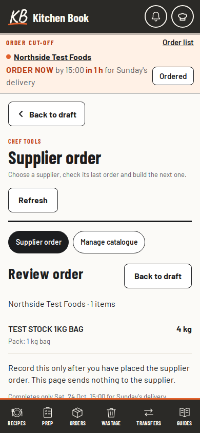
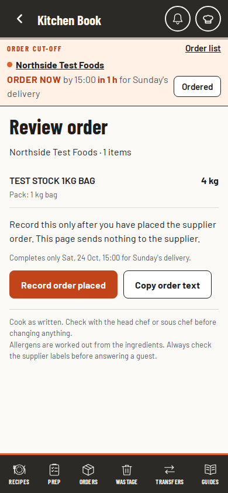

# Back actions

Accepted 24 Oct 2026. Keep the current layouts, fonts, buttons and permissions. Make it clear how to return from a
task without losing work. A back action never submits a form or records an order.

## Page return

Each task page has one 20 px arrow in the existing dark header, inside a transparent 44 px tap area. The arrow
replaces the book mark; the landing page keeps its mark and has no Back control. The header grows no taller for
Back. Its accessible label and tooltip name the destination, and its keyboard focus uses the book's existing
outline. Primary Save and Record controls keep their size. No separate return row, repeated editor footer or
floating recipe Zoom out control is added. Recipe hierarchy links stay available as quiet breadcrumbs.

The arrow returns through the pages opened in this run of the book. Opening or reloading a direct link starts a
fresh trail: a nested recipe returns to its parent, a guide to Guides, a function to Functions, a supplier to
Supplier order and a primary page to Kitchen Book. Editor tasks return to their parent form or list first.
Settings Done follows the same trail. Existing All recipes, All guides and navigation tabs still work.

Supplier review, item/par editing, supplier settings and import replace the workspace heading and tools with one
current-task heading. Returning restores the workspace, its supplier and its quantities. Supplier history keeps
its disclosure layout. The supplier sidebar remains collapsible in the workspace.

The route trail and scroll positions live only in memory. Browser history holds an opaque entry key, alongside
the existing sheet marker. It holds no form values, catalogue items or staff details. A contextual page return
skips a stale same-address sheet entry left by a link, so one press reaches the destination on its label. Ordinary
phone Back and Forward keep their normal history behaviour. The existing recipe shelf return still positions the
opened plate and keeps the recipe search and filters.

## Task return

| Task | Back behaviour | Unfinished work |
| --- | --- | --- |
| Supplier review or history | Return to its draft | Quantities stay in memory |
| Supplier catalogue, item, settings or import | Step to the containing catalogue, then order | A separate warning asks for a second Back press before discard; typing disarms it |
| Supplier pending save or uncertain recording | Keep the current step | Back stays unavailable until the outcome is known |
| Recipe or drawing editor | Return to recipe list or parent recipe | Flush the latest edit into the existing device draft before navigation |
| Function editor or review | Return to all functions or form | Keep the existing device draft, including a focused date or time entry |
| Chef staff, pings or minutes panel | Close the nearest editor or preview before its panel | Existing discard checks show a separate warning; unfinished ping or minutes drafts can be reopened |
| Guide editor | Return to Guides | Existing discard check shows a separate warning |
| Open sheet | Phone Back closes the sheet first | Closing does not save or mark a ping read |

Native close-first sheet handling covers guide zoom, shift pings, section selection, line actions, admin section
jumps, function details, wastage reasons and kitchen mail nudges. Close, Cancel, Escape and backdrops remove the
sheet's temporary history step. Admin jumps wait for that step to settle before scrolling, so native scroll
restoration cannot undo the jump.

Supplier drafts and catalogue forms remain private memory state. They clear on identity change and do not survive
a reload. A retained supplier form belongs to its original supplier; visiting another supplier cannot display or
save that form under the new supplier. Hidden forms cannot intercept Back, and an order review appears only for
its own supplier. A route opened during an unresolved order recording shows a recovery link to that review,
without controls that could replace its saved order identifier.

## Boundaries and evidence

No schema, rule, role, query, listener or persistent cache is added. Existing read budgets and save paths apply.
Date selection, search, filters and admin tabs remain local controls without extra browser history entries.
Lazy editors use revised script addresses and API checks (recipe/drawing/function UI 3, supplier UI 4) so an older delivered module asks for an update.

`back-navigation`, `local-back-navigation`, `editor-navigation` and `supplier-navigation` cover contextual returns,
direct links, Back and Forward, draft recovery, discard checks, blocked saves and native sheet closing. Existing
admin navigation, supplier save, permissions, offline, read-budget and full click suites remain release gates.

The compact-header checks cover normal and enlarged text at 390, 768 and 1280 px, one return control, a 44 px tap
area, a 20 px glyph and no extra header height. Held recipe, drawing, function and supplier saves keep the arrow
disabled until the outcome settles. Discard notices describe the arrow through aria-describedby while active.

## Phone comparison

Both views use the same synthetic supplier fixture at 390 × 844 px with the book's original fonts loaded. The
before view is commit `2951fd0`. These are sample goods, not the private kitchen catalogue. Record and Copy now
fit on the first screen while the existing order cut-off reminder remains visible.

| Before | Header arrow |
| --- | --- |
|  |  |
