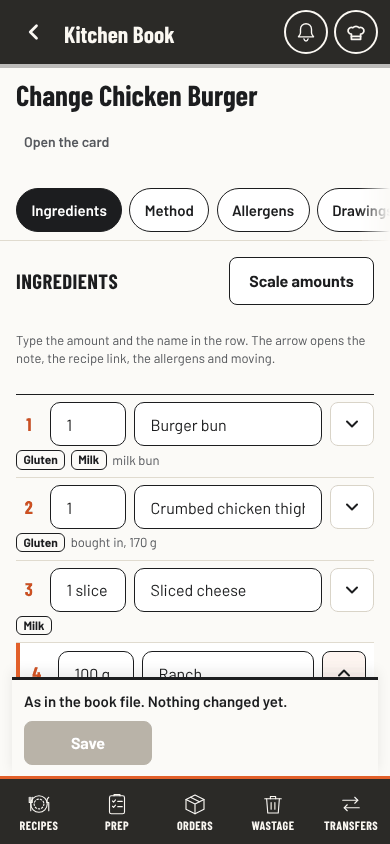
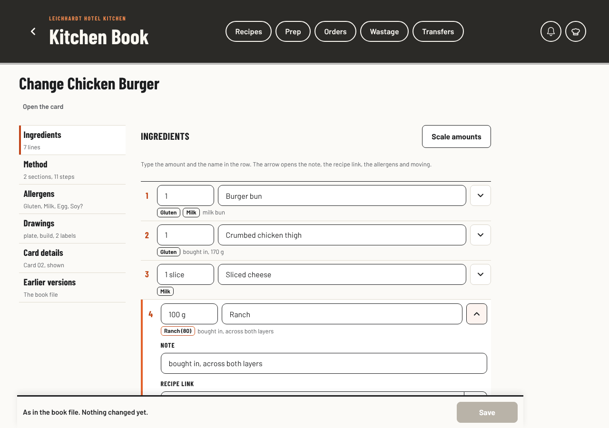

# Recipe and drawing editor: audit and two designs

Requested 3 November 2026 by the head chef: "The recipe and drawing page seems a bit too complicated. I love what it can do but it needs a better UI/UX. Audit it and recommend two new designs."

Status: **chosen 3 November 2026: A's chapters for the recipe form, with B's full-screen studio for drawings.** See Chosen, below. This record changes no app code; each build step is its own pull request. The two designs are example pages with the public Chicken Burger card and the book's own drawings. They never read or write the book. The head chef asked for two designs, so this record has two, not the three the whole-app audit brief usually asks for.

Open the comparison: `docs/recipe-editor-options/index.html` (live at `/leichhardt-kitchen/docs/recipe-editor-options/` after merge). Try the designs: `a.html` and `b.html`.

## What was checked

| Item | Detail |
| --- | --- |
| Pages | `#/manage` (the list), `#/manage/r/<id>` and `#/manage/new` (the recipe form), `#/manage/draw/<id>` and `#/manage/draw/new/<recipe>/<slot>` (the drawing editor) |
| Code read | `js/manage.js` (API 5), `js/draw.js`, `js/smart.js` (its `ui.tools` and `ui.panel` hooks), the `.mg-` and `.dw-` rules in `css/app.css`, `js/controls.js` (search and picker wrappers) |
| Screens | The head chef by PIN, test stand-in data (`tests/fake/`), real Barlow fonts, at 390 x 844, 768 x 1024 and 1280 x 900, `main` at `87b378d` |
| Kind of review | Role-based review of source and screens. No staff research, no emulator or live checks (nothing changed) |

## What works and stays

Drafts kept on the device; the version check and Open theirs; earlier versions; two-tap Remove; Save off when nothing changed; the error list that jumps to the field; Draw it for me; Check the drawing; "In this recipe, not on the plate yet"; library search with kitchen words (schnitty finds the schnitzel); arrow keys and Delete on the canvas; Undo and Redo. Both designs keep every one of them.

## Findings

Sizes are measured on the Chicken Burger (7 ingredients, 2 method sections).

| ID | Where | What we measured | Why it matters |
| --- | --- | --- | --- |
| R1 | Recipe form | One page of 11 sections: 7,628 px tall on a laptop, about 8,200 px on a phone. Between the top bar, the Save bar and the tab bar a phone shows about 610 px, so that is 13 screens. Ingredients start at 1,394 px on a phone, Method at 3,828 px, Drawings at 5,806 px. | The most changed parts (amounts, method, the plate) are the furthest away. |
| R2 | Recipe form | 52 boxes and 70 buttons for one burger. Each ingredient takes 266 px: amount, name, note, link box, link picker, then allergens, Up, Down, Remove. | Every row looks equally important, so nothing stands out. |
| R3 | Ingredient rows | The recipe link has two controls for one value: a typed box (No link, type to find a recipe) and a "Choose Recipe link, ingredient N" picker added by the shared controls. | Twice the reading for the same choice. |
| R4 | Recipe form | Rare things come first: the Show and Special switches, then 10 card fields (AVC name, guest menu words, short name) before the first ingredient. The multiplier sits above the ingredient list. | A quick amount fix starts with a long scroll past fields that rarely change. |
| R5 | Plate labels | Two places edit the Pass labels: the form's Drawings section (label, note, link, across %, down %, side, allergens) and the drawing editor (Label: Chips, made from the parts). | It is not clear which one wins. For the book's own drawings only the form can move a label. |
| R6 | Drawings section | Three dropdowns show file ids ("Chicken Burger (burger)", "burger-build"), no pictures. | Picking a drawing by its file name. |
| R7 | Recipe form, laptop | The form uses 740 px of a 1280 px screen. No view of the card while editing. | Room is left unused, and the result is only seen after Save and Open the card. |
| D1 | Drawing editor | 18 tool buttons and up to 15 part buttons, all the same underlined words: 33 actions. Draw it for me is the 14th tool. | The best feature is hidden among the rarest. |
| D2 | Drawing editor, phone | With a part picked, its buttons start at 768 px of 844, under the 99 px Save bar and the 68 px tab bar. Draw it for me at 663 px sits under the Save bar. On a 1280 x 900 laptop the part bar (815 to 957 px) also starts under the Save bar. | Deleting or recolouring a part means scrolling away from the part. |
| D3 | Drawing editor | Ten panels share one slot (Library, Servingware, Parts, Colours, Label, Change it, Template, Reuse, Library piece, Plating style), opened from buttons spread over two bars. | Hard to know where a panel will appear or how to get back to the library. |
| D4 | Part bar words | "Back" means send to the back. Everywhere else in the book Back goes to the last page. "Done" means stop picking. | A wrong guess moves the part instead of leaving. |
| D5 | Part bar | Delete looks the same as Duplicate. It has Undo, so no confirm is needed, but it should look different. | A destructive action without a destructive look. |
| L1 | Recipe list | 12 filters in one "All" picker mix three things: kinds (Dishes, Batch and components), states (Changed here, New, Hidden, Not saved yet, Book file changed, Cards to come) and other lists (Drawings, Templates, Made in the book). | Drawings and templates hide inside a recipe filter. |
| X1 | Shared search box | About 110 px of empty space under every enhanced search box inside a standard field. `.ux-search { flex: 1 1 10rem }` sits in the column-flex `.field`, so the box is 160 px tall. Seen on Find a recipe and Find a drawing. Came in with #433. | Pushes the list and library down on every screen size. A small CSS fix that needs no design choice. |

## The two designs

### A. Chapters and a studio (recommended)

The recipe opens on Ingredients. Six short chapters replace the one long form: Ingredients, Method, Allergens, Drawings, Card details, Earlier versions. A rail on a computer and a row of pills on a phone, each with a dot when it has an unsaved change and a mark when it needs a fix. This is the same pattern as the admin Chef's Desk the head chef chose on 1 November 2026.

- **Ingredient rows:** amount and name are typed in the row. One arrow opens the note, one recipe link control, the allergen chips, Move up, Move down and Remove. Scale amounts moves to a button that opens a sheet.
- **Allergens:** "The card shows" first, then Worked out or Set by hand. By hand is one row per allergen with Not in it, Has it, May have it.
- **Drawings:** three cards with pictures (On the plate, From the side, Build). Use another drawing opens a sheet of pictures, not file ids. Labels for a drawing made in the book move to the studio. Labels on the book's own drawings stay in this chapter, one row each.
- **Card details:** the Show and Special switches, name, number, kind, portion line and Finished. The rest folds under More card details.
- **Laptop:** a right column shows the card's allergens after saving and which chapters are not saved yet.
- **Studio:** one tool row above the canvas: Draw it for me, Another layout, Text, Shapes, Undo, Redo, More. Picking a part swaps that row for the part's own: Swap, Colour, Label, Arrange, More, Delete (red), Done. One panel with four tabs: Library (with the missing ingredients first), Servingware, Labels, Check. Save sits in a slim bar that no longer covers the tools.

### B. Edit on the card

The editor is the card staff see. In Edit every block is a button with a pencil: the title, the plate and its labels, the allergens, each ingredient line, the build, each method section and the tip and safety boxes. Tapping one opens its fields in a sheet on a phone or a drawer on a computer, and the card changes behind it as you type. Preview hides the pencils.

- **Ingredient sheet:** amount, name, note, recipe link and allergens, with Previous and Next ingredient so a whole list can be checked in one pass.
- **Empty boxes:** "+ Add a tip box", "+ Add a safety box", "+ Add an ingredient" show only in Edit.
- **Behind the card:** Show in the book, Special, guest menu place, AVC name, other names and earlier versions in one panel under the card.
- **Studio:** full screen, canvas first. One dock at the thumb: Draw it for me, Add, Plate, Labels, Check, More. A small bar appears beside the picked part: Swap, Colour, Label, More, Delete. Panels open as a drawer that leaves the canvas and Save in view.

## Side by side

| | Now | A. Chapters | B. On the card |
| --- | --- | --- | --- |
| Change one amount on a phone | Change this recipe, scroll about 1,400 px, type, Save | Change this recipe, type in the row, Save | Change this recipe, tap the line, type, Done, Save |
| Delete a part on a phone | Tap it, scroll past the Save bar, Delete, scroll back | Tap it, Delete (bar above the canvas) | Tap it, Delete (bar beside the part) |
| Draw it for me on a phone | Scroll, the button is under the Save bar | First button above the canvas | First button in the dock |
| See the result while editing | No, Save then Open the card | Allergen and change summary on a laptop | Yes, the card itself |
| Buttons on screen with a part picked | 33 | 7 in the part row, more in two menus | 5 beside the part, 6 in the dock |
| Fits the approved look | Yes | Yes, follows the Chef's Desk | Yes, follows the recipe card |
| Build size | | About 6 small pull requests | About 6 pull requests, two of them large |
| Main risk | | Moving label editing for drawings made in the book | Sharing the staff card's drawing code with the editor; full-screen studio and Back; most test selectors change |

## Recommendation

**A, Chapters and a studio.** It fixes every finding, follows the admin layout the head chef already chose, and can ship in small steps that each roll back on their own. It keeps the field ids and click names the tests and drafts rely on. B is the more striking idea and the most direct for a phone, but it needs the staff card's drawing code shared with the editor and a full-screen studio that has to work with Back, sheets and saved drafts. That is more risk to pages staff use every shift.

The studio halves are independent. "A's recipe chapters with B's full-screen studio" is a fair mix if the head chef likes B's studio better.

## Chosen (3 November 2026)

The head chef: "I trust your recommendations and go with a mix of both." That is the mix recommended above:

- **Recipe form, list and Drawings chapter from A.** Six chapters, rows you type in, pictures for drawings, rare fields folded away, kinds kept apart from states on the list.
- **Studio from B.** Full screen, canvas first, one dock (Draw it for me, Add, Plate, Labels, Check, More), a small bar beside the picked part, panels in a drawer that keeps the canvas and Save in view.

Acceptance for the build:

1. Every capability in the table below stays reachable, for the head chef, sous chefs and admin, with today's permissions, reads, writes, drafts, version checks and save batches. No new Firestore reads or fields.
2. The recipe opens on Ingredients. A chapter shows a dot for an unsaved change and a mark for a fix; an error jumps to its chapter and field. The field ids and `data-f` names stay, so kept drafts open as before.
3. Amount and name are typed in the row; one recipe link control per row; Scale amounts opens the multiplier in place.
4. Drawings show as pictures and are chosen by name. The Pass labels stay editable in the Drawings chapter for every drawing (changed 3 Nov 2026 during the build: moving labels on drawings made in the book into the studio would have lost hand-written label words, notes and links); the studio's Parts and Label say which ingredient each part is.
5. The studio covers the top bar and tab bar. Close and the book's Back return to the recipe and keep an unsaved drawing as a draft, as today. Escape closes an open drawer first. The picked part's bar has Swap, Colour, Label, More and a red Delete; arranging says "To the back", not "Back".
6. No sideways scroll and no page errors at 390, 768 and 1280 px; keyboard reachable; the click tests updated in the same pull request as each step.

## Build (3 November 2026)

Shipped in three pull requests, each step its own commit inside:

| Pull request | Steps | What changes |
| --- | --- | --- |
| #478 | X1 | The empty gap under search boxes inside a field |
| Recipe form and list | 2, 3, 4, 6 | Ingredient rows you type in, one link control, Scale amounts in place; six chapters with dots and fix marks; Drawings as picture cards chosen by name; the list's kinds apart from what needs a look |
| Drawing studio | 5 | Full screen, dock, the picked part's bar, one drawer, red Delete, To the back |

Measured on the Chicken Burger: the recipe form opens 1,376 px tall on a phone (was about 8,200) and 1,236 px on a laptop (was 7,628); an ingredient row is 83 px closed (was 266).

| Recipe form, phone | Recipe form, laptop |
| --- | --- |
|  |  |

The [Drawings chapter](../images/recipe-editor-drawings-desktop.png) ([phone](../images/recipe-editor-drawings-phone.png)) and the [recipe list](../images/recipe-editor-list-desktop.png) ([phone](../images/recipe-editor-list-phone.png)) use the same look. Captures use the test stand-in's synthetic data and the real fonts.

## Every capability stays

| Capability | A | B |
| --- | --- | --- |
| Show in the book, Special, Finished | Card details | Behind the card |
| Name, id (new recipe), card number, kind, where it belongs, portion line | Card details | Title sheet |
| Short name, guest menu words and place, AVC name, other names, tip and safety boxes, label note | More card details, Allergens | Behind the card, box sheets, allergen sheet |
| Ingredients: amount, name, note, link, allergens, order, add, remove, multiply | Rows and row details, Scale amounts | Ingredient sheet, Add an ingredient, Scale amounts above the list |
| Method sections: title, steps, order, add, remove | Method | Section sheet |
| Allergens worked out or by hand, "the card shows", what changes after saving, used in | Allergens, laptop column | Allergen sheet, the card |
| Plate, side and build drawings, draw in the book, labels and pins | Drawings, studio Labels tab | Plate block, studio Labels |
| Earlier versions, go back to the book file's copy | Earlier versions | Behind the card |
| Kept drafts, changed on another device, book file changed, errors with links | Banners at the top of the chapter | Banners above the card, errors link to the block |
| Studio: library search, categories, import SVG, text, line, arrow, box, oval | Library tab, Shapes menu | Add, More |
| Servingware with options, fit the food, save servingware | Servingware tab | Plate |
| Draw it for me, another layout, tidy up, plating style, which drawing (unsure picks) | Tool row, More | Dock, More |
| Pick several, snap to centre, parts list, undo, redo, zoom | More, tool row | More, top bar |
| Part: swap, colours, label, front/forward/backward/back, duplicate, flip, stretch, split, library piece, change it, delete | Part row, Arrange, More | Part bar, More |
| Save as a template, use for another recipe, start from a copy, newer library drawings | More, start panel | More, start panel |

## Steps after the choice

Each step is its own branch and pull request, under the usual rules (`CLAUDE.md`, How changes ship). None changes reads, writes, rules or stored data.

1. **X1 search box gap** (shared CSS, any choice). Add a check that the box is no taller than its input, see it fail first.
2. A: compact ingredient rows with one link control (R2, R3, R4). B: share the card's drawing code from `js/app.js` as an additive helper `js/manage.js` checks for.
3. A: chapters, rail and pills, dots and error marks (R1). B: Edit and Preview with block sheets.
4. A: Drawings chapter with pictures and the label move (R5, R6). B: ingredient sheet with Previous and Next, Behind the card.
5. Studio tool row, part row, Arrange and More menus, red Delete, "To the back" (D1, D2, D4, D5), keeping `LK_SMART.ui` as it is.
6. Studio panel tabs or dock and drawer (D3); recipe list kinds apart from states (L1).

Tests to change or add: `manage`, `draw`, `autodraw`, `reuse`, `smart`, `keep-typed-editors`, `device-editor-lock`, `council-drawing-resets`, `editor-navigation`, `recipe-multiplier`, plus a new check per step at 390, 768 and 1280 px. `MG_API` and `LK_DRAW.api` stay unless an older saved copy cannot run the new page.

## How the design pages were checked

Both pages load with no errors and no sideways scroll at 390, 768 and 1280 px with Barlow and Barlow Condensed loaded (15 captures in `previews/`). A scripted browser run of 64 checks passes, 32 at 390 px and 32 at 1280 px:

- A: typing in a row keeps the box and its cursor; the chapter shows its dot and Save turns on; Remove asks again, then removes; the Scale amounts sheet keeps Tab inside and closes on Escape and the backdrop; Save with no name lists the error and the error jumps to the name box; picking a part swaps in its own row; drag and the arrow keys move it; Delete takes it off and Undo brings it back.
- B: tapping a line opens its sheet and the card changes as you type; Tab stays in the sheet; Next ingredient moves on; Done returns to the line; Escape closes a sheet; Save with no name lists the error; Preview hides the pencils; the plate opens the full-screen studio; a picked part gets its bar; Delete and Undo; Add opens the library with Save still in view; Escape closes the drawer, then the studio.

The run is a scratch script, not part of `tests/`, because these are example pages. None of this is a claim about the production book.

## Files

| File | What it is |
| --- | --- |
| `index.html` | The comparison: findings, both designs on a phone and a computer, the recommendation |
| `a.html`, `a.css`, `a.js` | Design A, working example |
| `b.html`, `b.css`, `b.js` | Design B, working example |
| `shared.css`, `shared.js` | The book's tokens, the frame, sheets and the drawing canvas both designs use |
| `art.js` | The public Chicken Burger card and drawings copied from `js/data.js`, `js/art.js` and `js/lib/` |
| `previews/` | `current-*` the book today, `a-*` and `b-*` the designs at phone, tablet and desktop size |
