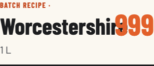
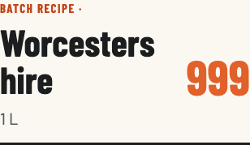

# Long amounts and recipe headings, 16 November 2026

After reporting transfer cards running off a phone, the owner asked for wider checks: "If the overflow is there there will be more". The [transfer repair](transfer-returns.md#phone-card-width-16-november-2026) is PR #719. This follow-up repairs two more reproduced causes in the existing layouts.

## Reproduced faults

- Orders forced a typed amount onto one line. The valid 35-character quantity `24 portions for the evening service` crossed the text column even when the document itself did not scroll. With actual fonts at 360 px and large text it ended at 381.2 px, making 21 px of page overflow; at 390 px and extra-large it ended at 419.1 px.
- Prep had a phone wrapping exemption, but the same amount beside the short item name Cream overlapped On it at 1280 px. At extra-large text it also crossed Urgent and Remove. The shared `.nb-q` now keeps a short quantity together as an inline block, limits it to its column including the existing margin, and wraps longer words inside it.
- The valid recipe title Worcestershire could cover the recipe number at extra-large text. At 390 px it crossed the number by 26.17 px. In Tiles at 360 px it crossed the illustration by 4.67 px. `.card-head h2` and `.tile .t-name` now break a word only when it cannot fit. Default Pass already fitted this title and keeps its existing style.

Verdict: Not needed (bug fixes). The existing layout, colours, fonts and text-size settings stay. Buttons retain their positions and targets; no task gains a tap. Long content may take more lines because it now stays inside its column. No new Firestore reads, writes, rules, fields, listeners or saved copies.

## Audit coverage and limits

Two independent browser probes and the main session checked 280 synthetic states using the complete app and actual Caveat/Barlow fonts. The main service-page probe covered Prep, Orders, Wastage and Cleaning at 360, 390, 768 and 1280 px with all three text sizes, their Add forms, and focused desktop quantity cases. The card probe covered Home, signed-out Home, Recipes in Pass and Tiles, recipe details, Settings and all chef-panel rooms, including long names. The remaining 64 states covered Today's team, Functions and sampled admin pages, including Export open, at four widths with normal and extra-large text.

The probes inspect card/text bounds and overlaps, not only document width. Intentional horizontal scrollers, screen-reader-only labels, closed disclosures and existing metadata ellipses are excluded after visual inspection. No other genuine overflow was found in those fixtures. This is not a claim that every possible data combination or physical device has been tested. No real kitchen data was read or written.

## Regression checks

`tests/line-amount-wrap.test.js` checks staff and sous-chef rows on Prep and Orders at four widths and all three text sizes. With actual fonts it fails 17 of 128 checks on the old code and passes all 128 after the repair. Short amounts stay together; long amounts remain complete and inside their column. Its fallback-font run passes all 112 checks.

`tests/recipe-title-wrap.test.js` checks Tiles and recipe headings at the same widths and text sizes. With actual fonts it fails 7 of 40 checks before and passes all 40 after. The ordinary fallback-font run also passes. Existing recipe, Prep density, Orders, amount-control, row-layout and design-pattern tests remain part of verification. CI and live results are recorded in the pull request.

Actual-app captures at 390 px with extra-large text, synthetic data:

| Before | After |
| --- | --- |
| [Orders](images/overflow-audit/orders-before.png) | [Orders](images/overflow-audit/orders-after.png) |
|  |  |

Revert the CSS changes through a new PR to roll back. Saved data and permissions are unchanged.
