# Revised Kitchen Book comparison

**Revised options awaiting review. PR #606 remains draft. No option chosen.** The first presentation was rejected and is superseded. Baseline images use the unchanged application with synthetic data. Every new target, timer name, task, person, time and booking in the designs is illustrative, not approved operational setup.

**A, Familiar Home** preserves the native Now and next board and pinned papers. It adds a compact cooling row and prep/cleaning worksheet links inside Prep by section. Function rounds stay on the board; saved team and future summaries use compact disclosures. **B, Working notebook** puts actual minimum counts inline on Home. Phone Prep/Cleaning tabs show due counts, with one extra tap for Cleaning; desktop shows facing pages. Cooling remains above both tabs, with compact functions and Coming up below.

Both use the current SVG masthead, navigation, Barlow/Barlow Condensed UI, actual Caveat 700 handwriting and the same paper/orange palette. Neither adds a global section/service header. Saved roster scope is used silently, then named with a local Change link in the relevant worksheet. The phone difference is overview versus direct work.

The [complete proposal](brief.md) covers all five flows, management screens, permissions, schema, missing inputs, rollout and rollback. [Verification and council](verification.md) distinguish baseline checks from prototype checks and future implementation. [Reference study](references.md) records what was actually inspected.

Download [index.html](index.html) and open it in a browser to try the illustrative role, scenario, screen and width controls. Those controls belong to the review tool, not the intended kitchen interface. It never authenticates, reads or writes kitchen data.

## Staff phone, 390 px

| Current app | A, Familiar Home | B, Working notebook |
| --- | --- | --- |
|  | 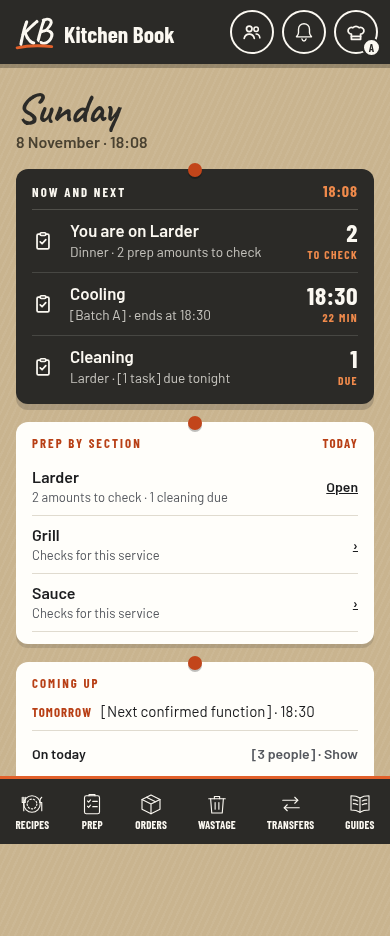 | 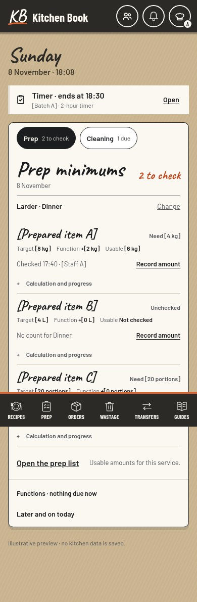 |

## Busy function service, 390 px

Three simultaneous timers, unresolved cleaning and a function in service test the busiest Home example. B keeps the next food time above its worksheet. Timers use one-action 2-hour/4-hour presets with optional names. The existing chime repeats on expiry until any signed-in kitchen staff member marks Done. Running timers have Stop timer. Timers record no temperature or food-safety outcome and need no cooling SOP setup.

| A | B |
| --- | --- |
| 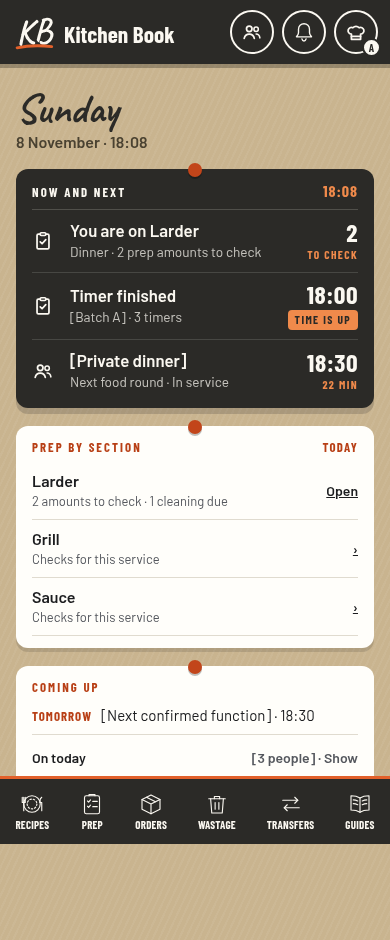 | 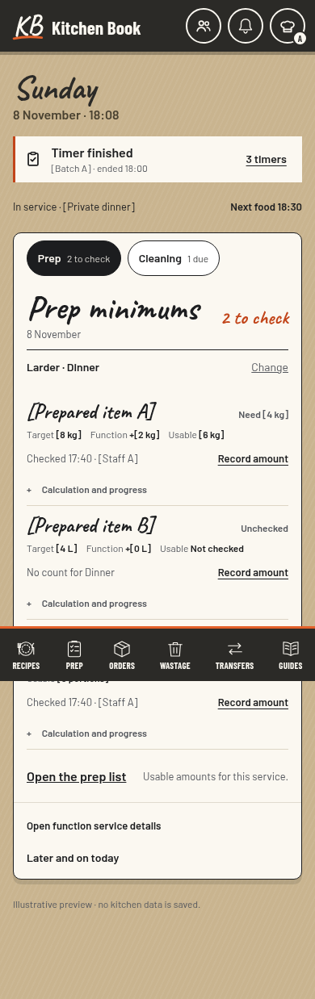 |

## Shared tablet, 768 px

| Current chef Home | A | B |
| --- | --- | --- |
|  | 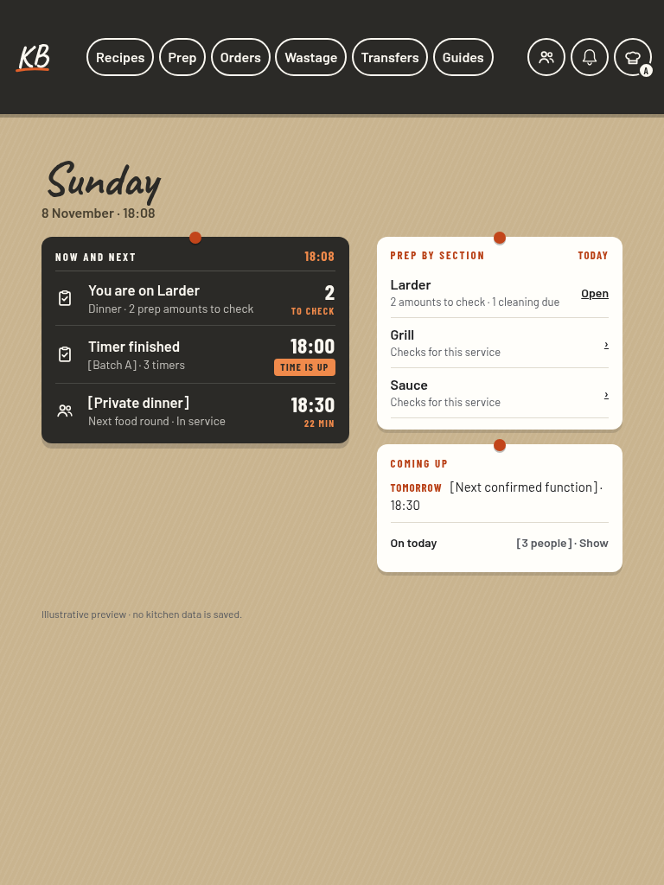 | 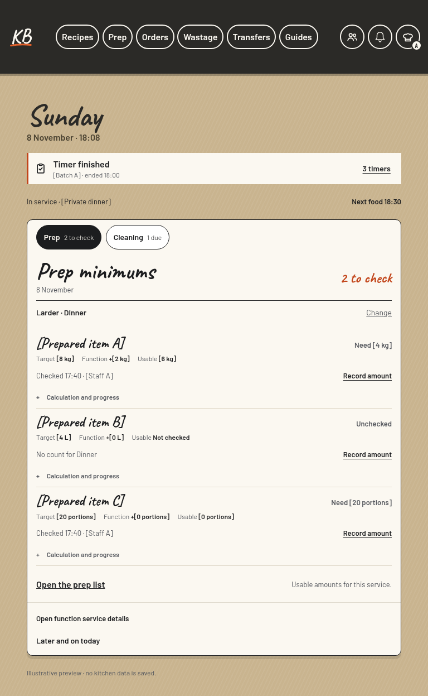 |

## Chef desktop, 1280 px

| Current chef Home | A | B |
| --- | --- | --- |
|  | 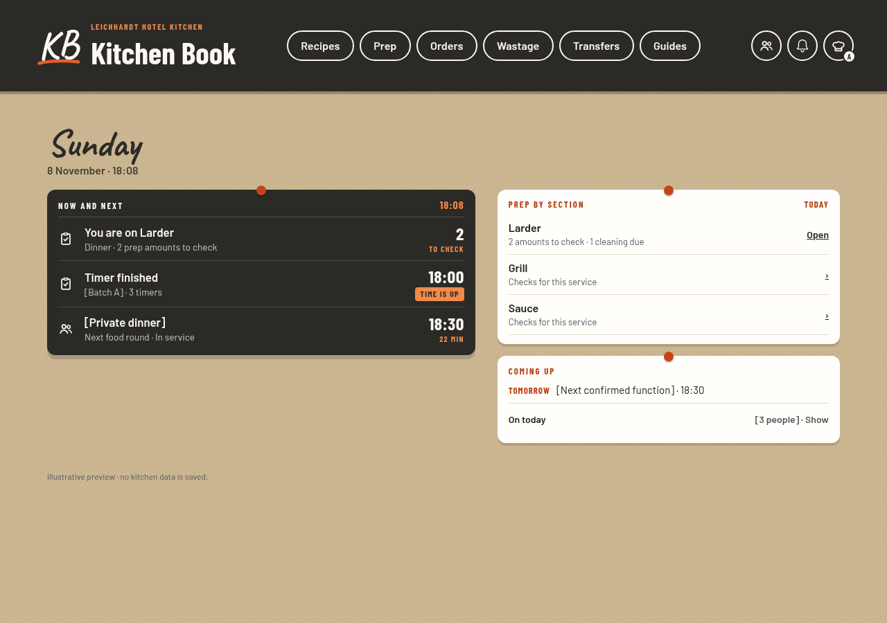 | 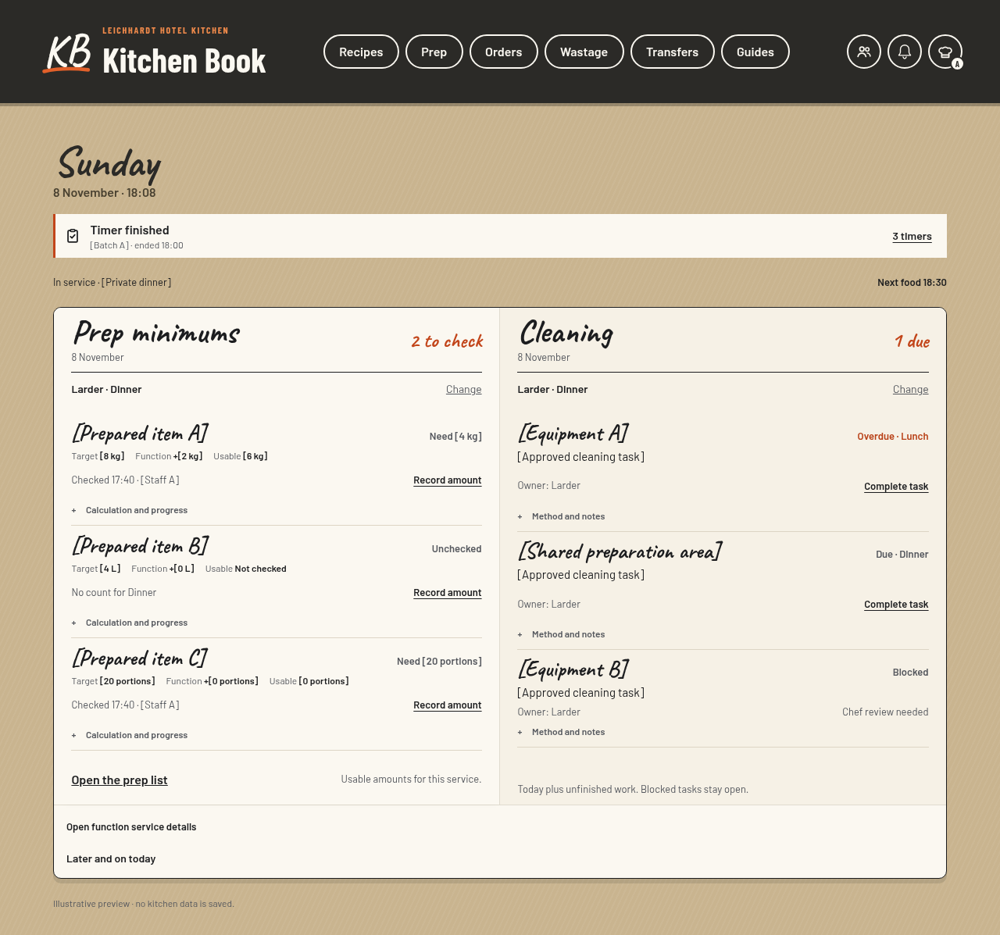 |

## Focused staff work

Both designs retain the ordinary Prep list. A opens focused minimum and cleaning worksheets; B also puts those service checks in Home's notebook. Recording usable amount changes the calculated shortfall, while an ordinary preparation tick does not invent stock. All signed-in kitchen staff may start, stop and mark timers Done even when Add/Tick is disabled; this exception grants no other rights. Cleaning exceptions do not count as completed.

| Shared cooling timers | Prep minimums | Cleaning |
| --- | --- | --- |
| 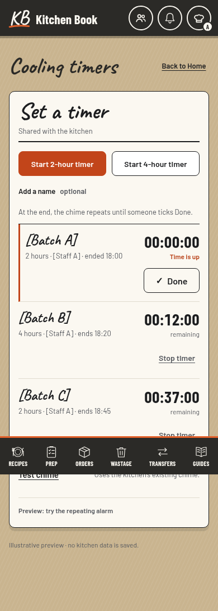 | 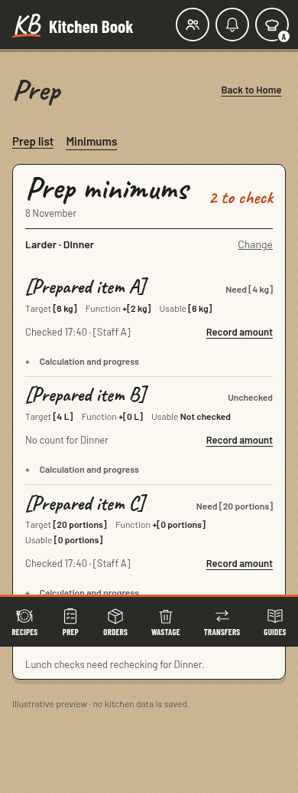 | 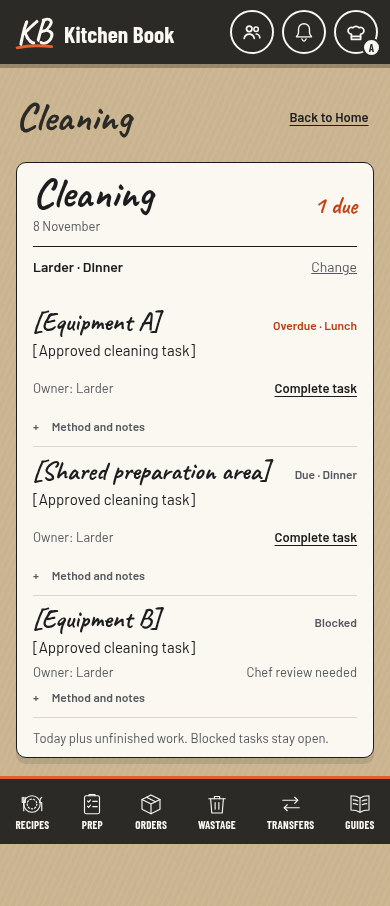 |

## Par levels and management

The new **Par levels** area is integrated into each authorised Admin, Head Chef and Sous Chef panel for approved section targets and mappings. Staff see approved pars on their sheets without target editing. Managers also configure actual equipment and cleaning templates through focused Chef's Desk pages. Existing shared sections/shifts and role/security grants retain their present Admin authority. Functions-only and public previews retain their existing scope without new kitchen operations.

| Admin: Par levels | Chef functions | Staff functions |
| --- | --- | --- |
| 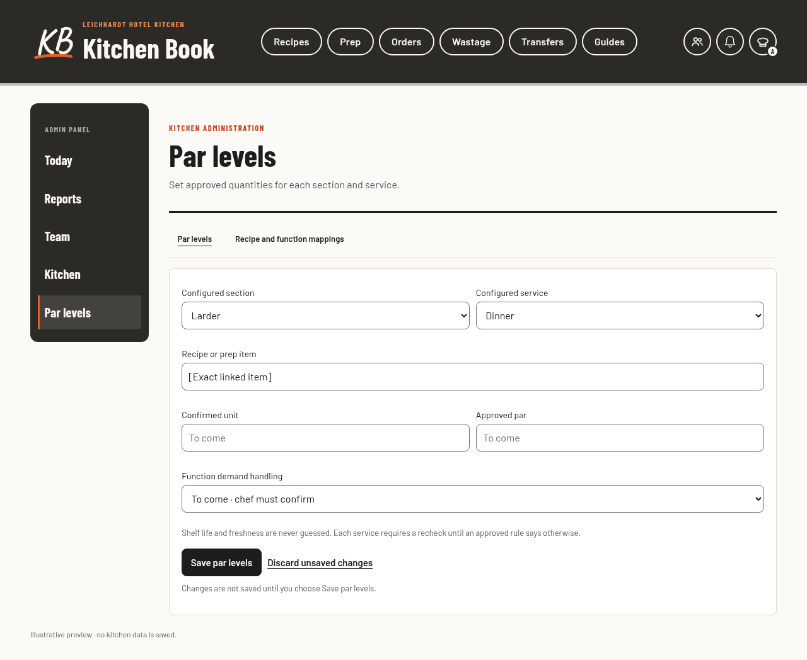 | 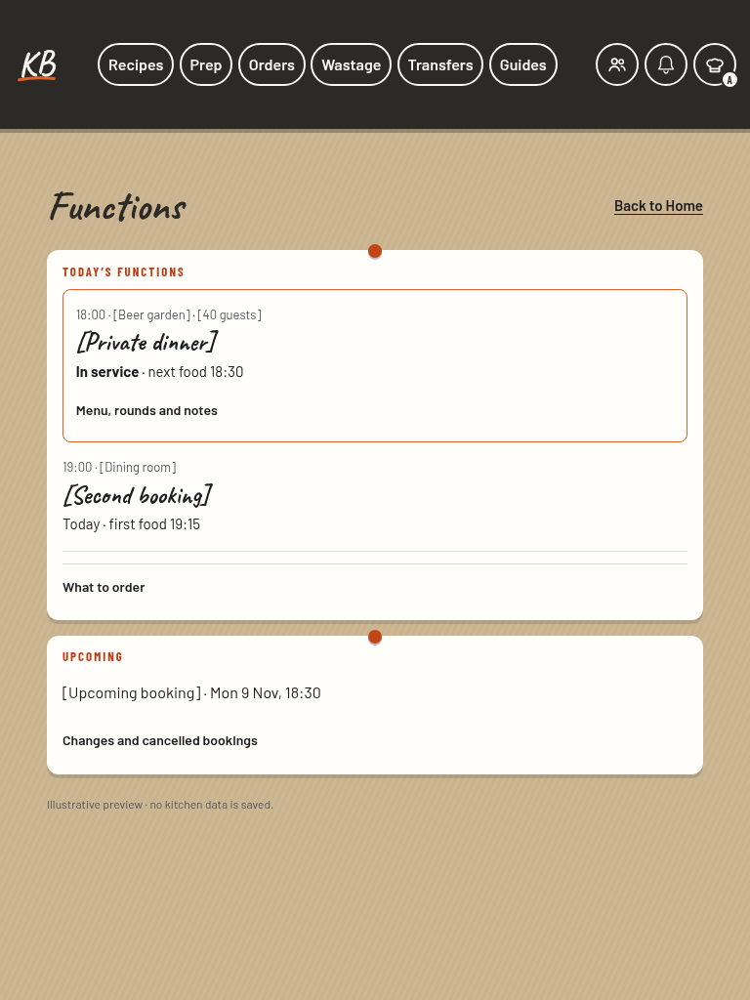 | 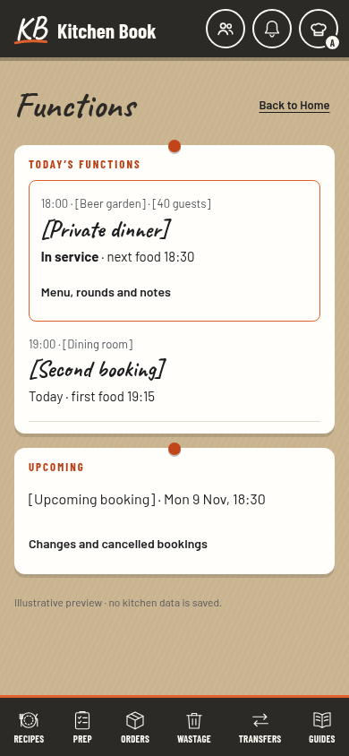 |

Par levels examples: [Admin panel](previews/v2-a-management-admin-1280.png), [Head / Sous Chef panel](previews/v2-a-management-chef-1280.png), and [phone](previews/v2-config-targets-390.png).

## Every management page

[Par levels](previews/v2-config-targets-390.png), [recipe/function mappings](previews/v2-config-mappings-390.png), [equipment and shared areas](previews/v2-config-equipment-390.png), [cleaning templates](previews/v2-config-templates-390.png), [exceptions](previews/v2-config-exceptions-390.png), [Timer chime and Test chime](previews/v2-config-cooling-390.png), [existing sections/shifts](previews/v2-config-sections-390.png), and [Admin rollout](previews/v2-config-rollout-390.png) have phone examples. The interactive prototype shows each at tablet and desktop widths too.

## Exceptions and connectivity

| Missing setup | Checking records | Save failed | No signal |
| --- | --- | --- | --- |
| 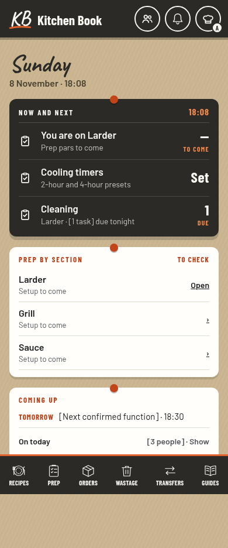 | 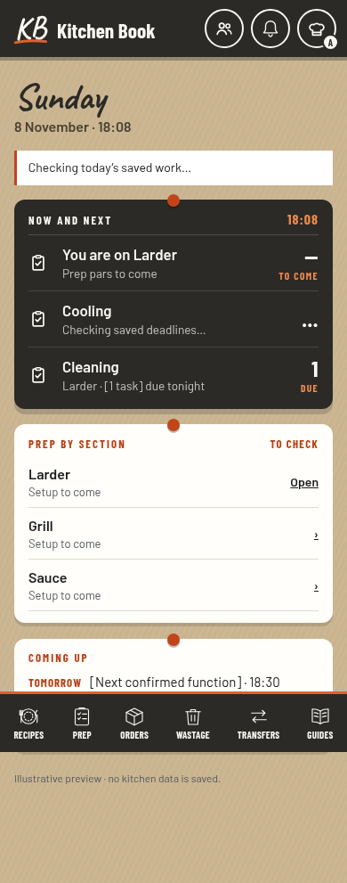 | 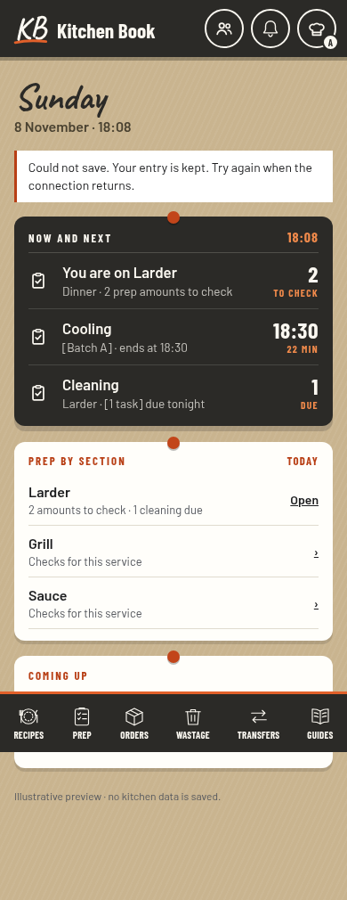 | 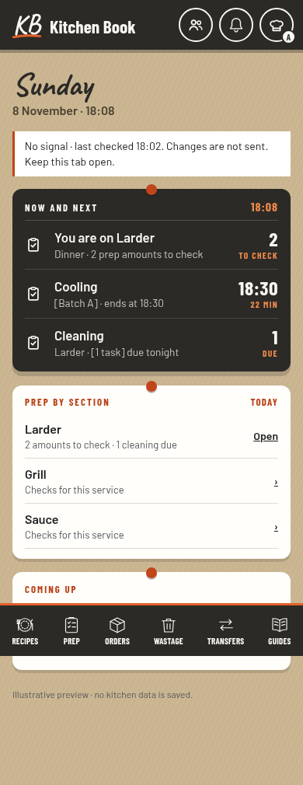 |

## Recommendation

A is the quieter starting point: it keeps Home as a familiar overview. Choose B if staff should record section amounts directly on Home. Five fresh review passes preferred A; the security pass rated them equal. These are agent reviews, not venue staff research.

## Decision

Review A, Familiar Home, and B, Working notebook, with the shared workflow contracts. The previous visual recommendation and prototype measurements apply to the rejected presentation; revised verification is recorded separately. No design choice or new test result is implied here. Closed-app alarms, unverified venue procedures and illustrative minimums are not approved capabilities. Implementation begins after design approval; the production app remains unchanged by this package.
