# Current Kitchen Book and two proposed options

**Design for approval. No production feature changes.** Baseline images use the unchanged application with synthetic data. Every new target, batch, temperature, task, person, time and booking in the designs is illustrative, not approved operational setup.

Recommended: **A, Refine Now and next**. It retains the shipped board and pinned notebook, puts current section work before the team roster and adds focused pages for the new work. **B, Structured service dashboard** gives chefs more simultaneous comparison on a wide screen, with more groups to scan on a phone.

The [complete proposal](brief.md) covers all five flows, management screens, permissions, schema, missing inputs, rollout and rollback. [Verification and council](verification.md) distinguish baseline checks from prototype checks and future implementation. [Reference study](references.md) records what was actually inspected.

Download [index.html](index.html) and open it in a browser to try the illustrative role, scenario, screen and width controls. Those controls belong to the review tool, not the intended kitchen interface. It never authenticates, reads or writes kitchen data.

## Staff phone, 390 px

| Current app | A, restrained refinement | B, structured dashboard |
| --- | --- | --- |
| 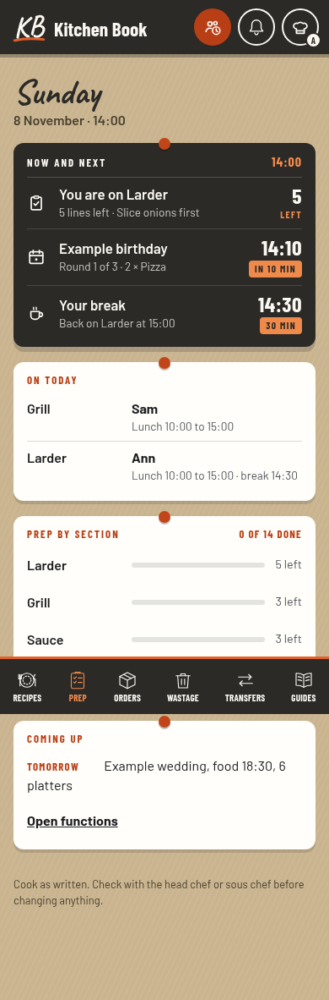 | 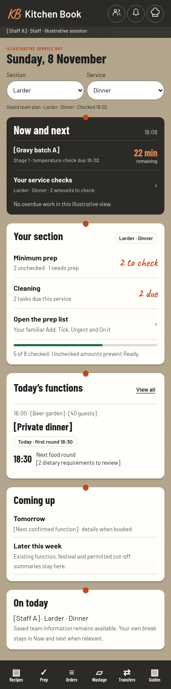 | 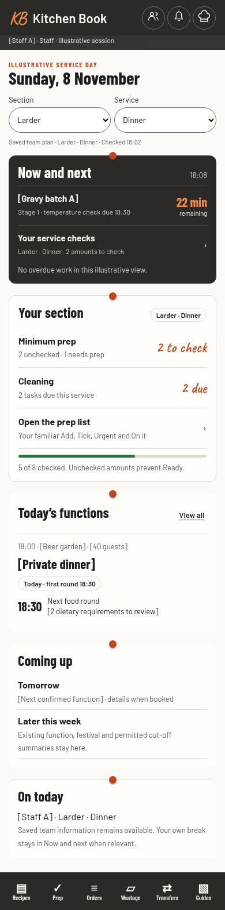 |

## Busy function service, 390 px

Three simultaneous batches, unresolved cleaning and a function in service test the hardest Home density. The sample values and temperatures do not establish compliant cooling. Only actual observations and the approved venue SOP can support recorded outcomes.

| A | B |
| --- | --- |
| 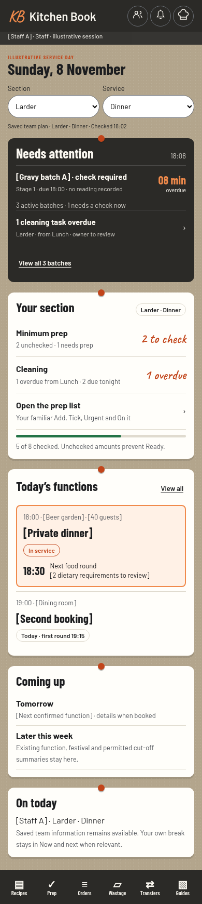 | 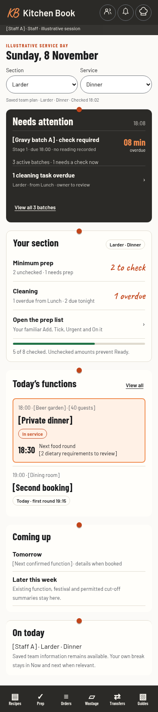 |

## Shared tablet, 768 px

| Current chef Home | A | B |
| --- | --- | --- |
| 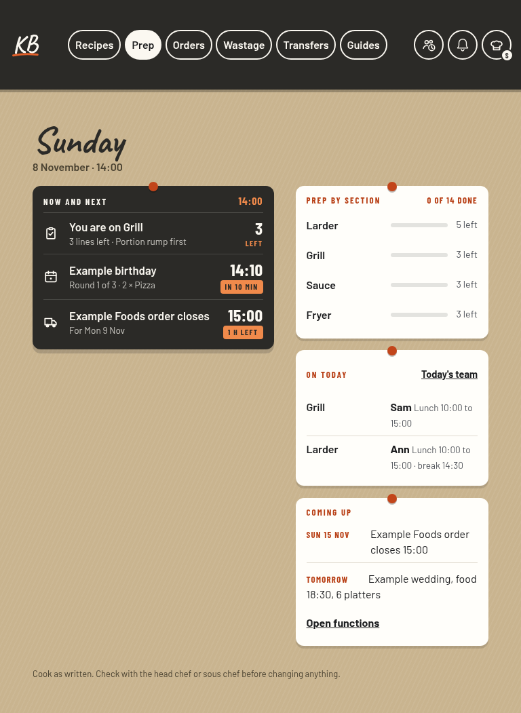 | 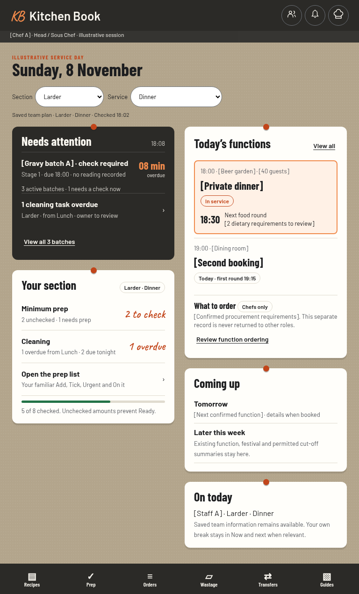 | 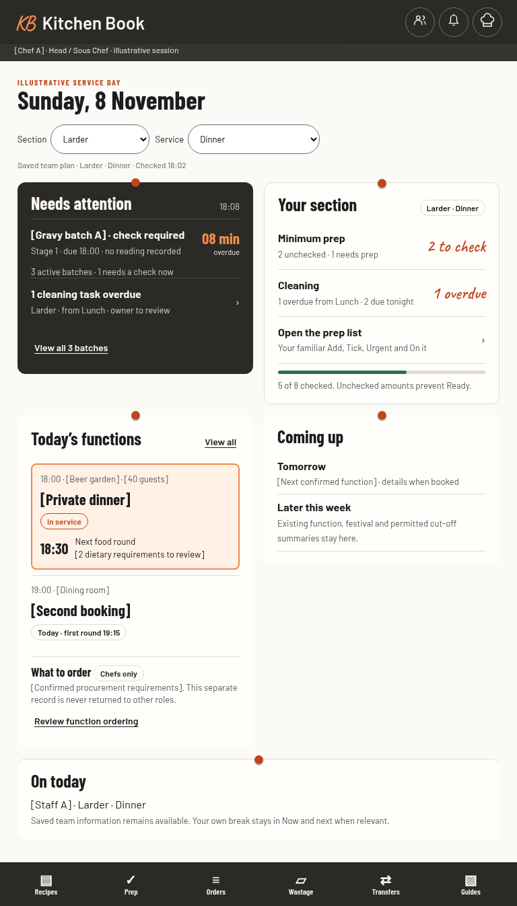 |

## Chef desktop, 1280 px

| Current chef Home | A | B |
| --- | --- | --- |
| 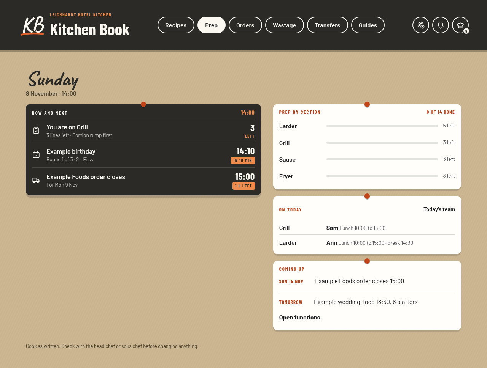 | 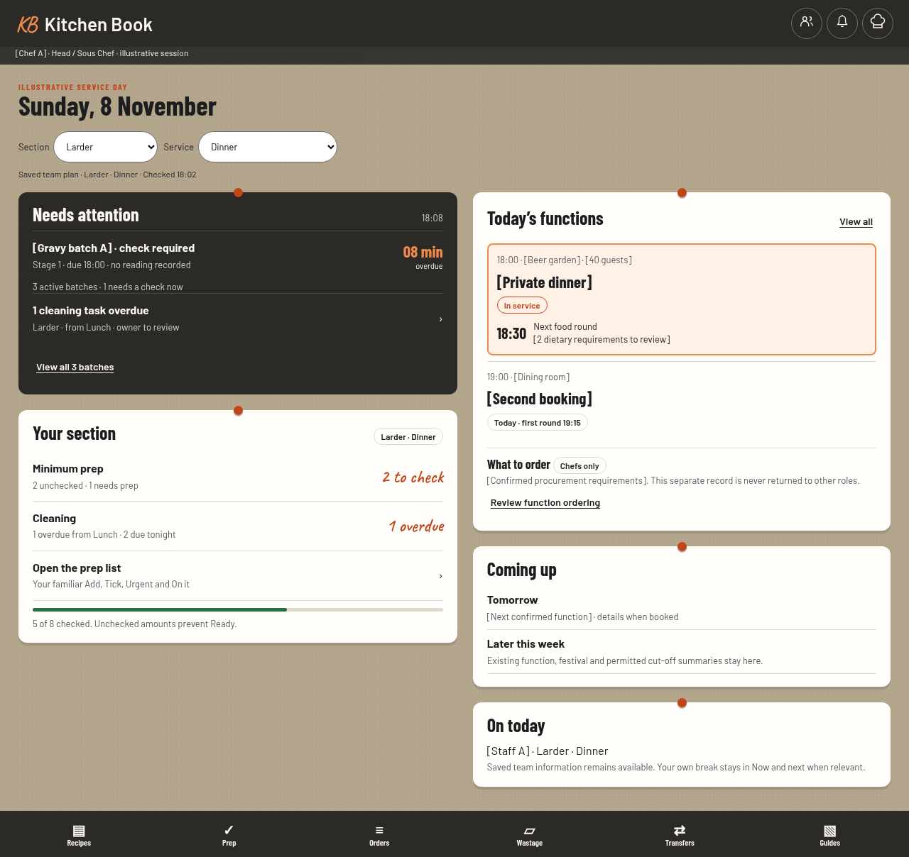 | 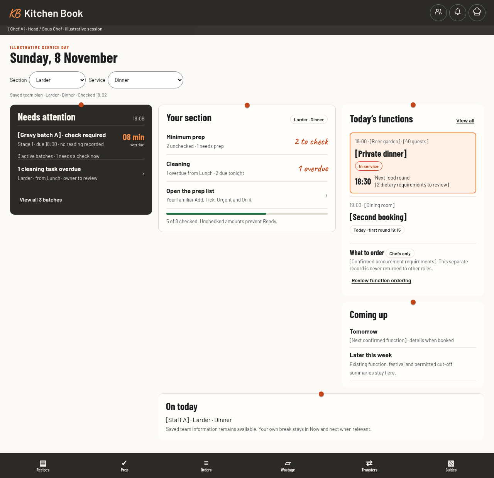 |

## Focused staff work

Both designs retain the ordinary Prep list. Minimums is a distinct service-check view; recording usable amount changes the calculated shortfall, while an ordinary preparation tick does not invent stock. Cooling acknowledgement, temperature recording and record completion remain distinct. Cleaning exceptions do not count as completed.

| Cooling | Prep minimums | Cleaning |
| --- | --- | --- |
| 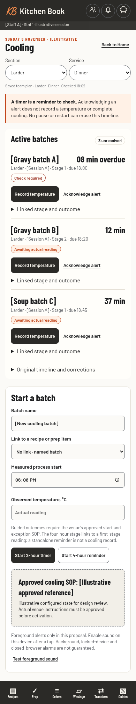 | 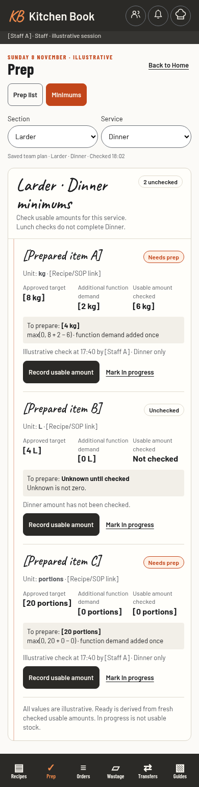 | 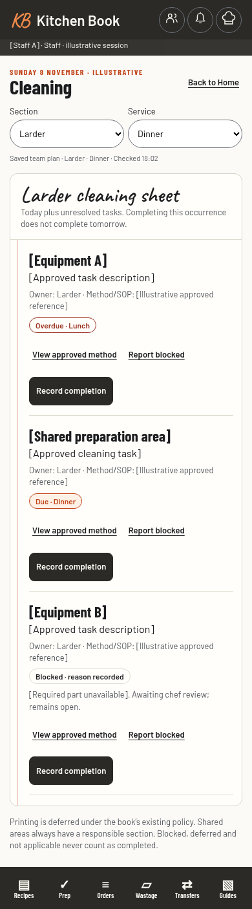 |

## Management and permission examples

Managers configure approved targets, unit mappings, actual equipment and cleaning templates through focused pages in the existing Chef's Desk. Existing shared sections/shifts and role/security grants retain their present Admin authority. Functions-only and public previews retain their existing scope without new kitchen operations.

| Management setup | Chef functions | Staff functions |
| --- | --- | --- |
| 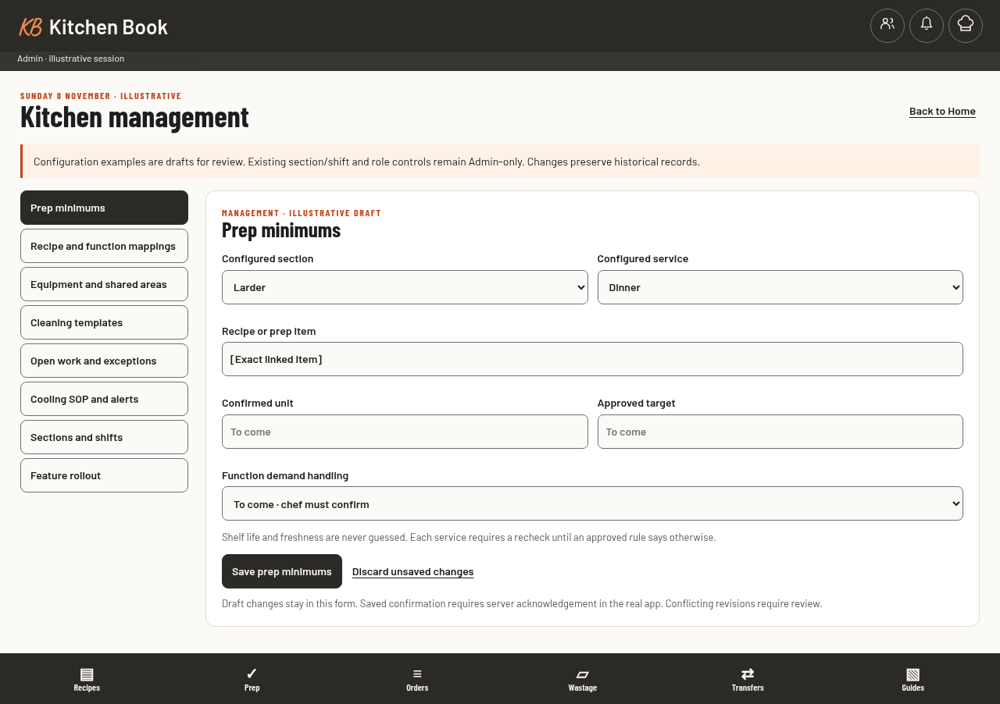 | 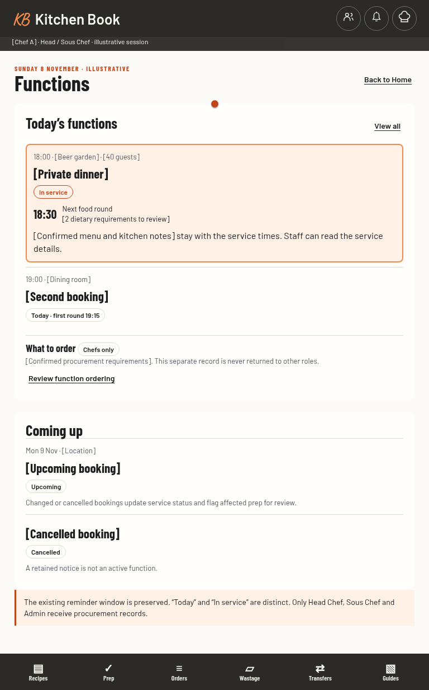 | 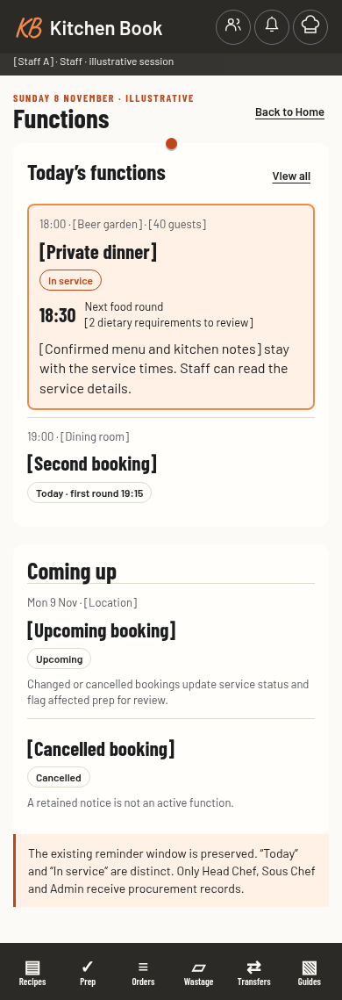 |

## Every management page

[Prep minimums](previews/config-targets-390.png), [recipe/function mappings](previews/config-mappings-390.png), [equipment and shared areas](previews/config-equipment-390.png), [cleaning templates](previews/config-templates-390.png), [exceptions](previews/config-exceptions-390.png), [cooling SOP and alerts](previews/config-cooling-390.png), [existing sections/shifts](previews/config-sections-390.png), and [Admin rollout](previews/config-rollout-390.png) have phone examples. The interactive prototype shows each at tablet and desktop widths too.

## Exceptions and connectivity

| Missing setup | Checking records | Save failed | No signal |
| --- | --- | --- | --- |
| 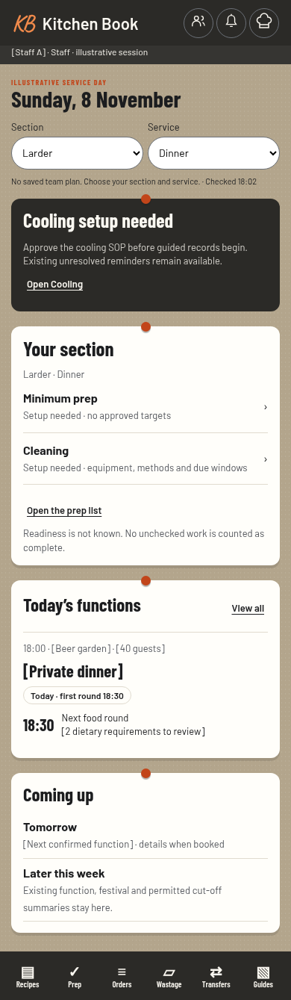 | 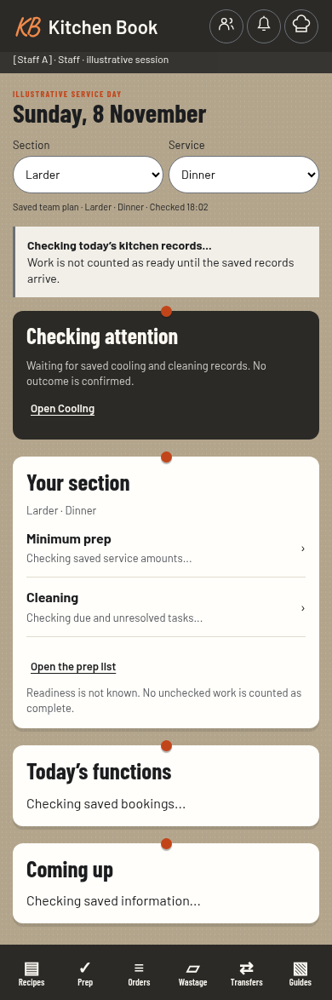 | 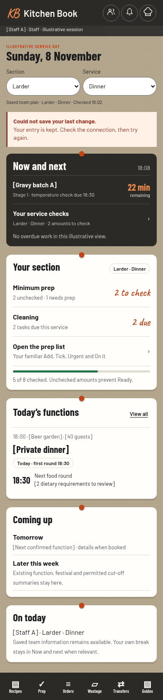 | 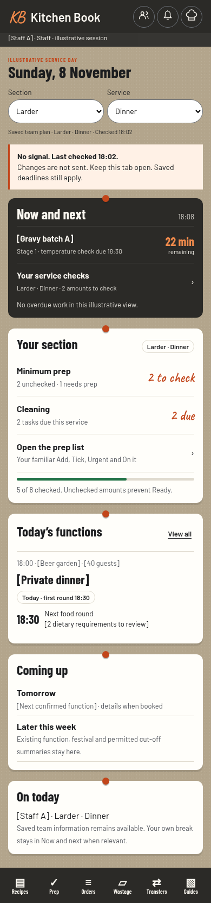 |

## Decision

Choose A or B after reviewing the layouts and the proposed workflow contracts. Closed-app alarms, unverified venue procedures and illustrative minimums are not included as approved capabilities. Implementation begins after design approval; the production app remains unchanged by this package.
