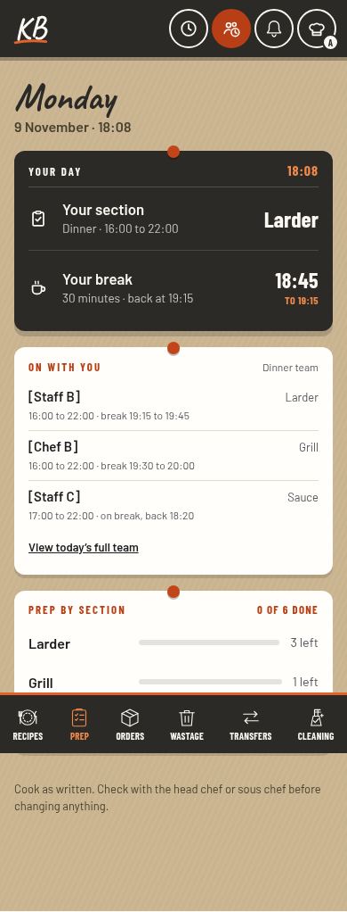

# Staff-first Home after the latest pushes

9 November 2026, Queensland. Checked main `5f604bd3a40ff3d16f7a45dd40e407fcd0735718` against the staff-first direction accepted by the owner. PR #606 is still a draft design PR. Its exact Home layout has not shipped.

The latest pushes preserve the saved section, shift hours, break/return and daily roster. They support the preferred order: **section and shift → break window and return → visible coworkers → kitchen work**. Current Home still sorts breaks among timed reminders, so the exact preferred ordering remains a layout change to implement.

## Refreshed phone illustration

This browser illustration places the accepted staff-first blocks inside the **latest actual header, clock, navigation and native fonts/CSS**. The lower prep card is the current task-progress card. Names and times in the proposed blocks are examples. They were inserted into the browser DOM for this layout check; this is not a screenshot of a shipped redesign or actual kitchen records. It proves fit and visual compatibility, not production data binding or new interactions.

[Tablet](previews/latest-proposed-home-768.png) · [Desktop](previews/latest-proposed-home-1280.png) · [Phone with Cleaning off](previews/latest-proposed-home-390-cleaning-off.png)

For comparison, these unmodified latest-client browser captures use synthetic Firebase records and the current Home renderer: [phone](previews/latest-current-home-390.png), [tablet](previews/latest-current-home-768.png), [desktop](previews/latest-current-home-1280.png).

## What the newer work changes

| Latest feature | Reconciliation for the preferred Home |
| --- | --- |
| Mobile KB logo and header clock | Retained in this illustration. The existing clock, Team, bell and hat stay together. |
| Cleaning in the sixth navigation slot; Guides in the hat | Retain the implemented navigation. Cleaning appears only when its existing rollout allows it. Both on/off states were captured at all three widths. |
| Operandio cooling | Reuse the shipped shared controller, header display and chime. The older preview's independent named/concurrent timers are not current app behaviour and must not become a parallel system. |
| Chef panel and prep standards | Reuse the implemented panel, editors and rollout. Current prep progress counts tasks; it does not establish counted usable stock or service readiness. |
| Downward swipe dismissal | Compatible with the staff-first layout; reuse the existing sheet behaviour. |

The original interactive comparison predates these merges. Its lower prep amount, cleaning and multi-timer examples remain historical proposals, not a specification of what main now does. This check supersedes the original absence-of-feature statements. It does not authorise implementing those older models alongside the shipped features.

## Verification

- Compared `homeOn`, `homeRows`, `homeBoardHTML`, `homePrepHTML`, `homeTeamHTML`, `homeSlot`, `homePaint` and the relevant saved-team/break helpers at `60150b7` and `5f604bd`: unchanged. Current source retains the existing saved-plan data and failure states. No new roster read is required for the preferred grouping.
- Actual latest Home captured at 390, 768 and 1280 px using synthetic Firebase and official Barlow, Barlow Condensed and Caveat 700 font bytes. No JavaScript errors or horizontal overflow.
- Proposed layout captured at the same widths with Cleaning on and off. Section/break/coworkers precede work. At 390 × 844, the break card ends around 365 px and all three example coworkers around 644 px; work begins around 662 px, before the bottom bar at 776 px. The newer clock and mobile logo do not displace those staff facts.
- Six existing browser suites have passing results: `home-board`, `home-staff-roster`, `cleaning-navigation`, `back-navigation`, `local-back-navigation` and `cooling-motion`. The first five passed on the first run. Cooling's first run had four browser-error failures caused by Google Font certificate errors; the rerun passed using cached official font files, without disabling TLS verification or changing the test/runtime files.
- GitHub Pages, Live click tests, Publish rules and Lock probe reported success for `5f604bd`. Live click tests use Firebase stand-ins and do not inspect private venue settings.

No production-loaded file, backend rule, saved kitchen record, rollout setting or deployment was changed. These are compatibility checks and review images. Runtime implementation must still bind the preferred blocks to the existing saved-plan helpers and retain loading, failed, unassigned, changed, split and completed-break behaviour.
