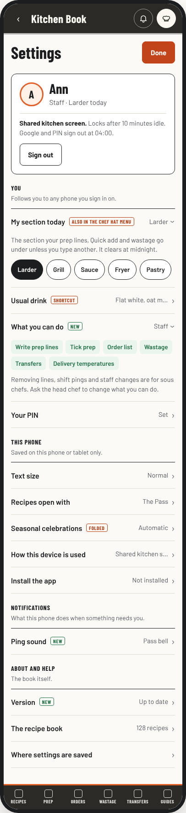
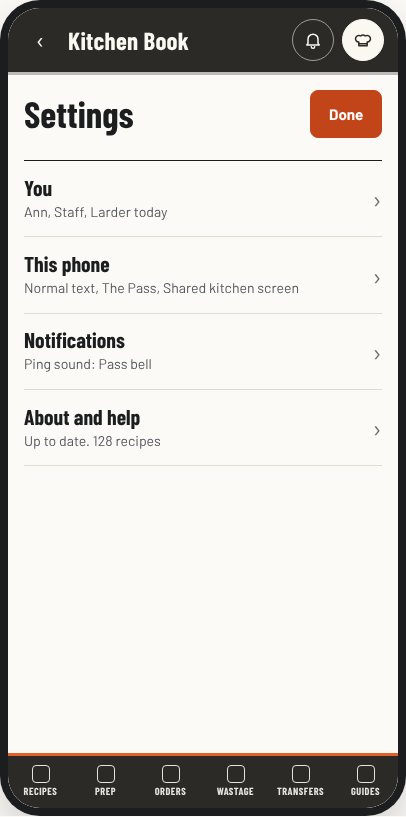
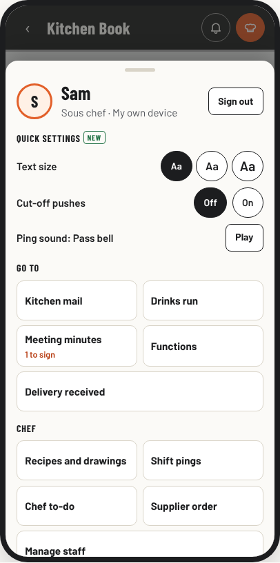

# Settings proposals

Requested 3 November 2026: "Considering how big our app has grown we might have to rethink and upgrade the settings page too for staff and admin/Headchef/sous chef". **Selected 3 November 2026: A, One sorted page, as the mockup shows it.** The four kitchen switches stay in the admin panel and The kitchen links to them. The new rows (What you can do, Play the ping sound, Check for an update, Find a setting) are built as shown; any of them can be left out later. The build follows "Build steps (A)", each step in its own pull request.

`index.html` in this folder is the mockup: switch between the three designs, who is signed in (nobody, staff, sous chef, head chef) and phone or computer. Every name, count and value in it is an example.

## What Settings is now

`#/settings` (`viewSettings()` in `js/app.js`), in this order:

| Block | Saved where | Who sees it |
| --- | --- | --- |
| Text size | This phone (`lk.settings.v1`) | Everyone |
| Install the app | This phone | Everyone |
| This device (personal or shared, change, forget) | This phone (`lk.device.v2`), guarded by `canChangeDevice()` | Everyone; changing needs the device's own person, or the head chef for a shared screen |
| Seasonal celebrations (selection, chooser, movement, ambience, replay) | This phone (`lk.seasonal.v1`) | Everyone |
| Opens with (The Pass or Tiles) | This phone | Everyone |
| Open on a phone (QR code, A4 sign) | Nothing saved | Everyone, on screens 900 px and wider |
| Ticked steps, Practice on this device | This phone | Head chef's device only |
| About (recipe count, date) | | Everyone |

Measured on 3 Nov 2026 with the click test stand-in at 390 x 844 px:

- 1,801 px tall signed out, 1,888 px for staff and sous chefs, 2,264 px for the head chef: 2 to 2.7 phone screens.
- No row about the person signed in. Ann (staff), Sam (sous chef) and nobody signed in get exactly the same seven blocks.
- Seasonal celebrations is the tallest block (699 px of the 1,888), with a large heading unlike the small labels of the others.
- The page ends "Settings are saved on this phone or tablet only", which is true for every row there, but not for the person's or the kitchen's settings, which live elsewhere.
- A sous chef's chef hat menu has 12 items under two headings. On an 844 px phone, Settings and Sign out are below the fold (`previews/now-sous-menu.png`).

## What lives somewhere else

| Setting | Scope | Where now |
| --- | --- | --- |
| My section today | The person, today | Chef hat menu (staff and leads, when sections are set up) |
| Usual drink | The person | Drinks run page |
| Cut-off pushes on this phone | This phone, chefs | Order list (Supplier orders today) and Admin, Operations, Cut-offs |
| Kitchen PIN on this device | This phone | Admin, Settings, Tools |
| Sign out | This phone | Chef hat menu |
| People, roles, ticks, Reset PIN, who books functions | The kitchen | Admin, Settings, People (sous chefs: Manage staff) |
| Kitchen sections, weekly top tickers, pages staff see | The kitchen | Admin, Settings, People |
| Ping sound for every phone | The kitchen | Admin, Operations, Shift pings |
| Sous chefs read Kitchen mail | The kitchen | Admin, Operations, Kitchen mail |
| Order cut-offs | The kitchen | Admin, Operations, Cut-offs |
| Change the kitchen PIN, Backup | The kitchen | Admin, Settings, Tools |

Nine kitchen-wide settings sit on five admin pages in two chapters. None of them is wrong where it is: each sits beside the work it belongs to. What is missing is one place that says how the kitchen is set up and where to change it.

## Ideas all three designs share

1. **Three scopes, said plainly.** This phone (saved here only), You (follows you to any phone you sign in on), The kitchen (every phone; only the head chef changes it). Every group says which it is.
2. **Your card.** Name, role, today's section, the device type and its lock, and Sign out, at the top.
3. **Rows that show their value.** "Text size: Normal", "Ping sound: Pass bell". Long blocks (Seasonal celebrations, the QR code) fold into one row and keep every control they have now.
4. **What you can do** (new, read only). The person's ticks in plain words: "Write prep lines, Tick prep, Order list". Staff can see why a page is not there for them.
5. **Notifications in one place.** Play the kitchen's ping sound (new: checks this phone's volume; the head chef still picks the sound for everyone) and Cut-off pushes for chefs (also stays on the Order list).
6. **The kitchen at a glance** for the verified admin: every kitchen-wide setting with its current value.
7. **Find a setting** (new) for the head chef, who sees 26 rows. The coding rules ask for type-to-find past about 12.
8. **About and help.** Version and Check for an update (new, uses the existing update check), the recipe count, and on a computer the QR code for another phone.

## The three designs

| Design | Shape | Best fit | Tradeoff |
| --- | --- | --- | --- |
| **A. One sorted page** (recommended) | Settings stays one page, sorted into You, This phone, Notifications, Team (sous chef) or The kitchen (head chef), About and help. Rows open in place. Kitchen rows open the admin page that already saves them. On a computer, group names sit in a left column. | Everyone. Least to learn, smallest build. | Shorter for nobody signed in, about the same for staff (1,383 px of content, now with their own rows), longer for the head chef (2,385 px), because it now shows the whole kitchen. Find a setting covers that. |
| **B. Settings chapters** | Chapters like the admin panel's Chef's Desk: a rail on a computer; on a phone a list of chapters that fits one screen, then one chapter at a time with Back. The mockup's Kitchen setup holds four simple switches itself. | The head chef on the office computer or a tablet. | One more tap on a phone for everyone. New routes (`#/settings/<chapter>`) and Back trail work. |
| **C. Your card first** | The chef hat opens your card: Sign out at the top, quick settings (text size, pushes, ping sound), then the pages the menu holds now as a two-column grid. All settings opens A's page. | Staff on phones, and the sous chef's long menu (12 items become 6 rows of tiles). | Changes the chef hat menu everyone knows. The biggest change to learn. |

Measured in the mockup at 390 px, all rows folded: A is 903 px of content signed out (8 rows), 1,383 px for staff (13 rows), 1,580 px for a sous chef (15 rows), 2,385 px for the head chef (26 rows). B's chapter list is 430 to 600 px for every role. Today's page is 1,801 to 2,264 px, top bar and footer included.

**Recommendation: A.** It answers the request (staff, sous chefs and the head chef each get their own Settings) with the smallest change, no new routes, no rules change and no new reads. If the head chef mostly sets the kitchen up from the office computer, B. C's two-column chef hat menu can be added to A or B later on its own.

## Separate choices

1. **The layout:** A, B or C.
2. **Do four kitchen switches move out of the admin panel?** Ping sound for every phone, Sous chefs read Kitchen mail, Pages staff see and Weekly top tickers. The mockup shows them moved in B and linked in A, but either layout can do either. Moving them keeps the same verified-admin saves, but the People save has to be split, so it is its own pull request with every role walked through on the emulator. People, sections, function bookers, cut-offs, the kitchen PIN and backup stay in the admin panel either way.
3. **The new bits:** What you can do, Play the ping sound, Check for an update, Find a setting. Each can be left out.

## Limits every design keeps

- Nothing changes who may read or write what. No rules change. Kitchen rows show only for the verified admin (owner Google, this device's head PIN session and its grant), and stay hidden on a shared screen with staff signed in, as the admin panel does now.
- No new Firestore reads. Every value shown comes from what the phone already has: `config/main` through its listener, `lk.*` on the phone, the role ticks. Check for an update is the existing update check, not a Firestore read.
- Device type stays a preference, never proof of who someone is. Change and Forget keep `canChangeDevice()`, the unsent-work wait and the discard question (`docs/device-sessions.md`).
- Seasonal celebrations keep Automatic, Choose a celebration, Off, Animated, Still, Subtle, Full and Replay (`docs/seasonal-celebrations.md`). Only the block folds.
- Sign out keeps its "Not saved yet" and "Not sent yet" second tap.
- Done and Back keep the page trail (`docs/navigation.md`).
- No staff names, PINs or emails in the repo. The mockup uses Ann, Sam and Head chef, the click tests' made-up people.

## Build steps (A)

Small pull requests, each with click tests at 390, 768 and 1280 px and each role walked through (`tests/roles.test.js`):

1. **Sorted page.** Groups with scope lines, rows with values that open in place, your card, Seasonal celebrations and the QR code folded, the Version row. `viewSettings()` in `js/app.js`, `css/app.css`; the `#kb-seasonal-settings` slot stays. Tests: `pages`, `phone-first`, `seasonal`, `device-choice`, `practice`, `install-card`, `who-mark`, a new `settings.test.js`.
2. **You and Notifications.** My section (`secOpen()`), usual drink link, What you can do (role ticks), Play the ping sound (`LK_CHIME`), cut-off pushes (`pushHTML()` through `LK_PREP`). Tests: `kitchen-sections`, `ping-sound`, `cutoff-push`.
3. **The kitchen and Find a setting** for the verified admin, and the kitchen PIN on this device moved from Admin, Tools. Tests: `admin-tools`, `admin-hidden`, `read-budget`.

B adds the chapter routes and their Back trail, and C rewrites `whoMenuOpen()` in `js/app.js` with `chef-menu` and `who-mark` tests. Moving the four switches (choice 2) is its own pull request after step 3.

## Files

- `index.html`: the three designs in one page, with Design, Who is signed in, Screen and Show what moved switches. Taps change only the page.
- `previews/`: A for staff on a phone and the head chef on a phone and a computer, B's chapter list for staff and its Kitchen setup on a computer, C for a sous chef on a phone and the head chef on a computer, and today's sous chef menu.

Checked: no sideways scroll at 390, 768 and 1440 px, no script errors, real Barlow and Barlow Condensed fonts.

| A. One sorted page | B. Settings chapters | C. Your card first |
| --- | --- | --- |
|  |  |  |
