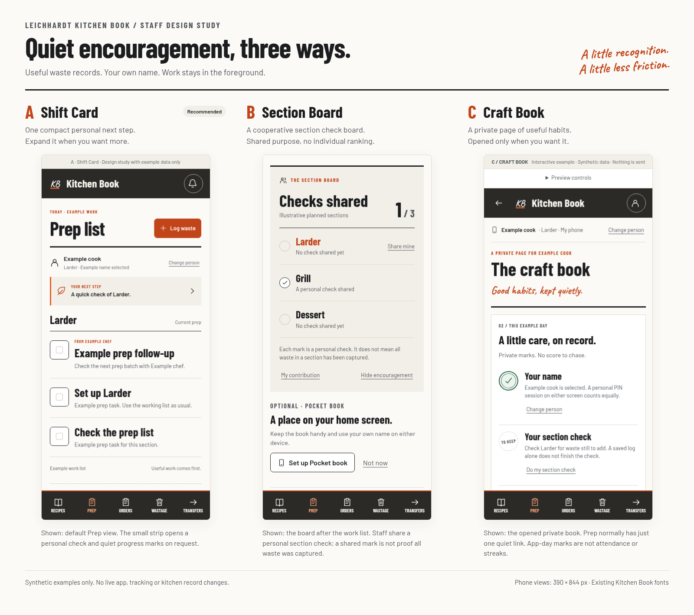

# Better signals and quiet encouragement

Requested 1 November 2026. Status: proposals and three interactive visual concepts, awaiting selection. This branch changes documentation and example-only previews. It does not change the live app, collect staff information or read/write kitchen records.

The aim is more useful, honestly attributed records and easier follow-through. The examples treat "clock in" as signing into the app under a person's own name. The Kitchen Book is not a payroll time clock. A personal PIN session on the shared screen is as valid as one on a phone.

## Three additional insight ideas

| Idea | What the head chef could learn | Available source and minimal addition | Definition and limit |
| --- | --- | --- | --- |
| **1. Handover changes** | Which items and sections keep being added after the agreed prep handover? Use this to improve the next list or handover discussion. | Existing original prep creation time, section, item, creator and rollover/function/practice flags. Add one explicitly chosen handover time. The current nightly summary would need retaining the eligible counts; it currently drops creator/timing details. | Late eligible original routine lines with usable creation times divided by all eligible original routine lines with usable creation times on the same completely read, completed list days. Exclude rolled copies, function-generated, practice and removed records. Exclude missing or unusable times from this ratio and show their count and the sample days separately. This measures recorded list changes, not work duration or an employee's speed. Current source corrections are not an immutable historical handover snapshot. |
| **2. Concerns followed through** | Which equipment, safety or workflow reports are still waiting for attention? Make staff reporting lead to a visible next step. | Existing Kitchen mail category, priority, creation time, seen time, done flag and done time. The current inbox reads all open messages plus messages marked done in the last 30 days. Start with a recent creation cohort wholly inside that coverage, such as the last seven completed kitchen days; an older creation cohort would need a new bounded query. This is not already part of the nightly activity summary. | Show open count and ages, plus currently marked-done reports divided by all reports in a stated creation cohort. Opening the inbox is the current seen event. Marked done is not proof the problem was fixed; reversing done changes the current state. A future reporter confirmation would be a separate explicit field if wanted. |
| **3. Attribution and setup help** | How much activity has a usable stable person reference, and who wants help setting up the app? Improve evidence before comparing staff. | Existing creator/completer/logger IDs. Keep legitimate automatic/admin records separate. A small optional, explicitly confirmed setup status can say Personal app ready / Shared screen works / Help wanted / Not asked, with confirmation date. | Named coverage is valid known person references over eligible human action roles, deduplicated by source, document and role. Separate missing and unknown IDs. Setup status uses the active staff list as its denominator; it is self-reported setup, not personal-device adoption or attendance. A saved name cannot establish who physically did the work. |

Recommend starting with **3**, then **1**. They improve the trustworthiness and usefulness of later staff comparisons. No numerical improvement target is proposed without a measured baseline.

## Three ideas for useful waste reporting

| Idea | What staff see | Why it helps | Data scope |
| --- | --- | --- | --- |
| **1. A useful-record receipt** | A small acknowledgement after a successful save: "Saved as Example cook. Item, amount, unit and reason kept." Encourage a section when known. | Makes good reporting visible without celebrating a larger waste total or awarding points for splitting entries. | Reuses current waste fields and named session. Recognition must wait for acknowledgement; current optimistic feedback would need adapting if selected. No score per log, kg, dollar or note length. |
| **2. A calm section check** | At a natural stopping point: Log something to add / Checked; nothing to add. At most one gentle mark for the person's section check that day. | Gives someone who has nothing unreported to add an honest way to participate. More complete reporting becomes the habit, not more waste. | **New proposed self-declaration.** Person, day, section, outcome and acknowledged time would need an agreed data/access contract. It is separate from an actual waste line and the chef's existing daily review. A single log does not automatically finish a section check. It does not assert zero waste or complete kitchen coverage. |
| **3. Show the learning carried forward** | A quiet link from the chef's review to the resulting prep follow-up: "Your report helped us decide what to check next." | Staff see a useful result from speaking up. One restrained follow-through mark can accompany the existing task. | Extends the existing review/change-to-prep flow. Keep explicit source linkage if added. Completing a task does not prove waste was prevented or money saved. |

## Three ideas for own-name and personal-app use

| Idea | What staff see | Why it helps | Data scope |
| --- | --- | --- | --- |
| **1. Your name, your contribution** | A clear current-name line and a quiet "Saved as Example cook" receipt, with Change person close by. | Makes correct attribution useful and easy to check. Repeated sign-ins earn nothing. | Reuses normal personal PIN identity and existing record attribution. Shared-screen sessions receive the same recognition. No inference that the current name is necessarily the physical actor. |
| **2. Pocket book ready** | Optional help to add the existing app to the home screen, open it and use their own PIN. A small setup mark; Not now stays available. | Makes a personal app convenient without forcing staff to use their own phone. | Existing local install detection can guide the steps. Any admin setup-help list is explicitly confirmed, not background device tracking. Installed mode is not proof of phone ownership. |
| **3. My app-day card** | Their chosen section, relevant pings and useful next task in one compact private card or book. | Signing in gives immediate value. A private record of useful habits can grow without a streak reset or public comparison. | Existing section and task state can support the current card. A cross-day private habit history would need a new self-only summary; the current admin-only analysis cannot simply be exposed to staff. App days are not scheduled shifts or attendance. |

## Three visual directions

All use the same core example actions, current Kitchen Book type, warm paper, charcoal shell and restrained orange. They preserve access to prep work and Log waste. The draft figures and people are synthetic.

| Direction | Layout and interaction | Tradeoff |
| --- | --- | --- |
| **A. Shift Card, recommended** | One small personal next-step strip on Prep, with more detail on request and a quiet save receipt. | Least distracting during service; less visible team context. |
| **B. Section Board** | A compact cooperative view of checks shared by the selected example sections, with private My contribution details. | Encourages teamwork; needs a clear section plan and a staff-safe aggregate. |
| **C. Craft Book** | A private journal opened from a small Prep link, with restrained ink marks for useful habits and follow-through. | Calmest main work screen; people must choose to open their progress. |

The three concepts are comparable functional prototypes, not palette swaps. They include named/shared example states, waste saving and failure/retry, separate section checks, a prep follow-up, optional phone setup and Hide encouragement. They collect no PIN, persist no staff data and call no operational API. Only local example state changes.

## Measurement if a direction is chosen

Start with one baseline period before setting a target. Keep the first version small: selected encouragement placement, explicit record attribution and useful waste feedback. Evaluate whether it helps without adding taps or pressure.

| Proposed measure | Meaning | Guardrail |
| --- | --- | --- |
| Usable named attribution | Valid named human action roles over eligible action roles in a fixed completed period. | Separate automated/admin writes and unknown/missing IDs. This is record quality, not proof of physical identity. |
| Checks shared | At least one explicit check received per selected section/day, over the explicitly planned section/days. | A plan must exist. Missing is unknown; a no-addition declaration is not zero waste. Duplicate checks do not increase coverage. No staff ranking or penalty. |
| Useful waste detail | Saved entries with item, amount, unit and reason, plus section coverage separately when known. | Core fields are already required; avoid presenting compliance as an improvement by itself. Watch corrections/duplicates and guard against split/fabricated entries. Logged quantity may rise when reporting improves. |

Do not use more sign-ins, more app visits, more raw ticks, more waste entries or lower logged waste as a standalone success score. No fixed target is invented here. Review staff feedback and whether the action remains quick. Remove encouragement if it obscures current work. Failed/offline writes cannot award a completion mark before acknowledgement. A delayed valid record can still be counted on its actual kitchen day; no daily deadline or lost streak is needed.

## Existing foundations and evidence

This review uses repository code and existing synthetic tests, not production staff records. It does not claim a measured current participation rate, waste reduction or behaviour change.

- `js/prep.js`: `insightsHTML`, `teamHTML`, `skillsHTML` and `habit` already cover counts, hour/weekday patterns, time to tick, rollover and section activity. Existing Top tickers ranks raw weekly ticks; the new ideas do not add another such ranking.
- `js/prep.js`: `addWaste`, `saveReview`, `rvChef`, `loadPageReview` and the review-to-prep action hold the existing waste entry, attribution and chef-review boundaries. The daily review is not an all-sections or no-waste declaration.
- `js/prep.js`: `mlSend`, `mlSeenAll` and the Kitchen mail done handler provide the current report lifecycle. Seen and done have the limits stated above.
- `js/analysis-core.js`, `scripts/analysis.mjs` and `scripts/nightly-analysis.mjs`: existing bounded completed-day summaries. New breakdowns need explicit derived fields while retaining budgets, source quality and current unit/identity boundaries.
- `js/app.js`: existing install and home-screen guidance. Shared device mode is local; neither it nor `activity.lastSeen` proves device ownership or attendance.
- `docs/private-kitchen-access.md`, `docs/admin-intelligence.md` and `docs/wastage-history.md`: current permissions, data meanings, read budgets, private records and history contracts.

## Selection and implementation boundary

Choose a visual direction and the first behaviours before changing the app. The smallest useful first release is A with the current-name receipt and useful-save feedback. An explicit section check or private cross-day history needs its own agreed data/rules design; do not silently create it from silence or tick counts. Staff must not gain access to admin analysis, other people's private progress or chef-only reviews.

This design PR must remain a draft and must not be merged or deployed as implemented gamification. The existing live application is unchanged. Selection and later release evidence belong in the PR and this brief.

## Preview files and verification

Open [the interactive comparison](index.html), [the single-file portable comparison](review.html), or [the design board](previews/comparison.png). The board shows A's default work view, B's board after scrolling past work, and C's book after opening it. The [design contract](design-contract.md) records the comparable actions and boundaries.

The three concepts pass 165 focused checks in total: A 48, B 46 and C 71. Both the normal and portable comparisons pass 69 checks each across 390, 768 and 1440 px, including tabs, keyboard controls, preview sizing, state retention and full-size links. These are 303 focused browser checks in total. Final captures use the actual fonts and fit all three widths with no page errors or horizontal overflow. Enlarged phone text, Save clearance, failure/retry and changing the example person are covered.

The portable comparison embeds its scripts, styles, icons and three examples, using Blob documents. The existing Google fonts are optional external resources. HTTP-served portable verification passes; direct local-file opening could not be verified because this managed Chromium blocks file URLs before loading. The draft does not claim a tested offline installation.

Runtime inspection recorded no app API calls, non-GET requests or storage writes. These checks validate the concepts, not a production implementation. No production feature, stylesheet, rules, schema, role, analytics collection or stored staff history changed.

